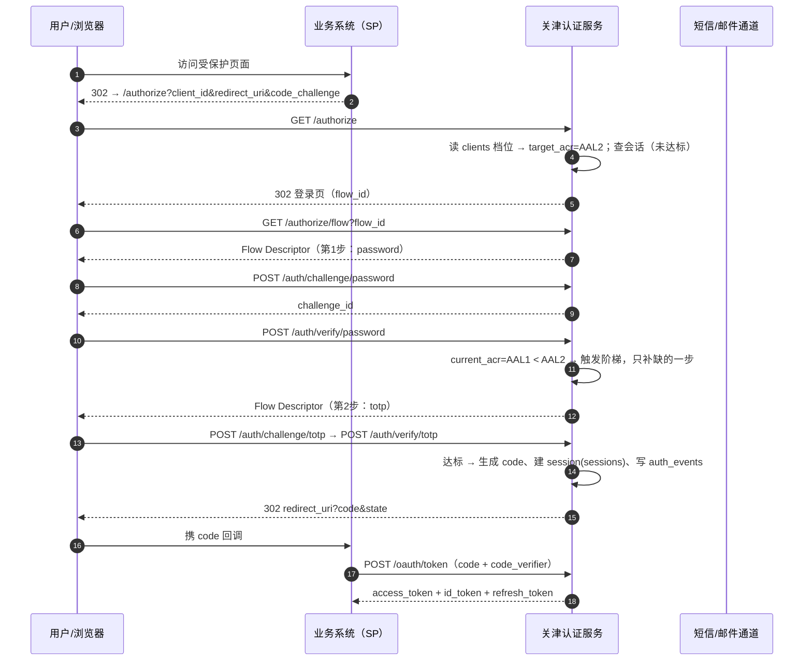
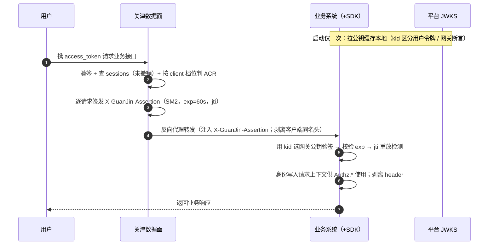
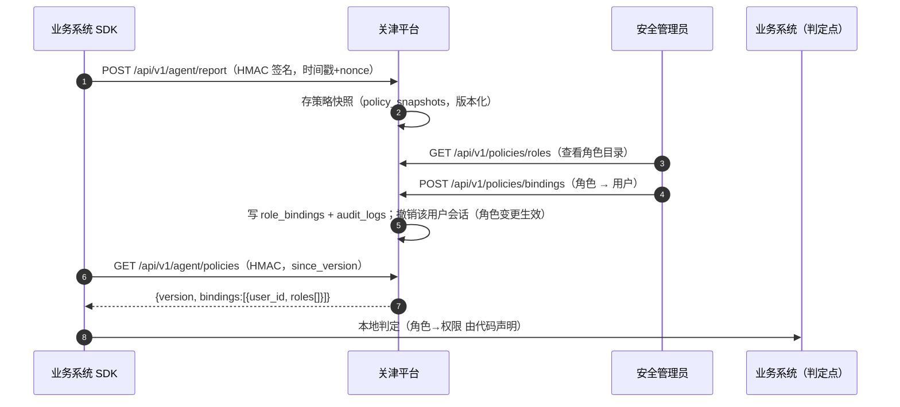

# 关津 · 接口清单（API 契约）

| 项目 | 内容 |
|---|---|
| 文档类型 | 实现前接口清单 / API 契约 |
| 编写日期 | 2026-10-11 |
| 解决的问题 | 端点散落在各基线文档，无集中清单，组件边界无法确定（见 `GuanJin-设计基线索引.md` §6.1 缺口 2） |
| 上位依据 | `GuanJin-设计基线索引.md` §2（已生效决定）**为准**；其余文档与本节冲突处以索引为准 |
| 覆盖范围 | 8 个面 + 运维面；每条接口标注**基线出处** |
| 不在本文范围 | SDK 侧完整能力契约（缺口 3）、页面规格（缺口 4）、数据模型 DDL（缺口 1）、数据面逐条转发规则 |

> **阅读约定**：`⚠️ 待定` = 基线未定义或基线内部有冲突，需人工裁决（集中清单见索引 §4.2 / §5）。
> 数据表名一律使用：`users`、`identifiers`、`authenticators`、`challenges`、`sessions`、`auth_events`、`audit_logs`、`clients`、`login_policies`、`signing_keys`、`runtime_config`、`role_bindings`、`policy_snapshots`、`user_visited_clients`。

---

## 1. 一页结论

### 1.1 接口面的划分原则

| # | 原则 | 含义 |
|---|---|---|
| 1 | **按"谁发起的信任关系"分组，不按技术栈分组** | 协议面 = 标准 OIDC（外部 SP 发起）；因子面 = 编排层内部步骤；自助面 = 已登录用户对"自己"的操作；管理面 = 三员对"别人"的操作；Agent 面 = 业务系统程序 ↔ 平台的机器间通道；数据面 = 平台自身站在流量路径上的转发语义 |
| 2 | **标准协议端点不发明私有语义** | `/.well-known/*`、`/authorize`、`/oauth/token`、`/oauth/revoke`、`/oauth/introspect`、`/userinfo`、`/logout` 严格按 OIDC/OAuth2 语义；平台的差异化能力（Flow Descriptor、档位判定、阶梯认证）只体现在 `/authorize/flow`、`/authorize/submit` 与因子面 |
| 3 | **档位门槛只在"进入业务系统"这一刻判定** | 门槛不满足时**不失败**，而是返回 `ACR_INSUFFICIENT` + 引导补因素（`/auth/challenge/{factor}`），这是"档位即准入、阶梯认证"的直接落地 |
| 4 | **无上下文操作按"生效配置"** | 标识符自助、会话自助、找回、后台处置等没有 `client_id` 上下文的接口，其 ACR 前置 = 该用户 `user_visited_clients` 中档位最高的那一个（索引 §2） |
| 5 | **机器间双向认证方向分离** | 业务系统 → 平台（Agent 面）= **每业务系统独立 secret 的 HMAC**；平台 → 业务系统（数据面）= **SM2 非对称签名**（`X-GuanJin-Assertion`）。两者不可互换 |
| 6 | **平台只回传"用户的角色列表"** | 授权判定的策略（角色→权限）在 SDK 本地，平台不下发权限、不做行级/密级判定（`权限模型设计.md` §0/§2.2/§6） |

### 1.2 哪些接口是"薄"的、哪些"必须厚"

> **"薄" = 纯转发 / 纯查询，无跨请求状态判定；"厚" = 有状态机、不变式或跨系统共享状态（失败计数、锁定、会话版本、标识符唯一性）。** 厚度决定实现与测试成本，也是评审重点。

| 薄（纯转发/查询，可水平无状态扩展） | 必须厚（有状态判定，是安全与正确性的核心） |
|---|---|
| `/.well-known/openid-configuration`、`/.well-known/jwks.json` | `/authorize`、`/authorize/flow`、`/authorize/submit` — ACR 判定 + 编排状态机 |
| `/userinfo`、`/oauth/introspect`（查询态） | `/oauth/token` — 授权码一次性消费 + 刷新令牌轮换 + 重复使用检测 |
| `/oauth/revoke`（状态开关，实现薄） | `/auth/challenge/{factor}`、`/auth/verify/{factor}` — 挑战状态机 + 限流 + **全局失败计数与锁定** |
| 管理面全部 `GET`（users/clients/keys/factors/policies/audit-logs/sessions） | `/auth/register/*` — 准入规则 + 标识符唯一性 + 挑战状态机 + 注册即登录；`/auth/recover/*` — anti-enumeration + 状态机 + **副作用（撤销全部会话、通知旧标识符）** |
| `GET /api/v1/me/identifiers`、`GET /api/v1/me/sessions`、`GET /api/v1/dashboard` | `POST/DELETE /api/v1/me/identifiers*` — **不变式（最后一个已验证标识符不可解绑）+ 冷却期 + 通知**；`POST /api/v1/me/password` — **旧口令/会话 ACR 判定 + 撤销其他会话 + 通知**；`POST /api/v1/me/deactivate`、`/export` — **审计强约束 + 留存策略 + 撤销全部会话** |
| `/healthz`、`/readyz` | `DELETE /api/v1/me/sessions/{id}`、管理面 `DELETE /sessions*` — **实时撤销 + 会话版本号递增** |
| 数据面转发（逻辑薄，但**在流量路径上**，性能/稳定性要求最高） | `POST/DELETE /api/v1/policies/bindings` — **授权动作 + 副作用（角色变更即撤销该用户会话）** |
| Agent 面 `GET /*`（签名校验本就无状态） | 管理面 `PATCH /clients/{id}`（**门槛项方向校验器**）、`POST /keys/rotate`（并行发布状态） |

---

## 2. 接口总览表

> 分组 = 10 个面 + 运维面。`鉴权` 取值见 §5.1。`依据` = 基线出处（可追溯）。

### 2.1 协议面（标准 OIDC / OAuth2）— 10 条

| 方法 | 路径 | 鉴权 | 一句话作用 | 依据 |
|---|---|---|---|---|
| GET | `/.well-known/openid-configuration` | 匿名 | OIDC 发现文档 | 路径约定 · OIDC |
| GET | `/.well-known/jwks.json` | 匿名 | 发布签名公钥（用户令牌 + 网关内部断言，`kid` 区分） | 数据面设计 §4.5/§4.6 |
| GET | `/authorize` | 匿名（浏览器会话） | 授权端点：已达标发码，未达标跳登录页 | 架构说明 §5.2 |
| GET | `/authorize/flow` | 匿名/用户会话 | 取 **Flow Descriptor**（目标档位、已达成、待补步骤、可用/禁用因子） | 档位清单 §三 + 因子模型 §5.3 |
| POST | `/authorize/submit` | 匿名/用户会话 | 提交本步骤答案、推进流；达标则签发授权码 | 档位清单 §三「阶梯认证」 |
| POST | `/oauth/token` | 客户端凭证（secret / PKCE） | 授权码换令牌、刷新令牌轮换 | 架构说明 §5.2 |
| POST | `/oauth/revoke` | 客户端凭证 / 用户令牌 | 撤销令牌（RFC 7009） | 路径约定 · OAuth2 |
| POST | `/oauth/introspect` | 客户端凭证（受信） | 令牌自省（RFC 7662） | 路径约定 · OAuth2 |
| GET/POST | `/userinfo` | 用户令牌 | OIDC 用户信息 | 路径约定 · OIDC |
| GET/POST | `/logout` | 用户会话/令牌 | RP 发起登出（按档位级联 SLO） | 档位清单 §三 D「单点登出级联范围」 |

### 2.2 因子与挑战面 — 2 条

| 方法 | 路径 | 鉴权 | 一句话作用 | 依据 |
|---|---|---|---|---|
| POST | `/auth/challenge/{factor}` | 匿名（流内）/用户令牌（升级） | 开启一次挑战（BeginChallenge），如发短信/邮箱码 | 因子模型 §5.3 `Authenticatable.BeginChallenge` |
| POST | `/auth/verify/{factor}` | 匿名（流内）/用户令牌（升级） | 校验挑战响应（VerifyResponse），产出 `amr`/`acr` | 因子模型 §5.3 `VerifyResponse` |

### 2.3 注册面 — 2 条

| 方法 | 路径 | 鉴权 | 一句话作用 | 依据 |
|---|---|---|---|---|
| POST | `/auth/register/start` | 匿名（必带目标业务系统上下文） | 校验准入规则与标识符唯一性，下发注册挑战（`purpose=register`） | 档位清单 §三 D「注册准入规则」 |
| POST | `/auth/register/complete` | 匿名 + `register_token` | 校验挑战与口令策略（按目标档位），建号并**注册即登录** | 架构说明 §5.1 + 档位清单 §三 A「口令要求」 |

### 2.4 标识符自助面 — 4 条

| 方法 | 路径 | 鉴权 | 一句话作用 | 依据 |
|---|---|---|---|---|
| GET | `/api/v1/me/identifiers` | 用户令牌 | 列出我的标识符（脱敏） | 架构说明 §3.1「换绑手机/邮箱」 |
| POST | `/api/v1/me/identifiers` | 用户令牌 + 生效配置 ACR | 绑定新标识符并发起验证 | 因子模型 §4.1（channel 型需前置标识符） |
| DELETE | `/api/v1/me/identifiers/{id}` | 用户令牌 + 生效配置 ACR | 解绑标识符（含冷却期与通知） | 架构说明 §5.4「换绑」 |
| POST | `/api/v1/me/identifiers/{id}/verify` | 用户令牌 | 校验绑定验证码，置为已验证 | 因子模型 §3 `IdentifierVerifying` |

### 2.5 个人中心面 — 3 条

| 方法 | 路径 | 鉴权 | 一句话作用 | 依据 |
|---|---|---|---|---|
| POST | `/api/v1/me/password` | 用户令牌（AAL2 会话可免旧口令） | 自助修改口令（按生效配置校验、撤销其他会话、通知标识符） | 架构说明 §3.1「改密码」+ 档位清单 §三 A |
| POST | `/api/v1/me/deactivate` | 用户令牌 + AAL2 | 账号注销（PIPL 注销权；审计不删、不可自助恢复） | 档位清单 §二「账号注销与数据导出」 |
| POST | `/api/v1/me/export` | 用户令牌 | 数据导出（PIPL 可携带权；标识符脱敏；写审计） | 档位清单 §二「账号注销与数据导出」 |

### 2.6 会话自助面 — 2 条

| 方法 | 路径 | 鉴权 | 一句话作用 | 依据 |
|---|---|---|---|---|
| GET | `/api/v1/me/sessions` | 用户令牌 | 查看我在各业务系统的在线会话 | 架构说明 §3.1「查看登录记录」 |
| DELETE | `/api/v1/me/sessions/{id}` | 用户令牌 | 踢掉指定会话 | 架构说明 §3.1「把某个设备踢下线」 |

> 变体：`DELETE /api/v1/me/sessions?scope=all` 一次踢掉我的全部会话（等价退出全部）。

### 2.7 找回面 — 3 条

| 方法 | 路径 | 鉴权 | 一句话作用 | 依据 |
|---|---|---|---|---|
| POST | `/auth/recover/start` | 匿名 | 发起找回，返回可用方式（脱敏、anti-enumeration） | 架构说明 §5.4 |
| POST | `/auth/recover/verify` | 匿名 | 校验找回凭据，发放短期 recovery_token | 架构说明 §5.4 |
| POST | `/auth/recover/complete` | 匿名 + recovery_token | 设置新凭据并撤销全部会话、通知全部标识符 | 架构说明 §5.4 + 产品核心定义 §4.3 |

### 2.8 管理面（管理员）— 35 条

| 方法 | 路径 | 鉴权（三员角色） | 一句话作用 | 依据 |
|---|---|---|---|---|
| GET | `/api/v1/users` | 系统管理员 | 查询/检索用户 | 架构说明 §3.3「用户管理」 |
| POST | `/api/v1/users` | 系统管理员 | 建号（无默认口令，强制首登改密） | 档位清单 §二「无默认口令」 |
| GET | `/api/v1/users/{id}` | 系统管理员/审计员 | 用户详情 | 架构说明 §3.3 |
| PATCH | `/api/v1/users/{id}` | 系统管理员 | 启用/停用/锁定/解锁 | 架构说明 §3.3 |
| POST | `/api/v1/users/{id}/reset-password` | 系统管理员 | 重置口令（强制下次改密） | 档位清单 §二 |
| DELETE | `/api/v1/users/{id}` | 系统管理员 | 停用/注销用户 | 架构说明 §3.3 |
| GET | `/api/v1/users/{id}/role-bindings` | 安全管理员/审计员 | 查看某用户的角色绑定 | 权限模型 §0 ③ |
| GET | `/api/v1/clients` | 系统管理员/审计员 | 列出接入方 | 架构说明 §3.2/§5.5 |
| POST | `/api/v1/clients` | 系统管理员 | 登记接入方，返回 `client_id`+密钥（仅一次）+Agent HMAC secret | 架构说明 §5.5 + 数据面设计 §4.5 |
| GET | `/api/v1/clients/{id}` | 系统管理员/审计员 | 接入方详情（含档位） | 档位清单 §三 |
| PATCH | `/api/v1/clients/{id}` | 系统管理员 | 调整档位/门槛项（**方向校验**） | 档位清单 §五「只升不降」 |
| DELETE | `/api/v1/clients/{id}` | 系统管理员 | 注销接入方 | 架构说明 §3.2 |
| POST | `/api/v1/clients/{id}/secret/rotate` | 系统管理员 | 轮换 client_secret / Agent HMAC secret | 数据面设计 §4.5 |
| GET | `/api/v1/keys` | 系统管理员/审计员 | 列出签名密钥（kid/状态/有效期） | 档位清单 §二「签名密钥轮换」 |
| POST | `/api/v1/keys/rotate` | 系统管理员 | 触发轮换：先并行发布新公钥 | 档位清单 §二 |
| POST | `/api/v1/keys/{kid}/retire` | 系统管理员 | 退役旧密钥（存量过期后） | 档位清单 §二 |
| GET | `/api/v1/config` | 系统管理员/审计员 | 读平台运行参数 | 架构说明 §3.3「策略配置」 |
| PATCH | `/api/v1/config` | 系统管理员 | 改平台可调参数（仅白名单项） | 档位清单 §二/§五 |
| GET | `/api/v1/config/tiers` | 系统管理员/审计员 | 读档位门槛项与**方向矩阵**（只读） | 档位清单 §五 |
| GET | `/api/v1/factors` | 系统管理员/审计员 | 列出因子 + 能力声明（Descriptor） | 因子模型 §3/§4 |
| GET | `/api/v1/factors/{type}` | 系统管理员/审计员 | 因子详情与能力 | 因子模型 §6 |
| PATCH | `/api/v1/factors/{type}` | 系统管理员/安全管理员 | 平台级启用/停用（如通道故障临时关停） | 架构说明 §3.3「因子管理」 |
| GET | `/api/v1/policies` | 安全管理员/审计员 | 列出策略快照（登记上报产物） | 权限模型 §2.3 |
| GET | `/api/v1/policies/snapshots/{id}` | 安全管理员/审计员 | 快照详情（权限点/角色/接口映射/默认角色） | 权限模型 §2.3 |
| GET | `/api/v1/policies/roles` | 安全管理员/审计员 | 角色目录（按 client 聚合，供绑定时参考） | 权限模型 §2.3 |
| GET | `/api/v1/policies/bindings` | 安全管理员/审计员 | 列出「角色→用户」绑定 | 权限模型 §0 ③ |
| POST | `/api/v1/policies/bindings` | 安全管理员 | **授权动作**：绑定角色到用户（副作用：撤销其会话） | 权限模型 §0 ③ + §5 |
| DELETE | `/api/v1/policies/bindings/{id}` | 安全管理员 | 解绑（副作用：撤销其会话） | 权限模型 §5 |
| GET | `/api/v1/audit-logs` | 审计员/安全管理员 | 查询审计（时间/用户/客户端/结果） | 架构说明 §3.3「审计查询」 |
| GET | `/api/v1/audit-logs/{id}` | 审计员 | 审计详情（含完整性标签） | 档位清单 §二「审计完整性」 |
| GET | `/api/v1/audit-logs/export` | 审计员 | 导出审计（按 Client 切分） | 档位清单 §二「按 Client 切分与导出」 |
| GET | `/api/v1/sessions` | 系统管理员/安全管理员/审计员 | 查看全部在线会话 | 架构说明 §3.3「会话管理」 |
| DELETE | `/api/v1/sessions/{id}` | 系统管理员/安全管理员 | 强制下线指定会话 | 架构说明 §5.7 |
| DELETE | `/api/v1/sessions?user_id={id}` | 系统管理员/安全管理员 | 撤销某用户全部会话 | 架构说明 §5.7 |
| GET | `/api/v1/dashboard` | 系统管理员/安全管理员/审计员 | 管理后台概览聚合（用户数/业务系统数/活跃密钥数/登录成功率/锁定账号数/待办提醒） | 页面规格「概览」；档位清单 §二「密钥轮换 / 预算告警」 |

### 2.9 数据面（网关自身）— 转发边界，非具名端点

| 方法 | 路径 | 鉴权 | 一句话作用 | 依据 |
|---|---|---|---|---|
| ANY | `/{route}/*`（通配，映射到业务系统） | 用户令牌（准入判定）+ 内部签名注入 | 反向代理：认证/会话/实时撤销/按 client 档位/**身份注入** → 业务系统 | 数据面设计 §1.1（7 件事）/ §4.6 |

### 2.10 Agent 面（SDK ↔ 平台）— 3 条

| 方法 | 路径 | 鉴权 | 一句话作用 | 依据 |
|---|---|---|---|---|
| POST | `/api/v1/agent/report` | Agent 签名（HMAC） | SDK 上报策略快照（权限点/角色/接口映射/默认角色） | 权限模型 §2.3 |
| GET | `/api/v1/agent/policies` | Agent 签名（HMAC） | SDK 拉取「角色→用户」绑定（增量） | 权限模型 §0 ①/§5 |

### 2.11 运维面 — 2 条

| 方法 | 路径 | 鉴权 | 一句话作用 | 依据 |
|---|---|---|---|---|
| GET | `/healthz` | 匿名（内网） | 存活探针 | 缺口 6.3「初始化与引导」 |
| GET | `/readyz` | 匿名（内网） | 就绪探针（DB/Redis/密钥 就绪） | 同上 |

> **合计：66 条具名端点 + 1 条数据面通配转发边界。** 按面统计见文末。

---

## 3. 逐面详表

### 3.1 协议面（标准 OIDC / OAuth2）

#### 3.1.1 `GET /.well-known/openid-configuration`
| 项 | 内容 |
|---|---|
| 鉴权 | 匿名 |
| 请求要点 | 无参 |
| 响应要点 | `issuer`、`authorization_endpoint`、`token_endpoint`、`jwks_uri`、`userinfo_endpoint`、`revocation_endpoint`、`introspection_endpoint`、`end_session_endpoint`、`response_types_supported=["code"]`、`grant_types_supported=["authorization_code","refresh_token"]`、`code_challenge_methods_supported=["S256"]`、`id_token_signing_alg_values_supported=["SM3withSM2"]`、`acr_values_supported=["AAL1","AAL2"]`、`claims_supported` |
| 主要错误码 | `INTERNAL_ERROR` |

#### 3.1.2 `GET /.well-known/jwks.json`
| 项 | 内容 |
|---|---|
| 鉴权 | 匿名 |
| 请求要点 | 无参 |
| 响应要点 | `keys[]`，每项 `{kty, crv:"SM2", kid, use:"sig", alg:"SM3withSM2", x, y}`；**同时发布两套密钥**：用户令牌签名密钥 + 网关 `X-GuanJin-Assertion` 签名密钥，用 `kid` 区分（`signing_keys` 表） |
| 主要错误码 | `INTERNAL_ERROR` |

#### 3.1.3 `GET /authorize`
| 项 | 内容 |
|---|---|
| 鉴权 | 匿名（依赖浏览器会话 cookie） |
| 请求要点 | query：`response_type=code`、`client_id`、`redirect_uri`、`scope`、`state`、`nonce`、`code_challenge`、`code_challenge_method=S256`、`acr_values?`、`prompt?`(none/login/consent)、`login_hint?` |
| 响应要点 | 会话有效且 ACR 达标 → `302 redirect_uri?code=...&state=...`；否则 `302` 到统一登录页（携带 `flow_id`）或 `200` 渲染登录页。目标 ACR 由 `clients` 档位计算 |
| 主要错误码 | `INVALID_REQUEST` / `INVALID_CLIENT` / `INVALID_REDIRECT_URI` / `UNSAFE_REQUEST` |

#### 3.1.4 `GET /authorize/flow`
| 项 | 内容 |
|---|---|
| 鉴权 | 匿名（凭 `flow_id`）/ 用户会话 |
| 请求要点 | `flow_id`（或经会话推导） |
| 响应要点 | **Flow Descriptor**：`{flow_id, client:{id,name,tier}, target_acr, current_acr, satisfied, steps:[{factor, role:first\|second, status:pending\|done, challenge_hint}], available_factors[], disabled_factors[], registration_mode, expires_at}`。`disabled_factors` 来自 `clients` 的"禁用因子"；被禁因子**不计入** `current_acr` |
| 主要错误码 | `FLOW_NOT_FOUND` / `FLOW_EXPIRED` / `INVALID_CLIENT` |

#### 3.1.5 `POST /authorize/submit`
| 项 | 内容 |
|---|---|
| 鉴权 | 匿名（凭 `flow_id`）/ 用户会话 |
| 请求要点 | `{flow_id, answers:[{factor, challenge_id, response}], consent?:{decision:allow\|deny}}`。编排层内部对每个 `answer` 调用因子校验 |
| 响应要点 | `{status:"need_more", flow:<新 Descriptor>}` 或 `{status:"completed", code, redirect_uri, state}`。**只补缺步骤，不要求重输已达成因素** |
| 主要错误码 | `CHALLENGE_EXPIRED` / `INVALID_CREDENTIAL` / `ACR_INSUFFICIENT`（返回时含 `flow` 以引导）/ `RATE_LIMITED` / `ACCOUNT_LOCKED` / `FLOW_EXPIRED` |

#### 3.1.6 `POST /oauth/token`
| 项 | 内容 |
|---|---|
| 鉴权 | 客户端凭证：`Authorization: Basic base64(client_id:client_secret)` 或表单参数；公共客户端用 PKCE |
| 请求要点 | `grant_type=authorization_code`：`code, redirect_uri, client_id, code_verifier`；`grant_type=refresh_token`：`refresh_token, client_id, scope?` |
| 响应要点 | `{access_token, token_type:"Bearer", expires_in, refresh_token, id_token, scope}`。授权码**一次性消费**；刷新时**轮换 refresh_token** 并检测重复使用（`authenticators`/`sessions`） |
| 主要错误码 | `INVALID_GRANT` / `INVALID_CLIENT` / `UNSUPPORTED_GRANT_TYPE` / `PKCE_VERIFICATION_FAILED` / `INVALID_CODE_VERIFIER` / `REFRESH_TOKEN_REUSED` |

#### 3.1.7 `POST /oauth/revoke`
| 项 | 内容 |
|---|---|
| 鉴权 | 客户端凭证 / 用户令牌 |
| 请求要点 | `token, token_type_hint?` |
| 响应要点 | `200 {}`（无论令牌是否存在都返回成功，避免泄露）；撤销 refresh_token 时级联撤销同一会话的 access_token |
| 主要错误码 | `INVALID_CLIENT` / `UNSUPPORTED_TOKEN_TYPE` |

#### 3.1.8 `POST /oauth/introspect`
| 项 | 内容 |
|---|---|
| 鉴权 | 客户端凭证（仅**受信客户端**，`clients` 上标记） |
| 请求要点 | `token, token_type_hint?` |
| 响应要点 | 活跃：`{active:true, scope, client_id, sub, acr, amr[], iat, exp, jti}`；否则 `{active:false}`。**仅用于不支持 JWKS 的低频场景（第三方/排障）；禁止用于每请求校验**（**硬规则：禁止每请求校验** —— 不得每请求回源平台；数据面走 §5.8 的本地 JWT 验签） |
| 主要错误码 | `INVALID_CLIENT` / `UNAUTHORIZED_INTROSPECTOR` |

#### 3.1.9 `GET/POST /userinfo`
| 项 | 内容 |
|---|---|
| 鉴权 | 用户令牌（`Authorization: Bearer`） |
| 请求要点 | 无体（scope 决定返回字段：`openid`/`profile`/`email`/`phone`）。服务端**从 `access_token`（JWT）本地解析** `sub`/`scope`（见 §5.8），不查库、不回源 |
| 响应要点 | `{sub, preferred_username, name?, email?, phone_number?, ...}`；**不返回 `X-GuanJin-Assertion` 的网关 claim**（那是数据面专用）。字段按 §5.2 脱敏策略，响应主体本身为用户本人可见，不做脱敏但**不回传凭据材料** |
| 主要错误码 | `TOKEN_INVALID` / `TOKEN_EXPIRED` / `TOKEN_REVOKED` / `INSUFFICIENT_SCOPE` |

#### 3.1.10 `GET/POST /logout`
| 项 | 内容 |
|---|---|
| 鉴权 | 用户会话/令牌 |
| 请求要点 | `id_token_hint, client_id, post_logout_redirect_uri, state` |
| 响应要点 | `302 post_logout_redirect_uri?state=...`；**级联范围按客户端档位**（L1=仅当前业务系统；L2/L3=全部业务系统 SLO）。回收 `sessions` 并递增会话版本号 |
| 主要错误码 | `INVALID_CLIENT` / `INVALID_REDIRECT_URI` |

### 3.2 因子与挑战面

> **`{factor}` ∈ `password` / `sms_otp` / `email_otp` / `totp` / `recovery_code`**（因子模型 §4.1）。平台**按能力断言**处理，禁止 `if factor == "sms"` 分支（因子模型 §7 守护规则 1）。
> **存储裁定**：`challenges` 为**权威状态落数据库**（含 TTL / 尝试次数 / 一次性消费 / status）；Redis 只承载限流计数与热缓存（详见 §5.9）。

#### 3.2.1 `POST /auth/challenge/{factor}`
| 项 | 内容 |
|---|---|
| 鉴权 | 匿名（授权流内，凭 `flow_id`）/ 用户令牌（阶梯升级、绑定、重置） |
| 请求要点 | `{flow_id?, purpose:"login"\|"step_up"\|"enroll"\|"recover"\|"verify_identifier", target?:"phone\|email"（channel 型需前置标识符）, user_hint?}` |
| 响应要点 | `{challenge_id, ttl, attempts_left, hint:{target_masked}, next_action:"type_code"\|"input_totp"\|"input_password"}`；channel 型在此触发发送（落 `challenges` 表）；`recovery_code` 需先由 TOTP 签发 |
| 主要错误码 | `FACTOR_NOT_SUPPORTED` / `FACTOR_DISABLED` / `NO_ELIGIBLE_FACTOR` / `IDENTIFIER_NOT_FOUND` / `RATE_LIMITED` / `BUDGET_EXCEEDED` / `CAPTCHA_REQUIRED` |

#### 3.2.2 `POST /auth/verify/{factor}`
| 项 | 内容 |
|---|---|
| 鉴权 | 匿名（授权流内）/ 用户令牌 |
| 请求要点 | `{challenge_id, response, flow_id?}` |
| 响应要点 | `{verified:true, amr:["pwd"\|"sms"\|"email"\|"totp"], acr:"AAL1"\|"AAL2", binding?:{identifier_id}}`。**校验含恒定时间比较、一次性消费、尝试次数扣减**；失败时全局失败计数 +1（**权威状态落 `challenges` 表**，Redis 仅承载限流计数与热缓存），成功时**全局清零** |
| 主要错误码 | `INVALID_CREDENTIAL` / `CHALLENGE_EXPIRED` / `CHALLENGE_CONSUMED` / `CHALLENGE_INVALID` / `ATTEMPTS_EXCEEDED` / `ACCOUNT_LOCKED` / `TEMPORAL_CODE_REUSED` / `RATE_LIMITED` |

### 3.3 注册面

> **前提**：开放自注册，且**一定带业务系统上下文**（用户从某业务系统重定向过来）；**注册准入规则按目标业务系统的档位计算**（档位清单 §三 D「准入与生命周期」）。注册出来的账号是全局的，但"从哪个入口进来、要满足什么条件"按该业务系统。注册用因子取自该 client 的可用/禁用因子集，挑战 `purpose=register`。

#### 3.3.1 `POST /auth/register/start`
| 项 | 内容 |
|---|---|
| 鉴权 | 匿名（请求体必带 `client_id`，即目标业务系统上下文） |
| 请求要点 | `{client_id, type:"phone"\|"email"\|"username", value, invite_code?}`。校验：①目标业务系统的注册准入规则（L1/L2/L3 默认允许自注册，可按客户端收紧为邀请制/实名前置）②标识符唯一性（跨客户端全局，`identifiers`）③该 client 的禁用因子约束。通过后下发**注册挑战**（`purpose=register`），落 `challenges`。**若该客户端准入规则为"仅用户名 + 密码"（无需验证），本步可跳过**——由 `complete` 依 `client_id` 直接校验准入 |
| 响应要点 | `{register_token, challenge_id?, next_action:"type_code"\|"input_password"\|"none", target_masked?, expires_at}`；`username` 型免验证时可无 `challenge_id` |
| 主要错误码 | `REGISTRATION_NOT_ALLOWED` / `IDENTIFIER_ALREADY_BOUND` / `INVITE_CODE_INVALID` / `IDENTIFIER_INVALID_FORMAT` / `RATE_LIMITED` / `CAPTCHA_REQUIRED` / `BUDGET_EXCEEDED` |

#### 3.3.2 `POST /auth/register/complete`
| 项 | 内容 |
|---|---|
| 鉴权 | 匿名 + `register_token` |
| 请求要点 | `{register_token, code?, password}`。校验挑战响应（若有）与口令策略（**按目标业务系统档位**：最小长度/复杂度/历史不可复用/弱口令黑名单，档位清单 §三 A）；口令以慢哈希派生存储 |
| 响应要点 | `{ok:true, access_token, token_type:"Bearer", expires_in, id_token, refresh_token}`。**注册即登录**（直接签发登录令牌）：创建 `users` + `identifiers` + `authenticators`，将该标识符标记为"已验证"，建立 `sessions`，写 `auth_events`；该类标识符同时成为登录方式与找回通道 |
| 主要错误码 | `REGISTRATION_NOT_ALLOWED` / `CHALLENGE_EXPIRED` / `INVALID_CREDENTIAL` / `IDENTIFIER_ALREADY_BOUND` / `WEAK_PASSWORD` / `PASSWORD_POLICY_VIOLATION` / `ATTEMPTS_EXCEEDED` / `RATE_LIMITED` |

> **涉及表**：`users`、`identifiers`、`authenticators`、`challenges`。

### 3.4 标识符自助面

> **生效配置**：本面所有写操作的前置 ACR = 用户 `user_visited_clients` 中档位最高者对应的门槛（索引 §2「无上下文按生效配置」）。不满足时返回 `ACR_INSUFFICIENT` 并引导补因素。

#### 3.4.1 `GET /api/v1/me/identifiers`
| 项 | 内容 |
|---|---|
| 鉴权 | 用户令牌 |
| 请求要点 | 无参（分页，见 §5.5，通常不超一页） |
| 响应要点 | `[{id, type:"phone"\|"email"\|"username", value_masked, verified, primary, created_at, bound_factor, unbind_cooldown_until?}]`；**一律脱敏**（`138****8888`） |
| 主要错误码 | `TOKEN_INVALID` / `TOKEN_EXPIRED` |

#### 3.4.2 `POST /api/v1/me/identifiers`
| 项 | 内容 |
|---|---|
| 鉴权 | 用户令牌 + 生效配置 ACR（`step_up`） |
| 请求要点 | `{type:"phone"\|"email", value}`；占用外部资源的标识符**必须验证**才能成立（档位清单 §二「注册与验证规则」） |
| 响应要点 | `{id, verified:false, challenge_id, target_masked}`；同值已存在则拒绝；写 `identifiers`（状态 pending_verification） |
| 主要错误码 | `IDENTIFIER_ALREADY_BOUND` / `IDENTIFIER_INVALID_FORMAT` / `IDENTIFIER_NOT_OWNED` / `ACR_INSUFFICIENT` / `RATE_LIMITED` |

#### 3.4.3 `DELETE /api/v1/me/identifiers/{id}`
| 项 | 内容 |
|---|---|
| 鉴权 | 用户令牌 + 生效配置 ACR |
| 请求要点 | 无体（可选 `reason`） |
| 响应要点 | `204 No Content`。**不变式**：若为最后一个已验证标识符 → 拒绝；遵循 `revocable.on_identifier_unbind` 的冷却期与联动失效；**通知全部已绑标识符（含旧值）** |
| 主要错误码 | `LAST_IDENTIFIER_CANNOT_UNBIND` / `IDENTIFIER_NOT_FOUND` / `ACR_INSUFFICIENT` / `COOLDOWN_ACTIVE` / `IDENTIFIER_REQUIRED_BY_POLICY` |

#### 3.4.4 `POST /api/v1/me/identifiers/{id}/verify`
| 项 | 内容 |
|---|---|
| 鉴权 | 用户令牌 |
| 请求要点 | `{challenge_id, code}` |
| 响应要点 | `{verified:true, value_masked}`；置 `identifiers.verified=true`，成为可用登录方式与找回通道 |
| 主要错误码 | `CHALLENGE_EXPIRED` / `INVALID_CREDENTIAL` / `ATTEMPTS_EXCEEDED` / `RATE_LIMITED` / `IDENTIFIER_NOT_FOUND` |

### 3.5 个人中心面

> C 端「个人中心」为**全量**：改密 + 换绑（见 §3.4）+ 会话管理（见 §3.6）+ 注销 + 导出。本面承载账号级操作；写操作的 ACR 前置按「生效配置」（§3.4 引言），**注销固定要求 AAL2**。**注销与导出必须写 `audit_logs`**（见 §5.10）。

#### 3.5.1 `POST /api/v1/me/password`
| 项 | 内容 |
|---|---|
| 鉴权 | 用户令牌；**当前会话已达 AAL2 可凭会话免旧口令**，否则须提交旧口令 |
| 请求要点 | `{old_password?, new_password}`。若会话 ACR < AAL2 且未提供 `old_password` → `ACR_INSUFFICIENT`；新口令按**该用户生效配置**的口令策略校验（长度/复杂度/历史不可复用/弱口令黑名单，档位清单 §三 A） |
| 响应要点 | `{ok:true}`。**副作用**：撤销该用户**全部其他会话**（保留当前会话）；更新口令历史；通知全部已绑标识符（含旧值） |
| 主要错误码 | `OLD_PASSWORD_INCORRECT` / `PASSWORD_POLICY_VIOLATION` / `PASSWORD_REUSED` / `WEAK_PASSWORD` / `ACR_INSUFFICIENT` / `ATTEMPTS_EXCEEDED` / `ACCOUNT_LOCKED` |

#### 3.5.2 `POST /api/v1/me/deactivate`
| 项 | 内容 |
|---|---|
| 鉴权 | 用户令牌 + **AAL2 会话** |
| 请求要点 | `{confirm:true, reason?}`（**二次确认**）。语义 = **停用 + 按留存策略处理数据**；**审计记录不删**（等保留存，档位清单 §二）；撤销全部会话；**不可自助恢复**（恢复走管理员流程） |
| 响应要点 | `{ok:true}`。用户状态置停用；**写 `audit_logs`**（谁、何时、注销） |
| 主要错误码 | `ACR_INSUFFICIENT` / `CONFIRMATION_REQUIRED` / `TOKEN_INVALID` |

#### 3.5.3 `POST /api/v1/me/export`
| 项 | 内容 |
|---|---|
| 鉴权 | 用户令牌 |
| 请求要点 | `{format?:"json"\|"csv"}`；生成该用户的个人信息副本（PIPL 可携带权） |
| 响应要点 | `{export_id, status:"ready"\|"processing", download_url?, expires_at}`（异步生成时给 `export_id` 供轮询/下载）；**文件中的标识符按脱敏规则处理**；**导出行为本身写入 `audit_logs`** |
| 主要错误码 | `TOKEN_INVALID` / `EXPORT_IN_PROGRESS` |

### 3.6 会话自助面

#### 3.6.1 `GET /api/v1/me/sessions`
| 项 | 内容 |
|---|---|
| 鉴权 | 用户令牌 |
| 请求要点 | 分页参数（§5.5） |
| 响应要点 | `[{id, client:{id,name}, created_at, last_seen_at, ip, device, acr, amr[], current:bool}]`；IP/设备脱敏或按合规展示 |
| 主要错误码 | `TOKEN_INVALID` / `TOKEN_EXPIRED` |

#### 3.6.2 `DELETE /api/v1/me/sessions/{id}`
| 项 | 内容 |
|---|---|
| 鉴权 | 用户令牌（只能操作 `sub` 所属会话） |
| 请求要点 | 无体；变体 `?scope=all` 撤销本人全部会话 |
| 响应要点 | `204 No Content`。**实时生效**（数据面在路径上，索引 §2）；递增会话版本号；写 `auth_events` |
| 主要错误码 | `SESSION_NOT_FOUND` / `SESSION_NOT_OWNED` / `TOKEN_INVALID` |

### 3.7 找回面

> **统一恢复模型**：找回 = 换绑 = 重置走同一条链路（产品核心定义 §1.2「收敛」、架构说明 §5.4）。**前提**：该客户端未配置为"仅管理员重置"。

#### 3.7.1 `POST /auth/recover/start`
| 项 | 内容 |
|---|---|
| 鉴权 | 匿名 |
| 请求要点 | `{identifier:"<phone\|email\|username>", client_id?}` |
| 响应要点 | `{recover_id, methods:[{type, value_masked}], expires_at}`。**账号存在性不泄露**：账号不存在也返回相同结构、相同耗时 |
| 主要错误码 | `RATE_LIMITED` / `RECOVER_DISABLED` |

#### 3.7.2 `POST /auth/recover/verify`
| 项 | 内容 |
|---|---|
| 鉴权 | 匿名（凭 `recover_id`） |
| 请求要点 | `{recover_id, method, challenge_id?, code}` |
| 响应要点 | `{recovery_token, expires_in}`（短期，一次性）；仅可在本会话内使用 |
| 主要错误码 | `RECOVER_EXPIRED` / `INVALID_CREDENTIAL` / `ATTEMPTS_EXCEEDED` / `RATE_LIMITED` |

#### 3.7.3 `POST /auth/recover/complete`
| 项 | 内容 |
|---|---|
| 鉴权 | 匿名 + 短期 `recovery_token` |
| 请求要点 | `{recovery_token, new_password?, new_identifier?}`（按 `target` 区分重置口令 / 换绑标识符） |
| 响应要点 | `{ok:true}`。**副作用**：撤销该用户全部在线会话；更新口令历史（不可复用最近 N 次）；**通知全部已绑标识符（含旧值）**。不变式：不能删掉最后一个可用登录方式 |
| 主要错误码 | `RECOVERY_TOKEN_EXPIRED` / `PASSWORD_POLICY_VIOLATION` / `PASSWORD_REUSED` / `LAST_AUTHENTICATOR_CANNOT_REMOVE` |

### 3.8 管理面（管理员）

> **三员分离**（档位清单 §二「管理员角色模型」）：**系统管理员**（基础设施：users/clients/keys/config/sessions）、**安全管理员**（授权与策略：policies/bindings、factors、sessions）、**审计员**（只读：audit-logs + 只读查询）。**审计员不得执行任何写操作**。

#### users

**`GET /api/v1/users`**
| 项 | 内容 |
|---|---|
| 鉴权 | 管理员令牌（系统管理员） |
| 请求要点 | `?q=&status=&created_from=&created_to=&page=&page_size=` |
| 响应要点 | 分页用户列表（含状态、是否锁定、最后登录） |
| 主要错误码 | `INSUFFICIENT_ROLE` |

**`POST /api/v1/users`**
| 项 | 内容 |
|---|---|
| 鉴权 | 系统管理员 |
| 请求要点 | `{identifiers:[{type,value}], initial_password?}`；**无默认口令**，初始凭据外部注入，`status=pending_password`，首登强制改密 |
| 响应要点 | `{id, status:"pending_password"}` |
| 主要错误码 | `IDENTIFIER_ALREADY_BOUND` / `IDENTIFIER_INVALID_FORMAT` / `PASSWORD_POLICY_VIOLATION` |

**`GET /api/v1/users/{id}`** ：`系统管理员/审计员`；响应用户详情 + 已绑标识符（脱敏）+ 会话数；错误 `USER_NOT_FOUND` / `INSUFFICIENT_ROLE`。

**`PATCH /api/v1/users/{id}`** ：`系统管理员`；请求 `{action:"enable"|"disable"|"lock"|"unlock", reason}`；停用/锁定即撤销该用户全部会话；错误 `USER_NOT_FOUND` / `INVALID_PARAMETER`。

**`POST /api/v1/users/{id}/reset-password`** ：`系统管理员`；请求 `{new_password}` 或 `{force_external_injection:true}`；被重置用户**下次登录必须改密**；错误 `PASSWORD_POLICY_VIOLATION` / `USER_NOT_FOUND`。

**`DELETE /api/v1/users/{id}`** ：`系统管理员`；停用/注销（软删，保留审计）；撤销全部会话；错误 `USER_NOT_FOUND`。

**`GET /api/v1/users/{id}/role-bindings`** ：`安全管理员/审计员`；响应绑定列表 `[{binding_id, client_id, role, granted_by, granted_at}]`；错误 `USER_NOT_FOUND`。

#### clients

**`GET /api/v1/clients`** ：`系统管理员/审计员`；分页；含 `tier`、`disabled_factors`、回调地址数。

**`POST /api/v1/clients`**
| 项 | 内容 |
|---|---|
| 鉴权 | 系统管理员 |
| 请求要点 | `{name, redirect_uris[], tier:"L1"\|"L2"\|"L3"（默认 L2）, disabled_factors[], grant_types, registration_policy, is_confidential}` |
| 响应要点 | `{client_id, client_secret(仅返回一次), agent_hmac_secret(仅返回一次), tier}`；落 `clients` 表 |
| 主要错误码 | `INVALID_PARAMETER` / `CLIENT_LIMIT_REACHED` |

**`GET /api/v1/clients/{id}`** ：`系统管理员/审计员`；详情 + 当前档位门槛展开值（§四方向矩阵）。

**`PATCH /api/v1/clients/{id}`**
| 项 | 内容 |
|---|---|
| 鉴权 | 系统管理员 |
| 请求要点 | 可改 `tier` 与各**门槛项**；服务端**方向校验器**：只允许"更严"方向（下限类只能更大、上限类只能更小、只能更严类不可放松、只能提高类只能提高） |
| 响应要点 | `{id, tier, applied_changes[]}`；每次调整写审计（含变更前后值） |
| 主要错误码 | `TIER_DIRECTION_VIOLATION` / `TIER_UNKNOWN` / `CONFIG_READONLY`（尝试改平台固定项） |

**`DELETE /api/v1/clients/{id}`** ：`系统管理员`；注销接入方；错误 `CLIENT_NOT_FOUND`。

**`POST /api/v1/clients/{id}/secret/rotate`** ：`系统管理员`；请求 `{target:"client_secret"|"agent_hmac_secret"}`；新旧 secret 并行窗口后旧值失效；错误 `CLIENT_NOT_FOUND`。

#### keys

**`GET /api/v1/keys`** ：`系统管理员/审计员`；响应 `[{kid, alg, scope:"user_token"|"gateway_assertion", status:"active"|"publishing"|"retiring"|"retired", not_before, not_after, created_at}]`。

**`POST /api/v1/keys/rotate`**
| 项 | 内容 |
|---|---|
| 鉴权 | 系统管理员 |
| 请求要点 | `{scope:"user_token"|"gateway_assertion", reason}` |
| 响应要点 | `{new_kid, status:"publishing"}`；**先并行发布新公钥**，待存量令牌自然过期后再退役旧密钥（档位清单 §二） |
| 主要错误码 | `KEY_ROTATION_IN_PROGRESS` |

**`POST /api/v1/keys/{kid}/retire`** ：`系统管理员`；仅允许在旧密钥已无有效令牌后退役；错误 `KEY_RETIRE_PREMATURE` / `KEY_NOT_FOUND`。

#### config

**`GET /api/v1/config`** ：`系统管理员/审计员`；返回平台**可调**参数（注册/验证码限流、短信预算阈值、审计留存天数等）；**不返回固定项**（无默认口令、口令慢哈希、审计完整性算法、主密钥来源等一律不可见/不可改）。

**`PATCH /api/v1/config`** ：`系统管理员`；请求为白名单键值；尝试修改固定项 → `CONFIG_READONLY`。

**`GET /api/v1/config/tiers`** ：`系统管理员/审计员`；只读返回档位门槛项与**方向矩阵**（①②③④类方向），供管理端渲染并驱动校验器。

#### factors

**`GET /api/v1/factors`** ：`系统管理员/审计员`；响应因子清单 + 能力声明：`[{type, kind, enabled, capabilities[], descriptor}]`（因子模型 §6 的 YAML 契约）。

**`GET /api/v1/factors/{type}`** ：`系统管理员/审计员`；单个因子能力详情；错误 `FACTOR_NOT_SUPPORTED`。

**`PATCH /api/v1/factors/{type}`** ：`系统管理员/安全管理员`；请求 `{enabled, reason}`；**平台级**开关（如通道故障临时关停），与客户端级"禁用因子"是两回事；写审计。

#### policies

**`GET /api/v1/policies`** ：`安全管理员/审计员`；分页列出策略快照 `[{snapshot_id, client_id, version, reported_at}]`。

**`GET /api/v1/policies/snapshots/{id}`** ：`安全管理员/审计员`；快照详情：权限点目录、角色目录（角色→权限）、接口→权限映射、默认角色、数据敏感标记定义；错误 `SNAPSHOT_NOT_FOUND`。

**`GET /api/v1/policies/roles`** ：`安全管理员/审计员`；按 client 聚合的角色目录，供绑定时检索。

**`GET /api/v1/policies/bindings`** ：`安全管理员/审计员`；`?user_id=&client_id=&role=`；响应 `[{binding_id, user_id, client_id, role, granted_by, granted_at}]`。

**`POST /api/v1/policies/bindings`**
| 项 | 内容 |
|---|---|
| 鉴权 | 安全管理员（**授权主体必须是真人**，等保 e)；权限模型 §0 ③） |
| 请求要点 | `{user_id, client_id, role, reason}` |
| 响应要点 | `{binding_id}`；写 `role_bindings` + `audit_logs`（谁、何时、把哪个角色给谁）；**副作用：撤销该用户会话**，使其重新登录拿到新角色（权限模型 §5 推荐 A） |
| 主要错误码 | `BINDING_ALREADY_EXISTS` / `ROLE_UNKNOWN` / `USER_NOT_FOUND` |

**`DELETE /api/v1/policies/bindings/{id}`** ：`安全管理员`；解绑；**同样撤销该用户会话**；错误 `BINDING_NOT_FOUND`。

#### audit-logs

**`GET /api/v1/audit-logs`** ：`审计员/安全管理员`；`?from=&to=&user_id=&client_id=&event_type=&result=&page=&page_size=`；**只读、只增**；含完整性标签校验状态。

**`GET /api/v1/audit-logs/{id}`** ：`审计员`；详情（含变更前后值、完整性标签）；错误 `AUDIT_LOG_NOT_FOUND`。

**`GET /api/v1/audit-logs/export`** ：`审计员`；`?from=&to=&client_id=&format=csv`；按 Client 切分（档位清单 §二）；导出结果中标识符**脱敏**。

#### sessions

**`GET /api/v1/sessions`** ：`系统管理员/安全管理员/审计员`；`?user_id=&client_id=&active=true`；分页。

**`DELETE /api/v1/sessions/{id}`** ：`系统管理员/安全管理员`；强制下线，**实时生效**；错误 `SESSION_NOT_FOUND`。

**`DELETE /api/v1/sessions?user_id={id}`** ：`系统管理员/安全管理员`；撤销某用户全部会话；错误 `USER_NOT_FOUND`。

#### dashboard

**`GET /api/v1/dashboard`**
| 项 | 内容 |
|---|---|
| 鉴权 | `系统管理员/安全管理员/审计员` |
| 请求要点 | `?window=24h\|7d\|30d`（登录成功率等指标的统计窗口，默认 24h） |
| 响应要点 | `{users:{total,active,locked}, clients:{total}, keys:{active,expiring_soon}, login:{success_rate,window}, todos:[{type:"key_expiring"\|"tier_downgrade_confirm"\|"budget_alert",...}]}`。**只读聚合**，无副作用；聚合数据来自 `users`/`clients`/`signing_keys`/`auth_events`/`audit_logs` |
| 主要错误码 | `INSUFFICIENT_ROLE` |

### 3.9 数据面（网关自身）— 边界描述

> **只描述边界，不逐条列转发规则**（数据面设计 §1.1）。数据面 = **一个带认证语义的路由器**，剥掉通用网关能力后只剩 7 件事。

| 边界 | 契约 |
|---|---|
| **入口** | `ANY /{route}/*`。前置 Nginx/Kong 已完成 TLS 终结、粗路由、WAF、通用限流；关津只看明文 |
| **该层要做的 7 件事**（数据面设计 §1.1） | ① 令牌验签与认证 ② 会话管理 + **实时撤销** ③ **身份注入** ④ 按 client 档位差异化策略 ⑤ 认证风控 ⑥ 认证审计 ⑦ 单点登出通知 |
| **准入判定** | 取出用户令牌 → 验签 → 查 `sessions`（有效？未撤销？）→ 按目标 client 的 `tier` 判 ACR。**不达标时**：返回 `ACR_INSUFFICIENT` 并引导到 `/auth/challenge/*` 补因素，**不直接失败** |
| **身份注入（平台 → 业务系统）** | **逐请求**签发 `X-GuanJin-Assertion`（JWT，**SM2** 签名，独立密钥对，`kid` 区分，JWKS 发布），有效期 **60s**。claim 见 §5.2 |
| **header 处理** | 注入 `X-GuanJin-Assertion`；**必须剥离**客户端可能自带的同名 header；SDK 验签后须在下游转发前删除该 header（数据面设计 §4.6 第 5 步） |
| **上游签名算法** | **SM2**（一方签、多方验）；签名算法留可替换抽象，性能须实测（数据面设计 §4.7） |
| **单点登出通知** | 登出/撤销时向该用户已访问的业务系统发出**签名通知**（同 SM2 方向） |
| **不在此层** | 业务路由/服务发现/熔断/灰度/协议转换（可后置给成熟组件，**先不引入**） |
| **不做** | 逐条转发规则、行级/密级判定（归 SDK 本地） |

### 3.10 Agent 面（SDK ↔ 平台）

> **鉴权统一为 Agent 签名**（每业务系统一个独立 secret 的 **HMAC**，含时间戳 + nonce）。详见 §5.3。

#### 3.10.1 `POST /api/v1/agent/report`
| 项 | 内容 |
|---|---|
| 鉴权 | Agent 签名（HMAC） |
| 请求要点 | `{client_id, sdk_version, version, model_conf_digest, permissions[], roles:[{role, permissions[]}], interface_map:[{path, method, resource, action}], default_role:{role, permissions[]}, label_defs[]?}`（对应权限模型 §2.3 上报内容） |
| 响应要点 | `{snapshot_id, stored_version}`；平台存为**带版本的策略快照**（`policy_snapshots`），可对比回溯；启动时 + 变更时上报 |
| 主要错误码 | `AGENT_SIGNATURE_INVALID` / `AGENT_TIMESTAMP_SKEW` / `AGENT_NONCE_REPLAY` / `AGENT_UNKNOWN_CLIENT` / `POLICY_SNAPSHOT_CONFLICT` |

#### 3.10.2 `GET /api/v1/agent/policies`
| 项 | 内容 |
|---|---|
| 鉴权 | Agent 签名（HMAC） |
| 请求要点 | `?since_version=&user_ids[]=`（支持全量或按用户增量） |
| 响应要点 | `{version, bindings:[{user_id, roles[]}], issued_at}`。**平台只回传"用户的角色列表"**（权限模型 §2.2 结论），不下发权限、不下发密级；⚠️ 需与"角色写进令牌"方案（权限模型 §5 方案 A）的取舍对齐：若走方案 A，本端点仅作缓存/补漏 |
| 主要错误码 | `AGENT_SIGNATURE_INVALID` / `AGENT_UNKNOWN_CLIENT` |

---

## 4. 关键时序

### 4.1 登录 + 阶梯认证到目标档位



### 4.2 网关转发 + 身份注入 + SDK 验签



### 4.3 SDK 策略上报 → 安全管理员绑定角色 → 绑定下发



---

## 5. 统一约定

### 5.1 鉴权方式枚举（全接口统一）

| 枚举 | 落地形态 | 用于 |
|---|---|---|
| **匿名** | 无凭证（浏览器会话 cookie 可选） | `.well-known/*`、`/authorize`、`/auth/register/*`、`/auth/recover/*`、`/auth/challenge|verify`（流内）、`/healthz`、`/readyz` |
| **用户令牌** | `Authorization: Bearer <access_token>`（OIDC access token） | `/userinfo`、`/api/v1/me/*`、`/logout` |
| **管理员令牌** | `Authorization: Bearer <access_token>`，令牌内含**三员角色**；服务端逐接口校验角色 | `/api/v1/*`（管理面） |
| **客户端凭证** | `Authorization: Basic base64(client_id:client_secret)` / 表单 `client_secret` / **PKCE**（公共客户端：`code_challenge`+`code_verifier`） | `/oauth/token`、`/oauth/revoke`、`/oauth/introspect` |
| **Agent 签名** | HMAC 头（见 §5.3.1） | `/api/v1/agent/*` |
| **网关断言**（平台→业务方向） | `X-GuanJin-Assertion` JWT（见 §5.2） | 数据面转发（非"接口鉴权"，是**身份注入**） |

### 5.2 内部令牌 `X-GuanJin-Assertion`

| 项 | 约定 |
|---|---|
| 形态 | JWT，**SM2 签名**，**独立密钥对**（与用户令牌分离），经 JWKS 发布、用 `kid` 区分 |
| 签发时机 | **逐请求签发**（网关每个转发请求现签），有效期 **60s**，仅作**防重放窗口**，非会话生命周期；无刷新概念 |
| claim | `iss="guanjin-gateway"` / `sub`（用户唯一标识） / `aud`（目标业务系统即 client） / `cid`（发起 client） / `uname`（用户名） / `roles[]`（角色列表） / `acr`（AAL1\|AAL2） / `amr[]`（如 `["pwd","otp"]`） / `iat` / `exp`（=iat+60） / `jti` |
| 使用约束 | SDK 验签失败即 401；校验 `exp` 并用 `jti` 做重放检测；**验签后必须在下游转发前剥离该 header**；**任何日志不得记录完整令牌** |
| 依据 | 数据面设计 §4.6；索引 §2「身份注入」 |

### 5.3 服务间认证

#### 5.3.1 业务系统 → 平台（Agent 面）：HMAC（每业务系统独立 secret）

| 头 / 字段 | 说明 |
|---|---|
| `X-GuanJin-Client` | `client_id`（标识是哪个业务系统） |
| `X-GuanJin-Timestamp` | Unix 秒；与平台偏差超容忍窗口 → `AGENT_TIMESTAMP_SKEW` |
| `X-GuanJin-Nonce` | 随机串，窗口内一次性（Redis 记录已用 nonce）→ 重复 → `AGENT_NONCE_REPLAY` |
| `X-GuanJin-Signature` | `Base64(HMAC-SM3(agent_hmac_secret, canonical_string))` |

`canonical_string` = `METHOD "\n" PATH "\n" sorted_query "\n" SHA256(body) "\n" timestamp "\n" nonce`
（secret = `clients.agent_hmac_secret`，**每个业务系统一份、不共用**；数据面设计 §4.5）

#### 5.3.2 平台 → 业务系统（数据面）：SM2 非对称签名

- 用**平台私钥**对 `X-GuanJin-Assertion` 签名；业务系统用 JWKS 公钥验签（与验 JWT 复用同一套代码）。
- 一次签名两件交付：**通信实体鉴别**（密评 8.2 a)）+ **身份注入**（数据面设计 §4.5）。
- 密钥管理：只需维护一对密钥 + 公布公钥；轮换只换自家私钥 + 公布新公钥。

### 5.4 错误响应与错误码体系

**统一响应体**（所有错误）：
```json
{ "code": "INVALID_CREDENTIAL", "message": "人类可读的说明", "trace_id": "…" }
```
- `code`：**大写下划线**前缀式；`message`：面向人（**不泄露账号是否存在等敏感信息**）；`trace_id`：贯穿全链路，出现在日志与响应。
- 可选项 `details`（对象）：如 `{"retry_after":30,"scope":"sms_send"}` / `{"remaining_attempts":2}` / `{"flow":{...}}`（引导阶梯认证时回带 Descriptor）。

**分级**（HTTP 状态由分级前缀决定，接口可覆盖）：

| 分级 | 前缀 | HTTP | 语义 |
|---|---|---|---|
| 请求与协议 | `E1` | 400 / 404 | 参数、协议格式、流程不存在 |
| 认证与凭据 | `E2` | 401 | 凭据/令牌/挑战失败 |
| 授权与档位 | `E3` | 403 | 档位不足、角色不足、会话被撤销 |
| 资源与不变式 | `E4` | 404 / 409 / 422 | 标识符冲突、口令策略、最后标识符等不变式 |
| 风控与限流 | `E5` | 429 | 限流、预算、风控拦截 |
| 服务端与依赖 | `E6` | 500 / 503 | 内部错误、依赖不可用（fail-closed） |
| 管理面与策略 | `E7` | 403 / 409 / 422 | 三员越权、方向越界、密钥轮换状态 |
| 服务间签名 | `E8` | 401 | Agent HMAC 校验失败 |

**完整枚举**：

| 分级 | 错误码 |
|---|---|
| E1 请求/协议 | `INVALID_REQUEST`、`MISSING_PARAMETER`、`INVALID_PARAMETER`、`INVALID_CLIENT`、`INVALID_REDIRECT_URI`、`UNSAFE_REQUEST`、`UNSUPPORTED_RESPONSE_TYPE`、`UNSUPPORTED_GRANT_TYPE`、`UNSUPPORTED_CODE_CHALLENGE_METHOD`、`UNSUPPORTED_TOKEN_TYPE`、`FLOW_NOT_FOUND`、`FLOW_EXPIRED`、`PAGE_SIZE_EXCEEDED`、`CONFIRMATION_REQUIRED` |
| E2 认证/凭据 | `INVALID_CREDENTIAL`、`OLD_PASSWORD_INCORRECT`、`TOKEN_INVALID`、`TOKEN_EXPIRED`、`TOKEN_REVOKED`、`REFRESH_TOKEN_REUSED`、`CHALLENGE_EXPIRED`、`CHALLENGE_CONSUMED`、`CHALLENGE_INVALID`、`ATTEMPTS_EXCEEDED`、`ACCOUNT_LOCKED`、`ACCOUNT_DISABLED`、`TEMPORAL_CODE_REUSED`、`PKCE_VERIFICATION_FAILED`、`INVALID_CODE_VERIFIER`、`INVALID_GRANT` |
| E3 授权/档位 | `ACR_INSUFFICIENT`、`MFA_REQUIRED`、`INSUFFICIENT_SCOPE`、`INSUFFICIENT_ROLE`、`SESSION_REVOKED`、`SESSION_NOT_FOUND`、`RECOVER_DISABLED` |
| E4 资源/不变式 | `IDENTIFIER_ALREADY_BOUND`、`IDENTIFIER_NOT_FOUND`、`IDENTIFIER_NOT_VERIFIED`、`IDENTIFIER_NOT_OWNED`、`IDENTIFIER_INVALID_FORMAT`、`LAST_IDENTIFIER_CANNOT_UNBIND`、`LAST_AUTHENTICATOR_CANNOT_REMOVE`、`PASSWORD_POLICY_VIOLATION`、`PASSWORD_REUSED`、`COOLDOWN_ACTIVE`、`IDENTIFIER_REQUIRED_BY_POLICY`、`FACTOR_NOT_SUPPORTED`、`FACTOR_DISABLED`、`NO_ELIGIBLE_FACTOR`、`RECOVER_EXPIRED`、`RECOVERY_TOKEN_EXPIRED`、`POLICY_SNAPSHOT_CONFLICT`、`USER_NOT_FOUND`、`CLIENT_NOT_FOUND`、`KEY_NOT_FOUND`、`SNAPSHOT_NOT_FOUND`、`AUDIT_LOG_NOT_FOUND`、`SESSION_NOT_OWNED` |
| E5 风控/限流 | `RATE_LIMITED`、`BUDGET_EXCEEDED`、`RISK_BLOCKED`、`CAPTCHA_REQUIRED`、`ACCOUNT_TEMP_BLOCKED`、`EXPORT_IN_PROGRESS` |
| E6 服务端/依赖 | `INTERNAL_ERROR`、`DEPENDENCY_UNAVAILABLE`、`REDIS_UNAVAILABLE`、`DB_UNAVAILABLE`、`KEY_UNAVAILABLE`、`UPSTREAM_UNAVAILABLE`、`SERVICE_DEGRADED` |
| E7 管理面/策略 | `TIER_DIRECTION_VIOLATION`、`TIER_UNKNOWN`、`CLIENT_LIMIT_REACHED`、`KEY_ROTATION_IN_PROGRESS`、`KEY_RETIRE_PREMATURE`、`THREE_POWER_VIOLATION`、`LAST_ADMIN_CANNOT_REMOVE`、`BINDING_ALREADY_EXISTS`、`BINDING_NOT_FOUND`、`ROLE_UNKNOWN`、`SNAPSHOT_IMMUTABLE`、`CONFIG_READONLY`、`UNAUTHORIZED_INTROSPECTOR` |
| E8 服务间签名 | `AGENT_SIGNATURE_INVALID`、`AGENT_TIMESTAMP_SKEW`、`AGENT_NONCE_REPLAY`、`AGENT_UNKNOWN_CLIENT`、`AGENT_SECRET_DISABLED` |

> `ACR_INSUFFICIENT` 的使用语义（贯穿 `/authorize/*`、数据面、自助面）：**不直接失败**，响应 `details.flow` 给出当前档位与待补步骤，引导客户端调用 `/auth/challenge/{factor}` 补因素（索引 §2「档位即准入」+ 档位清单「阶梯认证」）。

### 5.5 分页约定

- 请求：`?page=1&page_size=50`（默认 50，**上限 200**，超限 → `PAGE_SIZE_EXCEEDED`）。
- 响应：`{ "items": [...], "page": 1, "page_size": 50, "total": 1234 }`。
- 审计导出（`/audit-logs/export`）与 Agent 增量拉取使用**游标**：请求 `?cursor=`，响应 `{items, next_cursor}`；游标不透明。
- ⚠️ 基线未规定分页形态，以上为本文提案（见 §6-⑦）。

### 5.6 幂等约定

- 天然幂等：所有 `GET`；`PUT`（角色绑定如采用 PUT 形式）；`DELETE`。
- 需幂等保护：`POST /oauth/token`（授权码一次性）、`POST /auth/challenge/*`（发送计费）、`POST /auth/recover/*`、`POST /api/v1/agent/report`、管理面 `POST`（建号/建客户端/绑定）。
- 约定：写操作接受 `Idempotency-Key` 头；相同 key + 相同 body 在窗口内（建议 10 分钟）返回首次结果，不重复执行副作用；key 复用但 body 不同 → `INVALID_PARAMETER`。
- 授权码/refresh_token **一次性消费**，重复使用 → `INVALID_GRANT` / `REFRESH_TOKEN_REUSED`（并视为盗用，撤销该会话）。
- ⚠️ 基线未规定幂等键，以上为提案（见 §6-⑦）。

### 5.7 限流返回约定

- 触发限流：HTTP **429**，`code=RATE_LIMITED`，响应头 `Retry-After: <秒>`，`details={"retry_after":<秒>,"scope":"sms_send|login|recover|register|agent"}`。
- 短信/邮箱等**消耗外部资源**的因子：额度耗尽 → `BUDGET_EXCEEDED`；平台可一键关停（`PATCH /api/v1/factors/{type}`）。
- 风控触发图形验证：`CAPTCHA_REQUIRED`（响应含验证挑战），用户完成后方可继续。
- 限流维度：IP × 标识符 × 设备（档位清单 §二「注册与验证码限流」）；账号级失败计数与锁定**全局共享**，不随客户端重置。
- **依赖故障的 fail-closed**：Redis（承载限流计数与热缓存；**挑战/授权码权威状态落库**，见 §5.9）不可用时，认证服务**整体拒绝服务**（`REDIS_UNAVAILABLE`），**不降级放行**（档位清单 §二）。

### 5.8 用户访问令牌（access_token）—— **已裁定**

| 项 | 约定 |
|---|---|
| 形态 | **JWT，非对称签名，含 `kid`**（**已裁定**：不使用不透明令牌）。经 `/.well-known/jwks.json` 发布公钥，`kid` 区分用户令牌密钥与网关断言密钥 |
| 签名算法 | 契约以 `SM3withSM2` 表述；⚠️ 基线要求国密（档位清单 §二「国密 TLS」、密评 8.4 a)「应用密码做鉴别」），实现期签名算法可能需替换为 `SM3withSM2`——算法经 `kid` 抽象、**可替换，不改变本接口形态**（余项见 §6-⑨） |
| 本地解析 | `/userinfo` 等端点**直接对 `access_token` JWT 本地解析**（`sub`/`scope`/`acr`/`amr`/`roles`），**不查库、不回源** |
| 与 introspect 的关系 | `/oauth/introspect` **仅用于不支持 JWKS 的低频场景**（第三方/排障）；**禁止用于每请求校验**（**硬规则：禁止每请求校验**） |
| 与内部令牌的区别 | 用户令牌是**会话级**凭证；`X-GuanJin-Assertion` 是网关**逐请求**现签的 60s 短令牌；两者密钥对独立、`kid` 区分（§5.2） |

### 5.9 挑战状态（challenge）的存储 —— **已裁定**

| 项 | 约定 |
|---|---|
| 权威状态 | **落数据库 `challenges` 表**（**已裁定：落库**）：含 `challenge_id`、`purpose`、目标、`ttl`、`attempts_left`、一次性消费标记、`status` |
| Redis 的职责 | **仅承载限流计数与热缓存**（发送/校验频率、日配额、锁定计数快照）；**不作挑战状态的权威源** |
| 一致性 | Redis 抖动/重启**不丢失**挑战状态；Fail-closed 仍按 §5.7 执行（Redis 不可用时认证整体拒绝服务） |

### 5.10 账号级敏感操作的审计（注销 / 导出）—— **已裁定**

> **`POST /api/v1/me/deactivate`（账号注销）与 `POST /api/v1/me/export`（数据导出）都必须写 `audit_logs`**——记录"谁、何时、做了什么"（注销事件、导出事件、导出范围）。依据：PIPL 注销权与可携带权需可举证；档位清单 §二「账号注销与数据导出」为平台固定的合规底线，与档位无关。
> 注销**审计记录不删**（等保留存；脱敏后保留），仅按留存策略处理业务数据；导出文件中的标识符按脱敏规则处理（§3.5.3）。

---

---

## 附：接口总数（按面统计）

| 面 | 条数 | 备注 |
|---|---|---|
| 协议面（OIDC/OAuth2） | 10 | 含 2 条 `.well-known` |
| 因子与挑战面 | 2 | `{factor}` 参数化覆盖 5 类因子 |
| 注册面 | 2 | start / complete（注册即登录） |
| 标识符自助面 | 4 | GET/POST + DELETE + verify |
| 个人中心面 | 3 | password / deactivate / export |
| 会话自助面 | 2 | +1 变体（`?scope=all`） |
| 找回面 | 3 | start / verify / complete |
| 管理面 | 35 | users 7 · clients 6 · keys 3 · config 3 · factors 3 · policies 6 · audit-logs 3 · sessions 3 · dashboard 1 |
| 数据面 | — | 1 条通配转发**边界**（非具名端点） |
| Agent 面 | 2 | report / policies |
| 运维面 | 2 | healthz / readyz |
| **合计** | **65** | **具名端点**；另有 1 条数据面通配转发边界 |

---

*本文为 `GuanJin-接口清单`，是索引 §6.1 阻塞级缺口 2 的产出。任何与 `GuanJin-设计基线索引.md` §2 冲突之处，以索引为准；基线未定义处已用 ⚠️ 标记并汇总于 §6。*
