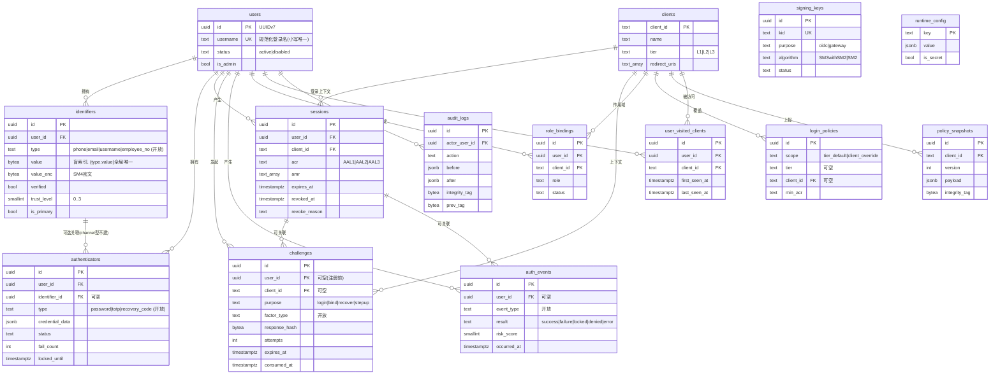

# 关津 · 数据模型规格

| 项目 | 内容 |
|---|---|
| 文档类型 | 设计规格（实现前） · 阻塞级缺口 #1 |
| 编写日期 | 2026-10-11 |
| 解决的问题 | 六元组领域模型（`User` / `Identifier` / `Authenticator` / `Challenge` / `Session` / `AuthEvent`）此前只在概念层定义，没有表结构、字段、索引与约束。本文给出可直接执行的 PostgreSQL DDL |
| 上游依据 | `GuanJin-设计基线索引.md` §2（已生效决定）、`GuanJin-因子分类与能力模型.md`、`GuanJin-权限模型设计.md`、`GuanJin-数据面设计.md`、`GuanJin-预设档位与配置点清单.html`、`合规要求横向对比矩阵.html` |
| 冲突裁决 | 基线内部矛盾一律以索引 §2 为准；待定项集中清单见索引 §4.2 / §5 |
| 共享契约 | 14 张表名与枚举取值由并行编写的另外两份文档共同引用，**不得改名** |

---

## 0. 一页结论

### 0.1 本模型的四个核心取舍

| # | 取舍 | 一句话 | 为什么这么定 |
|---|---|---|---|
| 1 | **`users` 瘦身，凭据/标识符外置** | 密码→`authenticators`，手机/邮箱→`identifiers`，`users` 只留"身份主体" | 六元组把"我是谁（主体）""我叫什么（标识符）""我凭什么证明（认证器）"三类事实解耦。主体表恒定不变，是"新增任何登录方式都不动核心表"的前提 |
| 2 | **类型列开放、结构列自描述** | `*.type` 用 `text`（**不加 CHECK**），`credential_data` 用 `jsonb`，因子能力声明在**代码**（SPI `Descriptor()`）而非库 | 这是"因子无限扩充"的落地点：新增因子/标识符类型只写数据、不改 DDL（论证见 §5） |
| 3 | **审计只增不改不删 + 哈希链** | `auth_events`/`audit_logs` 无 `updated_at`，由触发器禁止 `UPDATE`/`DELETE`，`integrity_tag` 用 HMAC-SM3 逐条链式 | 等保三级审计 c) 与密评 8.3 e) 要求"防止未预期删除/修改/覆盖"；链式标签让删改可被检出 |
| 4 | **门槛配置与状态分离** | 门槛项（口令多长、要几个因素）在 `login_policies`（**按 client 不同**）；失败计数/锁定/口令历史/已访问记录（**跨 client 全局共享**）不重复存 | 基线的"配置按客户端、状态全局共享"铁律：门槛放策略表，状态放主体/凭据表，避免"换业务系统绕过阈值" |

### 0.2 为什么密码/手机/邮箱必须搬出 `users`

| 若留在 `users` | 后果 |
|---|---|
| 密码列在用户表 | 加一个新因子（如 WebAuthn）就要给用户表加列/加迁移；每加一种因子都是一次不可逆的模式变更 |
| 手机/邮箱列在用户表 | 一个用户可能有多个手机号；"换绑"要原地改列，丢失历史与审计；也无法表达"未验证/已验证/信任级别" |
| 状态与凭据耦合 | "账户停用"与"某个因子失效"是两件事；耦合后无法独立撤销单个认证器 |

搬出后的直接收益：**`users` 的行在用户一生中几乎只写两次（创建、状态变更）**，而所有"会随因子演进而变化"的东西都在可扩展的 `identifiers` / `authenticators` 里。

### 0.3 它如何支撑"因子无限扩充"

三层解耦，缺一不可：

```text
能力声明（代码）   Provider.Descriptor()：capabilities / as_first / acr / trust…
      │             ← 新增因子 = 写一个 Provider 实现（架构验收：核心层零改动）
      ▼
实例数据（库）     authenticators{type(open), credential_data(jsonb), ...}
      │             ← 新因子的凭据结构自描述，DB 不感知字段含义
      ▼
编排请求（库）     challenges{purpose, factor_type(open), ...}
                    ← 编排层按"能力断言"选因子，按 type 落数据，从不 if type==...
```

**关键点**：数据库从不解释 `type` 的语义，只负责存。`type` 取值的合法性由**因子注册表（代码）** 校验，不是数据库 CHECK——所以"平台不限制因子种类"这条与"数据库有约束"并不冲突。

### 0.4 全局速览

| 维度 | 取值 |
|---|---|
| 主键 | `uuid`（**UUID v7**，时间有序，索引友好） |
| 时间 | 一律 `timestamptz`（UTC 存储） |
| 可变表 | 有 `created_at` / `updated_at`（`updated_at` 由触发器维护） |
| 审计表 | `auth_events` / `audit_logs`：只有 `created_at`，**禁止** `UPDATE`/`DELETE` |
| 软删 | 业务表用 `status` 字段；**审计表不软删**（物理保留至留存期满后由留存策略整段清理） |
| 枚举 | 封闭集合用 `text + CHECK`；开放集合（因子类型、标识符类型、事件类型）用 `text` 无 CHECK |
| 算法 | 口令派生 PBKDF2-SM3（迭代 ≥100000，盐 ≥16B）；摘要 SM3；审计完整性 HMAC-SM3；敏感字段 SM4；对外令牌 SM3withSM2；网关内部令牌 SM2 |
| 主密钥 | 环境变量注入，**不落库、不入 `runtime_config`**（由 CHECK 强制） |

---

## 1. 全局约定与共享 DDL

### 1.1 UUID v7

```sql
-- PostgreSQL 18+ 内置 uuidv7()。PG < 18 请二选一：
--   (a) 安装扩展 pg_uuidv7；或
--   (b) 由应用层生成 UUID v7 后作为参数写入（推荐，摆脱 DB 版本约束）。
-- 全库统一：主键默认值写作 uuidv7()，以下 DDL 不再重复说明。

-- 更新时间戳触发器（所有可变表挂载）
CREATE OR REPLACE FUNCTION set_updated_at() RETURNS trigger
LANGUAGE plpgsql AS $$
BEGIN
    NEW.updated_at := now();
    RETURN NEW;
END $$;

-- 只增表保护：禁止 UPDATE / DELETE
CREATE OR REPLACE FUNCTION forbid_mutation() RETURNS trigger
LANGUAGE plpgsql AS $$
BEGIN
    RAISE EXCEPTION 'append-only relation "%": % is not allowed', TG_TABLE_NAME, TG_OP
        USING ERRCODE = 'restrict_violation';
END $$;
```

> **为什么这么定**：UUID v7 高位是时间戳，既保留全局唯一又让 B-tree 索引近似顺序写入，避免 UUID v4 的随机写放大——这对"千万级用户 + 200 QPS 登录"的写入路径是硬需求。

### 1.2 建表顺序（依赖）

```text
users ─┬─ identifiers ── authenticators
       ├─ sessions ──┐
       ├─ challenges │
       └─ role_bindings / user_visited_clients / auth_events / audit_logs
clients ─┬─ sessions / challenges / role_bindings / login_policies / policy_snapshots / user_visited_clients
         └─（独立）signing_keys / runtime_config
```

> 迁移文件按 `users → clients → identifiers → authenticators → sessions → challenges → 其余` 顺序创建。

### 1.3 算法与字段分级归属（写代码时的唯一出处）

| 数据 | 算法 | 落库形态 |
|---|---|---|
| 口令 | PBKDF2-SM3，迭代 ≥100000，盐 ≥16B | `authenticators.credential_data`（派生密钥 + 盐 + 参数，**不可逆**） |
| 标识符（手机/邮箱） | 匹配用 SM3/HMAC-SM3 盲索引；还原用 SM4 | `identifiers.value`(盲索引) + `value_enc`(SM4) + `value_masked` |
| 凭据密钥材料（TOTP secret、恢复码集） | SM4 | `authenticators.credential_data.secret_enc` 等（base64） |
| 审计完整性 | HMAC-SM3（链式） | `audit_logs.integrity_tag` / `policy_snapshots.integrity_tag` |
| 对外令牌子 | SM2 256 位（SM3withSM2） | `signing_keys`（`purpose='oidc'`） |
| 网关内部令牌子 / 抗抵赖签名 | SM2 | `signing_keys`（`purpose='gateway'`）/ `audit_logs.signature` |
| 主密钥 | — | **环境变量，不落库** |

---

## 2. 实体关系概览

> 基线要求 ER 图用 mermaid，不用 SVG。



---

## 3. 逐表规格

### 3.1 `users` —— 身份主体（瘦身）

**职责**：只承载"这个身份主体是谁、是否可用、是否平台管理员"。**不存任何凭据、不存手机/邮箱。**

```sql
CREATE TABLE users (
    id              uuid        PRIMARY KEY DEFAULT uuidv7(),
    username        text        NOT NULL,                    -- 规范化登录名（小写存储）
    display_name    text,                                    -- 展示名，可空
    status          text        NOT NULL DEFAULT 'active'
                                CHECK (status IN ('active','disabled')),
    is_admin        boolean     NOT NULL DEFAULT false,      -- 平台管理员标记（C 端用户为 false）
    disabled_at     timestamptz,
    disabled_reason text,
    -- 可选：生效配置的物化缓存（= 已访问业务系统中最高的 tier），由应用层维护
    effective_tier  text        CHECK (effective_tier IN ('L1','L2','L3')),
    created_at      timestamptz NOT NULL DEFAULT now(),
    updated_at      timestamptz NOT NULL DEFAULT now(),

    CONSTRAINT users_username_len CHECK (char_length(username) BETWEEN 3 AND 64),
    CONSTRAINT users_disabled_consistency
        CHECK ((status = 'disabled') = (disabled_at IS NOT NULL))
);

-- 用户名大小写不敏感唯一（登录不区分大小写）
CREATE UNIQUE INDEX users_username_lower_uidx ON users (lower(username));

CREATE TRIGGER users_set_updated_at BEFORE UPDATE ON users
    FOR EACH ROW EXECUTE FUNCTION set_updated_at();
```

| 索引名 | 字段 | 为什么需要 |
|---|---|---|
| `users_username_lower_uidx` | `lower(username)` UNIQUE | 登录时按用户名等值查询且大小写不敏感；唯一性防重名 |
| `users_status_idx` | `status` | 管理后台"按状态筛用户"、停用账号统计 |
| `users_admin_partial_idx` | `is_admin WHERE is_admin` | 极小集合，加速"列出全部管理员"（后台高频） |

**关键设计说明**

- **为什么 `users` 里保留 `username`，其余凭据外置**：契约要求 `users.username` 存在（内部令牌 claim `uname`、后台展示、登录第一步都用它）。密码/手机/邮箱则一律外置——它们是"可换、可多、可加因子"的事实。**判断标准：这个字段是否随"新增一种登录方式"而变化？会变的，外置。**
- **为什么 `status` 用 `active/disabled` 而不是软删标记**：基线要求"停用/删除账户 + 立即全域失效"。`disabled` 保留主体与审计链，便于解冻与追责；真正的物理删除由注销（PIPL）走独立流程。
- ⚠️ `effective_tier` 是物化列，权威计算依据见 §3.14（`user_visited_clients`）。它不是必须的，仅为"无上下文判定"（改口令/换绑/注销）免去连表 MAX 聚合。

---

### 3.2 `identifiers` —— 指向用户的"名字"

**职责**：一个用户的所有标识符（手机号、邮箱、用户名、工号），含"是否已验证、可信级别、是否主标识符"。**这是信道型因子的物理载体。**

```sql
CREATE TABLE identifiers (
    id            uuid        PRIMARY KEY DEFAULT uuidv7(),
    user_id       uuid        NOT NULL REFERENCES users(id) ON DELETE RESTRICT,
    -- 开放集合：phone / email / username / employee_no / 未来新增（不加 CHECK）
    type          text        NOT NULL,
    -- 匹配用盲索引：HMAC-SM3(主密钥, 规范化值)。承担 (type,value) 全局唯一与等值查询
    value         bytea       NOT NULL,
    -- 还原用：SM4 密文（随机 IV，含 IV 前缀）
    value_enc     bytea       NOT NULL,
    -- 脱敏展示：138****8888 / a***@x.com
    value_masked  text        NOT NULL,
    verified      boolean     NOT NULL DEFAULT false,
    trust_level   smallint    NOT NULL DEFAULT 0 CHECK (trust_level BETWEEN 0 AND 3),
    is_primary    boolean     NOT NULL DEFAULT false,
    verified_at   timestamptz,
    verify_method text,                                  -- sms_otp / email_otp / admin ...
    last_used_at  timestamptz,
    status        text        NOT NULL DEFAULT 'active'
                              CHECK (status IN ('active','disabled')),
    created_at    timestamptz NOT NULL DEFAULT now(),
    updated_at    timestamptz NOT NULL DEFAULT now(),

    CONSTRAINT identifiers_type_value_uniq UNIQUE (type, value),   -- 全局唯一
    CONSTRAINT identifiers_verified_consistency
        CHECK (NOT verified OR verified_at IS NOT NULL)
);

-- 每个用户至多一个"主标识符"
CREATE UNIQUE INDEX identifiers_one_primary_per_user
    ON identifiers (user_id) WHERE is_primary;

-- 按用户列出全部标识符（个人中心 / 找回渠道列表）
CREATE INDEX identifiers_user_idx ON identifiers (user_id);

CREATE TRIGGER identifiers_set_updated_at BEFORE UPDATE ON identifiers
    FOR EACH ROW EXECUTE FUNCTION set_updated_at();
```

| 索引名 | 字段 | 为什么需要 |
|---|---|---|
| `identifiers_type_value_uniq` | `(type, value)` UNIQUE | 契约硬要求：全局唯一。也是登录/注册查重、防抢注的查询索引 |
| `identifiers_one_primary_per_user` | `(user_id) WHERE is_primary` | 保证"至多一个主标识符"这一业务不变式 |
| `identifiers_user_idx` | `user_id` | 个人中心列出已绑全部标识符；找回时列可用渠道 |

**关键设计说明**

- **`value` 为什么是"盲索引"而不是明文**：基线强制"标识符属于敏感字段，以 SM4 加密落库"，同时又要求 `(type,value)` 全局唯一——这两件事只有在**确定性表示**上才能同时成立。因此拆成三段：`value`（HMAC-SM3 盲索引，做匹配与唯一）+ `value_enc`（SM4 随机 IV 密文，做还原/发送）+ `value_masked`（脱敏展示）。**为什么这么定**：随机 IV 的密文无法建唯一约束；而盲索引不含明文、不泄露长度，比"确定性 SM4 密文"更稳（SM4 可用随机 IV 存于 `value_enc`）。
  - 等值查询写法：`WHERE type = 'phone' AND value = hmac_sm3(:masterKey, :normalized)`。
  - 规范化：email 转小写；phone 转 E.164；username 转小写。
  - ⚠️ 若团队判断"标识符不必强制加密"，等价替代是把 `value` 直接存规范化明文（其余不变）。见 §6。
- **`(type,value)` 为什么全局唯一而非 per-user**：手机号/邮箱是**他人/稀缺资源**，必须全局唯一（一个号只能绑一个账号）；`employee_no` 同理。这条约束在数据库层就挡住了抢注。
- **`trust_level` 语义**：0=未验证；1=弱验证（仅格式/管理员录入）；2=信道验证（短信/邮箱验证码，对应因子能力里 `recoverable.trust_level=2`）；3=强证明（恢复码等，对应 `trust_level=3`）。找回/换绑按 `trust_level` 排序选择可用渠道。
- **`is_primary` 范围**：本规格定义为"**每用户至多一个主标识符**"（账户主名，优先展示/找回）。若产品想要"每类型各一个主标识符"，改 partial unique 为 `(user_id, type)` 即可——⚠️ 见 §6。

---

### 3.3 `authenticators` —— 能证明"我是我"的凭据

**职责**：持有型因子（holding）的凭据实例：密码、TOTP、恢复码，以及未来的 WebAuthn。**信道型因子（短信/邮箱）不落此表**——它们的"凭据"就是已验证的标识符。

```sql
CREATE TABLE authenticators (
    id               uuid        PRIMARY KEY DEFAULT uuidv7(),
    user_id          uuid        NOT NULL REFERENCES users(id) ON DELETE RESTRICT,
    -- 可空：channel 型因子不建认证器；holding 型通常也无关联标识符
    identifier_id    uuid        REFERENCES identifiers(id) ON DELETE SET NULL,
    -- 开放集合：password / totp / recovery_code / webauthn ...（不加 CHECK）
    type             text        NOT NULL,
    -- 凭据信封（结构由因子实现自描述，DB 不解释）
    credential_data  jsonb       NOT NULL,
    status           text        NOT NULL DEFAULT 'active'
                                 CHECK (status IN ('active','disabled','revoked')),
    label            text,                                    -- 展示名，如"我的 iPhone"
    fail_count       integer     NOT NULL DEFAULT 0 CHECK (fail_count >= 0),
    locked_until     timestamptz,
    last_used_at     timestamptz,
    expires_at       timestamptz,                             -- 恢复码/临时凭据可设过期
    created_at       timestamptz NOT NULL DEFAULT now(),
    updated_at       timestamptz NOT NULL DEFAULT now(),

    CONSTRAINT authenticators_fail_nonneg CHECK (fail_count >= 0)
);

CREATE INDEX authenticators_user_idx ON authenticators (user_id);
CREATE INDEX authenticators_user_type_active_idx
    ON authenticators (user_id, type) WHERE status = 'active';

CREATE TRIGGER authenticators_set_updated_at BEFORE UPDATE ON authenticators
    FOR EACH ROW EXECUTE FUNCTION set_updated_at();
```

**`credential_data` 信封约定（每种因子自描述，新增因子只需新增一种结构）**

```jsonc
// password
{ "algo": "PBKDF2-SM3", "iterations": 210000, "salt": "<b64,>=16B>",
  "dk": "<b64 derived key>", "key_len": 32, "updated_at": "..." }

// totp（密钥材料 SM4 加密后落库）
{ "algo": "TOTP", "hash": "SM3", "digits": 6, "period": 30,
  "secret_enc": "<SM4 密文 b64>", "bound_at": "..." }

// recovery_code（一组一次性码，逐个 SM3 摘要后存，用后标记）
{ "algo": "SM3-SET", "codes": [ {"h":"<b64>","used_at":null}, ... ],
  "issued_at": "...", "batch_id": "..." }

// webauthn（预留，验证"全新因子形态不改表结构"）
{ "algo": "WEBAUTHN", "credential_id": "<b64>", "public_key": "<cbor b64>",
  "sign_count": 0, "aaguid": "..." }
```

| 索引名 | 字段 | 为什么需要 |
|---|---|---|
| `authenticators_user_idx` | `user_id` | 登录时列出用户全部可用因子、生命周期操作 |
| `authenticators_user_type_active_idx` | `(user_id, type) WHERE status='active'` | "该用户是否已有可用密码/TOTP"这类能力断言查询；部分索引体积小 |

**关键设计说明**

- **为什么短信/邮箱不建认证器行**：因子模型里它们是 `channel` 型，"本身没有凭据可重置，重置的是标识符"。其"可认证"能力由 `identifiers.verified + type∈{phone,email}` 表达。若强行建行，会出现"标识符与认证器指向同一事实"的冗余。
- **为什么 `credential_data` 用 `jsonb` 而不是分列**：这是"新增因子不改表结构"的核心——密码要 `iterations/salt/dk`，TOTP 要 `secret/digits/period`，WebAuthn 要 `credential_id/public_key`，字段完全不同。用 jsonb 让**凭据层零改动**。**为什么这么定**：任何"为每种因子加列"的方案都会让新增因子触发 DDL，直接违反验收标准。
- **`fail_count` / `locked_until` 定位**：契约要求这两个字段存在。本规格把它们定义为**失败计数的持久化镜像**；权威实时计数按基线放 Redis（见 §3.4 说明与 §6）。持锁状态在**账号级跨 client 共享**，因此按 `user_id` 归集，而非"每个 client 各算一份"。
- **`type` 不加 CHECK 的理由**：`password/totp/recovery_code` 是 V1 种子值，不是封闭集。合法性由代码侧因子注册表校验（守护规则：禁止 `if type == "sms"` 式分支）。

---

### 3.4 `challenges` —— 一次性挑战

**职责**：一次认证/绑定/找回/升级挑战的**权威状态与取证链**：发给了谁、期望响应（摘要）、试了几次、是否已消费、何时过期。

```sql
CREATE TABLE challenges (
    id               uuid        PRIMARY KEY DEFAULT uuidv7(),
    -- 注册场景可能尚无用户 → 可空
    user_id          uuid        REFERENCES users(id) ON DELETE SET NULL,
    identifier_id    uuid        REFERENCES identifiers(id) ON DELETE SET NULL,
    authenticator_id uuid        REFERENCES authenticators(id) ON DELETE SET NULL,
    client_id        text        REFERENCES clients(client_id) ON DELETE SET NULL,
    purpose          text        NOT NULL
                                 CHECK (purpose IN ('login','bind','recover','stepup')),
    -- 发起该挑战的因子类型（开放）
    factor_type      text        NOT NULL,
    channel          text,                                   -- sms / email；holding 型为空
    target_masked    text,                                   -- 脱敏投递目标
    -- 期望响应的摘要（SM3/HMAC-SM3），恒定时间比较；明文码永不落库
    response_hash    bytea       NOT NULL,
    attempts         integer     NOT NULL DEFAULT 0 CHECK (attempts >= 0),
    max_attempts     integer     NOT NULL DEFAULT 5 CHECK (max_attempts > 0),
    consumed_at      timestamptz,
    expires_at       timestamptz NOT NULL,
    created_at       timestamptz NOT NULL DEFAULT now(),
    updated_at       timestamptz NOT NULL DEFAULT now(),

    CONSTRAINT challenges_consumed_after_created
        CHECK (consumed_at IS NULL OR consumed_at >= created_at),
    CONSTRAINT challenges_expires_after_created
        CHECK (expires_at > created_at),
    CONSTRAINT challenges_attempts_bounded CHECK (attempts <= max_attempts)
);

-- 校验时按 id 命中（主键）；按用户/客户端排查近期挑战
CREATE INDEX challenges_user_created_idx ON challenges (user_id, created_at DESC);
CREATE INDEX challenges_client_created_idx ON challenges (client_id, created_at DESC);
-- 清理任务扫描过期未消费行
CREATE INDEX challenges_expires_idx ON challenges (expires_at)
    WHERE consumed_at IS NULL;

CREATE TRIGGER challenges_set_updated_at BEFORE UPDATE ON challenges
    FOR EACH ROW EXECUTE FUNCTION set_updated_at();
```

| 索引名 | 字段 | 为什么需要 |
|---|---|---|
| （主键 `id`） | `id` | 挑战校验按 id 命中，最高频路径 |
| `challenges_user_created_idx` | `(user_id, created_at DESC)` | 风控看"某用户近期是否有大量挑战"；审计关联 |
| `challenges_client_created_idx` | `(client_id, created_at DESC)` | 按业务系统排查；短信预算/发送统计 |
| `challenges_expires_idx` | `(expires_at) WHERE consumed_at IS NULL` | 后台 TTL 清理器只扫未消费的未过期窗口，索引极小 |

**关键设计说明（挑战为什么落库、而不是只落 Redis）**

| 论点 | 说明 |
|---|---|
| **取证链的唯一权威** | 等保三级要求认证事件可举证。若挑战只在 Redis，Redis 重启/过期即丢，无法回答"某次找回验证码何时签发、试了几次"。数据库提供持久的权威事实 |
| **一次性消费的严格性** | 用 `UPDATE challenges SET consumed_at = now() WHERE id = :id AND consumed_at IS NULL` 的行级原子更新即保证严格一次性；不需要 Redis Lua 也能成立 |
| **跨重启不卡住用户** | 用户正处于两步流程中时，Redis 抖动不应让挑战蒸发。落库后即使 Redis 全程不可用（此时按 fail-closed 拒绝新流量），已签发的挑战仍可被安全清理而不是静默消失 |
| **Redis 仍是必需的加速层** | 承接基线明确归属 Redis 的部分：**限流/日配额计数器**（`send:{factor}:{target}`、`verify:{...}`，原子 INCR + TTL）。Redis 不可用 → **整体 fail-closed 拒绝服务**（基线硬规则），绝不降级放行 |
| **与基线 §7 的差异** | 基线《系统架构说明》§7 说"验证码存缓存"。本规格把"**挑战的权威状态**"落库、"**限流计数**"留 Redis。⚠️ 这是对 §7 的精化，见 §6 |

- **`response_hash` 为什么不存明文码**：短信/邮件码是短期秘密，落库明文等于把"数据库被读"升级为"账号可被接管"。存摘要 + 恒定时间比较即可。
- **`purpose` 为什么是封闭四值**：`login/bind/recover/stepup` 是编排层的语义分类（契约固定），用 CHECK 约束防止编排层凭经验造词。**注意**：`bind/recover` 复用同一链路（基线"找回 = 换绑 = 重置"），差异只体现在 purpose 与目标。
- **`user_id` 可空**：开放自注册时，用户是"提交注册那一刻"才创建的，挑战先于用户存在。

---

### 3.5 `sessions` —— 会话

**职责**：一次登录产生的会话，记录达成级别、因子组合、有效期、撤销状态与设备上下文。

```sql
CREATE TABLE sessions (
    id              uuid        PRIMARY KEY DEFAULT uuidv7(),
    user_id         uuid        NOT NULL REFERENCES users(id) ON DELETE RESTRICT,
    -- 会话归属的业务系统（登录一定有客户端上下文；管理后台本身也是一个 client）
    client_id       text        NOT NULL REFERENCES clients(client_id) ON DELETE RESTRICT,
    acr             text        NOT NULL CHECK (acr IN ('AAL1','AAL2','AAL3')),
    amr             text[]      NOT NULL DEFAULT '{}',       -- ['pwd','totp',...]
    status          text        NOT NULL DEFAULT 'active'
                                CHECK (status IN ('active','revoked','expired')),
    issued_at       timestamptz NOT NULL DEFAULT now(),
    last_seen_at    timestamptz,
    expires_at      timestamptz NOT NULL,                    -- 绝对超时（重认证间隔）
    idle_expires_at timestamptz NOT NULL,                    -- 空闲超时（可滚动）
    revoked_at      timestamptz,
    revoke_reason   text,                                    -- logout|logout_all|admin|risk|role_change|password_change
    -- 设备上下文
    ip              inet,
    user_agent      text,
    device_id       text,
    created_at      timestamptz NOT NULL DEFAULT now(),
    updated_at      timestamptz NOT NULL DEFAULT now(),

    CONSTRAINT sessions_revoked_consistency
        CHECK ((status = 'revoked') = (revoked_at IS NOT NULL)),
    CONSTRAINT sessions_time_order
        CHECK (idle_expires_at <= expires_at)
);

-- 撤销/单点登出：按用户批量失效
CREATE INDEX sessions_user_status_idx ON sessions (user_id, status);
-- 并发会话数统计（按 client）与"挤掉最旧"
CREATE INDEX sessions_user_client_active_idx
    ON sessions (user_id, client_id, issued_at DESC) WHERE status = 'active';
-- 空闲超时清理
CREATE INDEX sessions_idle_idx ON sessions (idle_expires_at) WHERE status = 'active';

CREATE TRIGGER sessions_set_updated_at BEFORE UPDATE ON sessions
    FOR EACH ROW EXECUTE FUNCTION set_updated_at();
```

| 索引名 | 字段 | 为什么需要 |
|---|---|---|
| `sessions_user_status_idx` | `(user_id, status)` | 撤销全部会话（角色变更/改密/离职）；在线会话列表 |
| `sessions_user_client_active_idx` | `(user_id, client_id, issued_at DESC) WHERE status='active'` | "单用户在该业务系统内并发会话数上限"的计数与"挤掉最旧" |
| `sessions_idle_idx` | `(idle_expires_at) WHERE status='active'` | 空闲超时扫描，仅活跃会话 |

**关键设计说明**

- **为什么 `client_id` 为 NOT NULL**：基线"登录与注册一定有业务系统上下文"。并发会话上限是**按业务系统**定义的（预设档位 B 组），因此会话必须带 client 维度。跨系统"一次验证全域通行"通过**复用已有会话的 `acr/amr`**（不为新 client 重复产生认证事件）实现，而不是把会话做成全局单条。
- **`acr` / `amr` 的取值**：`acr ∈ {AAL1,AAL2,AAL3}`；`amr` 是开放数组，建议取 RFC 8176 语义 + 因子类型：`pwd`、`sms_otp`、`email_otp`、`totp`、`recovery_code`、`webauthn`。**为什么 acr 用 CHECK、amr 不用**：acr 是合规对标的封闭等级；amr 随因子扩充而增长，必须开放。
- **撤销实时生效**：基线已定"关津承载数据面"，撤销**实时生效**（请求都在路径上）。因此本表不需要为"拉取间隔"设计版本号/撤销清单表——`revoked_at` 即为权威事实。若将来退回接入侧本地验签，再补一张撤销清单/版本表（见 §6）。
- **`expires_at` vs `idle_expires_at`**：绝对超时到点必须重新认证；空闲超时滚动续期。硬约束（预设档位 B 组）：`refresh_token_ttl ≤ expires_at - issued_at`，在应用层与 `login_policies` 侧联合校验。

---

### 3.6 `auth_events` —— 认证事件流水（只增不改不删）

**职责**：每一次认证动作（发送、校验、成功、失败、锁定、拒绝）的不可变流水，供合规举证与风控。

```sql
CREATE TABLE auth_events (
    id            uuid        PRIMARY KEY DEFAULT uuidv7(),
    user_id       uuid        REFERENCES users(id) ON DELETE SET NULL,       -- 未识别用户可空
    identifier_id uuid        REFERENCES identifiers(id) ON DELETE SET NULL,
    session_id    uuid        REFERENCES sessions(id) ON DELETE SET NULL,
    client_id     text        REFERENCES clients(client_id) ON DELETE SET NULL,
    -- 开放集合：login / logout / otp_send / otp_verify / bind / unbind /
    --          recover / reset / stepup / lock / unlock / revoke ...
    event_type    text        NOT NULL,
    factor_type   text,                                       -- 参与因子（开放）
    result        text        NOT NULL
                              CHECK (result IN ('success','failure','locked','denied','error')),
    reason        text,                                       -- 失败分类（不含敏感信息）
    risk_score    smallint    CHECK (risk_score BETWEEN 0 AND 100),
    acr           text        CHECK (acr IN ('AAL1','AAL2','AAL3')),
    amr           text[]      NOT NULL DEFAULT '{}',
    ip            inet,
    user_agent    text,
    device_id     text,
    trace_id      text,
    occurred_at   timestamptz NOT NULL DEFAULT now(),
    created_at    timestamptz NOT NULL DEFAULT now()
);

-- 按业务系统 + 时间导出（合规要求"审计可按业务系统切分与导出"）
CREATE INDEX auth_events_client_time_idx ON auth_events (client_id, occurred_at DESC);
CREATE INDEX auth_events_user_time_idx   ON auth_events (user_id, occurred_at DESC);
CREATE INDEX auth_events_type_result_idx ON auth_events (event_type, result, occurred_at DESC);
-- 账号级异常检测：近期失败激增
CREATE INDEX auth_events_failure_idx ON auth_events (user_id, occurred_at DESC)
    WHERE result IN ('failure','locked');

-- 只增不改不删（基线硬要求）
CREATE TRIGGER auth_events_append_only
    BEFORE UPDATE OR DELETE ON auth_events
    FOR EACH ROW EXECUTE FUNCTION forbid_mutation();
```

| 索引名 | 字段 | 为什么需要 |
|---|---|---|
| `auth_events_client_time_idx` | `(client_id, occurred_at DESC)` | 合规：按业务系统维度导出审计；各业务方独立取证 |
| `auth_events_user_time_idx` | `(user_id, occurred_at DESC)` | "我的登录记录"；管理后台按用户查 |
| `auth_events_type_result_idx` | `(event_type, result, occurred_at DESC)` | 成功率统计、异常事件筛查 |
| `auth_events_failure_idx` | `(user_id, occurred_at DESC) WHERE result∈(failure,locked)` | 账号级风控：失败激增/异地跳变检测 |

**关键设计说明**

- **为什么物理上禁止改删**：等保三级审计 c) 要求"避免未预期的删除、修改或覆盖"。触发器 + (可选)撤销 `UPDATE/DELETE` 权限，是"软删不适用"在数据库层的落地。软删除对认证流水毫无意义——它需要的是**不可否认**。
- **为什么没有 `updated_at`**：只增表没有"更新"语义。事件一旦发生，事实不可变；纠正只能是"追加一条新事件"。
- **`event_type` 开放而 `result` 封闭**：事件类型随因子/流程扩充会不断新增（如未来加"passkey 注册事件"），不能 CHECK；而结果分类是稳定的五值。
- **留存**：基线定 365 天（高于等保要求的 180 天）。由留存策略按 `occurred_at` **整段清理**（分区表按月分区时是 `DROP PARTITION`），而非逐行删——既高效又避免与"防删"语义打架。

---

### 3.7 `audit_logs` —— 管理操作审计

**职责**：管理侧每一次"谁、何时、对什么、改前改后是什么"的不可变台账，带 HMAC-SM3 链式完整性标签。

```sql
CREATE TABLE audit_logs (
    id            uuid        PRIMARY KEY DEFAULT uuidv7(),
    actor_user_id uuid        REFERENCES users(id) ON DELETE SET NULL,
    actor_role    text,                                       -- sys_admin|sec_admin|auditor
    action        text        NOT NULL,                       -- user.disable / role.bind /
                                                              -- policy.update / key.rotate ...
    target_type   text,                                       -- user / role_binding / client / signing_key ...
    target_id     text,
    client_id     text,                                       -- 与某业务系统相关时填写
    before        jsonb,                                      -- 变更前（脱敏后）
    after         jsonb,                                      -- 变更后（脱敏后）
    result        text        NOT NULL CHECK (result IN ('success','failure')),
    -- 链式完整性：HMAC-SM3(主密钥, prev_tag || 规范化记录内容)
    integrity_tag bytea       NOT NULL,
    prev_tag      bytea,                                      -- 前一条的 integrity_tag（首条为 NULL / 锚定值）
    signature     bytea,                                      -- 关键操作 SM2 签名（抗抵赖），可空
    ip            inet,
    trace_id      text,
    occurred_at   timestamptz NOT NULL DEFAULT now(),
    created_at    timestamptz NOT NULL DEFAULT now()
);

CREATE INDEX audit_logs_actor_time_idx  ON audit_logs (actor_user_id, occurred_at DESC);
CREATE INDEX audit_logs_target_idx      ON audit_logs (target_type, target_id, occurred_at DESC);
CREATE INDEX audit_logs_client_time_idx ON audit_logs (client_id, occurred_at DESC);
CREATE INDEX audit_logs_action_time_idx ON audit_logs (action, occurred_at DESC);

-- 只增不改不删
CREATE TRIGGER audit_logs_append_only
    BEFORE UPDATE OR DELETE ON audit_logs
    FOR EACH ROW EXECUTE FUNCTION forbid_mutation();
```

| 索引名 | 字段 | 为什么需要 |
|---|---|---|
| `audit_logs_actor_time_idx` | `(actor_user_id, occurred_at DESC)` | "某管理员做过什么"（三权分立核查） |
| `audit_logs_target_idx` | `(target_type, target_id, occurred_at DESC)` | 追溯"某个用户/角色绑定/密钥的全部变更历史" |
| `audit_logs_client_time_idx` | `(client_id, occurred_at DESC)` | 按业务系统导出 |
| `audit_logs_action_time_idx` | `(action, occurred_at DESC)` | 按操作类型审计（如"全平台的角色绑定变更"） |

**关键设计说明**

- **为什么用哈希链而不是单条 HMAC**：单条 HMAC 只能证明"这条没被改"，删掉中间一条无法发现。链式（`prev_tag` 指向上一条的标签）让**任何删除或重排都会使后续链断裂**。**为什么这么定**：密评 8.3 e) 要"日志记录完整性"，链式是"可检测篡改"的最小成本实现。
- **`before`/`after` 为什么存脱敏后的 jsonb**：契约要求记录变更前后值；同时基线要求"界面、审计查询与导出中的标识符一律脱敏"。所以写库前先脱敏再入 `before/after`，原始敏感值只经 `identifiers` 加密列保管。
- **⚠️ 链式并发写风险**：多副本部署下，`prev_tag` 需要全局顺序。本规格建议：审计写入走**单写者**（专用审计写入器/队列消费单分区），或用 `pg_advisory_xact_lock` 串行化链尾。见 §6。
- **`signature` 用途**：对"关键管理操作"（如密钥轮换、角色绑定、批量停用）附 SM2 签名，实现抗抵赖——密评里抗抵赖为"宜"、等保四级为"应"，本项目按最高实现固定开启。

---

### 3.8 `clients` —— 业务系统

**职责**：接入的业务系统的登记信息：档位、回调地址、密钥、配套要求。

```sql
CREATE TABLE clients (
    client_id                 text        PRIMARY KEY,        -- 即 OAuth client_id
    name                      text        NOT NULL,
    tier                      text        NOT NULL DEFAULT 'L2'
                                          CHECK (tier IN ('L1','L2','L3')),
    status                    text        NOT NULL DEFAULT 'active'
                                          CHECK (status IN ('active','disabled')),
    redirect_uris             text[]      NOT NULL DEFAULT '{}',
    post_logout_redirect_uris text[]      NOT NULL DEFAULT '{}',
    -- 对接密钥（业务系统 → 关津的上报/拉策略通道；每业务系统一份，不共用）
    secret_hash               bytea,                          -- HMAC-SM3 盲索引/验证用
    secret_enc                bytea,                          -- SM4 密文（还原展示/重发）
    prev_secret_hash          bytea,                          -- 轮换过渡期
    secret_rotated_at         timestamptz,
    -- 声明元数据（SDK 上报的策略快照另存 policy_snapshots）
    default_role              text,                           -- 合成默认角色，如 authenticated_user
    -- 门槛项 E：建设方配套要求（平台登记/跟踪，不实现技术）
    pentest_required          boolean     NOT NULL DEFAULT false,
    soc_required              boolean     NOT NULL DEFAULT false,
    created_at                timestamptz NOT NULL DEFAULT now(),
    updated_at                timestamptz NOT NULL DEFAULT now(),

    CONSTRAINT clients_tier_valid CHECK (tier IN ('L1','L2','L3')),
    CONSTRAINT clients_redirect_unique CHECK (
        redirect_uris = (SELECT array_agg(DISTINCT x) FROM unnest(redirect_uris) AS x)
    )
);

CREATE INDEX clients_tier_idx   ON clients (tier) WHERE status = 'active';
CREATE INDEX clients_status_idx ON clients (status);

CREATE TRIGGER clients_set_updated_at BEFORE UPDATE ON clients
    FOR EACH ROW EXECUTE FUNCTION set_updated_at();
```

| 索引名 | 字段 | 为什么需要 |
|---|---|---|
| （主键 `client_id`） | `client_id` | 数据面每个请求都要按 client 取档位/策略，最高频 |
| `clients_tier_idx` | `(tier) WHERE status='active'` | "列出全部 L3 系统"（合规盘点） |
| `clients_status_idx` | `status` | 后台按状态筛选 |

**关键设计说明**

- **`tier` 为什么是封闭三值**：档位只有 L1/L2/L3 一层（基线已定），是合规对标的核心维度，必须固定。默认 **L2**（新建业务系统不特别声明即满足等保二级 + 密评二级）。
- **`redirect_uris` 为什么用数组**：一个业务系统可有多个回调（多域名/多环境）。CHECK 保证数组内无重复。回调解码匹配在应用层做**精确匹配**（防开放重定向）。
- **密钥为什么存"盲索引 + SM4 密文"两列**：验证 incoming 请求签名需要能等值查到客户端（`secret_hash`）；而"重新展示/服务端签发"需要能还原（`secret_enc`）。这也支撑 `prev_secret_hash` 的轮换过渡期（新老密钥短期并行）。
- **每业务系统独立密钥而非共用**：基线明确"不要共用一个"（一破全破）。

---

### 3.9 `login_policies` —— 档位门槛项取值 + 按 client 覆盖

**职责**：把预设档位清单第三节 A~E 的门槛项落成数据；含**档位默认**与**客户端级覆盖**两种 scope。

```sql
CREATE TABLE login_policies (
    id           uuid        PRIMARY KEY DEFAULT uuidv7(),
    scope        text        NOT NULL
                             CHECK (scope IN ('tier_default','client_override')),
    tier         text        CHECK (tier IN ('L1','L2','L3')),          -- scope=tier_default 必填
    client_id    text        REFERENCES clients(client_id) ON DELETE CASCADE, -- scope=client_override 必填

    -- A · 凭据要求
    min_acr                     text     NOT NULL DEFAULT 'AAL1'
                                         CHECK (min_acr IN ('AAL1','AAL2','AAL3')),
    password_min_length         smallint NOT NULL DEFAULT 12 CHECK (password_min_length BETWEEN 8 AND 128),
    password_char_classes       smallint NOT NULL DEFAULT 3  CHECK (password_char_classes BETWEEN 2 AND 4),
    password_history_count      smallint NOT NULL DEFAULT 5  CHECK (password_history_count >= 0),
    password_max_age_days       integer  NOT NULL DEFAULT 90 CHECK (password_max_age_days > 0),
    -- B · 会话与令牌
    session_idle_timeout_min    integer  NOT NULL DEFAULT 30 CHECK (session_idle_timeout_min > 0),
    session_absolute_timeout_min integer NOT NULL DEFAULT 720 CHECK (session_absolute_timeout_min > 0),
    access_token_ttl_sec        integer  NOT NULL DEFAULT 600 CHECK (access_token_ttl_sec > 0),
    refresh_token_ttl_sec       integer  NOT NULL DEFAULT 28800 CHECK (refresh_token_ttl_sec > 0),
    max_concurrent_sessions     integer  CHECK (max_concurrent_sessions IS NULL OR max_concurrent_sessions > 0), -- NULL=不限
    concurrent_overflow_action  text     NOT NULL DEFAULT 'deny_new'
                                         CHECK (concurrent_overflow_action IN ('deny_new','evict_oldest','evict_oldest_alert')),
    -- C · 失败处理
    fail_threshold              smallint NOT NULL DEFAULT 5 CHECK (fail_threshold > 0),
    lock_duration_min           integer  NOT NULL DEFAULT 15 CHECK (lock_duration_min > 0),
    -- D · 准入与生命周期
    self_registration_allowed   boolean  NOT NULL DEFAULT true,
    password_self_recovery      boolean  NOT NULL DEFAULT true,
    sso_logout_scope            text     NOT NULL DEFAULT 'all_clients'
                                         CHECK (sso_logout_scope IN ('current_client','all_clients')),
    -- E · 因子限制与配套
    disabled_factors            text[]   NOT NULL DEFAULT '{}',
    operator_requirements       jsonb    NOT NULL DEFAULT '{}'::jsonb,

    created_at   timestamptz NOT NULL DEFAULT now(),
    updated_at   timestamptz NOT NULL DEFAULT now(),

    CONSTRAINT login_policies_scope_xor CHECK (
        (scope = 'tier_default'    AND tier IS NOT NULL AND client_id IS NULL) OR
        (scope = 'client_override' AND client_id IS NOT NULL AND tier IS NULL)
    ),
    -- 硬约束：刷新令牌有效期 ≤ 会话绝对超时（否则绝对超时被绕过）
    CONSTRAINT login_policies_refresh_le_absolute
        CHECK (refresh_token_ttl_sec <= session_absolute_timeout_min * 60)
);

-- 每个档位仅一份默认
CREATE UNIQUE INDEX login_policies_tier_default_uidx
    ON login_policies (tier) WHERE scope = 'tier_default';
-- 每个客户端仅一份覆盖
CREATE UNIQUE INDEX login_policies_client_override_uidx
    ON login_policies (client_id) WHERE scope = 'client_override';

CREATE TRIGGER login_policies_set_updated_at BEFORE UPDATE ON login_policies
    FOR EACH ROW EXECUTE FUNCTION set_updated_at();
```

| 索引名 | 字段 | 为什么需要 |
|---|---|---|
| `login_policies_tier_default_uidx` | `(tier) WHERE scope='tier_default'` | 三行全局默认，读取快；防重复 |
| `login_policies_client_override_uidx` | `(client_id) WHERE scope='client_override'` | 客户端覆盖一对一 |

**关键设计说明**

- **"全局默认 + 客户端覆盖"两 scope 放同一表**：省一张表，且约束（XOR、唯一）能集中表达。读取顺序：优先取 `client_override`，无则回落到对应 `tier_default`。
- **"档位即门槛、只升不降"的方向校验放应用层**：四类方向（下限只能更大、上限只能更小、只能更严、只能提高）无法用简单 CHECK 表达，必须由统一"门槛项方向矩阵"校验器拦截越界调整，并将越界尝试写审计（预设档位第五节）。**为什么不在库里做**：方向是相对"档位基准"的比较，需要读基准行，属跨行逻辑。
- **`disabled_factors` 语义**：只约束"进入本业务系统时的验证方式"；被禁因子既不能用于进入，也不计入进入本系统时的保证级别（预设档位 E 组关键规则）。
- **硬约束落在 DB**：`refresh_token_ttl_sec ≤ session_absolute_timeout_min*60` 写成 CHECK，是因为"绝对值被绕过"是安全硬伤，不该只靠应用层记忆。

---

### 3.10 `signing_keys` —— 签名密钥

**职责**：平台签名密钥的登记、轮换与状态。对外令牌 SM3withSM2；网关内部令牌 SM2。

```sql
CREATE TABLE signing_keys (
    id              uuid        PRIMARY KEY DEFAULT uuidv7(),
    kid             text        NOT NULL UNIQUE,      -- JWKS 里对外可见的 key id
    purpose         text        NOT NULL CHECK (purpose IN ('oidc','gateway')),
    algorithm       text        NOT NULL CHECK (algorithm IN ('SM3withSM2','SM2')),
    status          text        NOT NULL DEFAULT 'pending'
                                CHECK (status IN ('pending','active','retiring','retired','compromised')),
    public_key      text        NOT NULL,             -- PEM / base64（可公开）
    private_key_enc bytea       NOT NULL,             -- SM4 密文（受主密钥保护，绝不落明文）
    activates_at    timestamptz,
    retires_at      timestamptz,
    created_at      timestamptz NOT NULL DEFAULT now(),
    updated_at      timestamptz NOT NULL DEFAULT now(),

    -- 用途与算法绑定：对外 SM3withSM2，网关内部 SM2
    CONSTRAINT signing_keys_purpose_algo CHECK (
        (purpose = 'oidc'    AND algorithm = 'SM3withSM2') OR
        (purpose = 'gateway' AND algorithm = 'SM2')
    )
);

-- 发布 JWKS：只取某用途当前可用密钥
CREATE INDEX signing_keys_purpose_status_idx
    ON signing_keys (purpose, status);

CREATE TRIGGER signing_keys_set_updated_at BEFORE UPDATE ON signing_keys
    FOR EACH ROW EXECUTE FUNCTION set_updated_at();
```

| 索引名 | 字段 | 为什么需要 |
|---|---|---|
| `signing_keys_kid_uidx`（隐含） | `kid` UNIQUE | 验签方按 `kid` 选公钥，必须唯一 |
| `signing_keys_purpose_status_idx` | `(purpose, status)` | JWKS 端点按用途发布 active/retiring 公钥；轮换时查状态 |

**关键设计说明**

- **为什么 `purpose` 与 `algorithm` 绑定成 CHECK**：基线明确"对外令牌 SM3withSM2、网关内部令牌 SM2"，且网关内部密钥对与用户令牌密钥对**独立**（用途分离）。用 CHECK 从结构上杜绝"用 SM3withSM2 签内部令牌"这类错配。
- **为什么 `private_key_enc` 用 SM4 且密钥来自环境变量**：基线要求"私钥不得以明文出现在密码边界之外"。主密钥不落库（见 §3.11），所以即使库泄露，私钥仍受环境变量保护。
- **轮换**：固定 90 天。遵循"先并行发布新公钥 → 等存量令牌自然过期 → 再退役旧密钥"：即 `pending → active`（并行）→ `retiring`（新令牌不再用、仍可验）→ `retired`。`activates_at/retires_at` 支撑这个时序。

---

### 3.11 `runtime_config` —— 运行时配置与平台参数

**职责**：键值形式的运行时参数（限流默认值、审计留存、日志外送开关、因子启用开关等）。**主密钥绝不入此表。**

```sql
CREATE TABLE runtime_config (
    key         text        PRIMARY KEY,
    value       jsonb       NOT NULL,
    value_type  text        NOT NULL DEFAULT 'json'
                            CHECK (value_type IN ('string','int','bool','json','secret')),
    description text,
    is_secret   boolean     NOT NULL DEFAULT false,   -- true 时 value 内容为 SM4 密文（base64）
    updated_by  uuid        REFERENCES users(id) ON DELETE SET NULL,
    created_at  timestamptz NOT NULL DEFAULT now(),
    updated_at  timestamptz NOT NULL DEFAULT now(),

    -- 硬约束：SM4 主密钥不得存此表、不得以任何明文形式落库
    CONSTRAINT runtime_config_no_master_key CHECK (
        lower(key) !~ '(master[_-]?key|root[_-]?key|kek|sm4[_-]?master)'
    ),
    -- is_secret 与 value_type 一致
    CONSTRAINT runtime_config_secret_consistency CHECK (
        (is_secret = false) OR (value_type = 'secret')
    )
);

CREATE TRIGGER runtime_config_set_updated_at BEFORE UPDATE ON runtime_config
    FOR EACH ROW EXECUTE FUNCTION set_updated_at();
```

| 索引名 | 字段 | 为什么需要 |
|---|---|---|
| （主键 `key`） | `key` | 配置按 key 精确读取，天然热点小表 |

**关键设计说明**

- **主密钥为什么用 CHECK 挡在库外**：基线原话——"若主密钥也加密落库，拿到库即拿到一切（自解锁），加密形同虚设"。因此把"不可落库"这条底线从"约定"升级为**数据库约束**：任何试图写入 `master_key` 类键名都会失败。**为什么这么定**：约定会被绕过，约束不会。
- **为什么用键值表而不是配置列**：平台参数会随合规项增减，键值表让"新增一个平台参数"是**写一行数据**而非改表结构（与因子扩充同一哲学）。
- **`is_secret` 的场景**：如短信服务商口令、SMTP 口令这类第三方凭据，需 SM4 加密后**作为值存**（与主密钥不同，它们是被保护对象，不是根密钥）。

---

### 3.12 `role_bindings` —— 用户 → 角色绑定

**职责**：平台管辖的**唯一授权事实**：把哪个角色给了哪个用户在哪个业务系统。平台**不定义**角色与权限（那是业务代码语义），只登记绑定与审计。

```sql
CREATE TABLE role_bindings (
    id            uuid        PRIMARY KEY DEFAULT uuidv7(),
    user_id       uuid        NOT NULL REFERENCES users(id) ON DELETE CASCADE,
    client_id     text        NOT NULL REFERENCES clients(client_id) ON DELETE CASCADE,
    role          text        NOT NULL,                      -- 业务系统定义的角色名
    status        text        NOT NULL DEFAULT 'active'
                              CHECK (status IN ('active','revoked')),
    granted_by    uuid        REFERENCES users(id) ON DELETE SET NULL,  -- 安全管理员
    granted_at    timestamptz NOT NULL DEFAULT now(),
    revoked_at    timestamptz,
    revoke_reason text,
    created_at    timestamptz NOT NULL DEFAULT now(),
    updated_at    timestamptz NOT NULL DEFAULT now(),

    CONSTRAINT role_bindings_uniq UNIQUE (user_id, client_id, role),
    CONSTRAINT role_bindings_revoked_consistency
        CHECK ((status = 'revoked') = (revoked_at IS NOT NULL))
);

CREATE INDEX role_bindings_user_active_idx ON role_bindings (user_id) WHERE status = 'active';
CREATE INDEX role_bindings_client_role_idx ON role_bindings (client_id, role);

CREATE TRIGGER role_bindings_set_updated_at BEFORE UPDATE ON role_bindings
    FOR EACH ROW EXECUTE FUNCTION set_updated_at();
```

| 索引名 | 字段 | 为什么需要 |
|---|---|---|
| `role_bindings_uniq` | `(user_id, client_id, role)` UNIQUE | 契约硬要求；防重复绑定 |
| `role_bindings_user_active_idx` | `(user_id) WHERE status='active'` | 登录时把该用户在某 client 的角色列表写进令牌（零回源） |
| `role_bindings_client_role_idx` | `(client_id, role)` | 后台按"角色"查"谁被绑了"；安全管理员操作面 |

**关键设计说明**

- **为什么"用户→角色"是唯一授权事实、角色→权限不入库**：权限模型设计 §0 的四段分工——策略定义在**代码**，平台只登记绑定。因此平台数据面里**根本没有"角色→权限"表**，只有"用户→角色"。这是"平台不做授权、只做授权入口"在数据层的体现。
- **角色变更 → 撤销会话**：基线要求"角色变更时平台主动撤销该用户会话"（因角色是放进令牌的，变更需重登生效）。实现：应用层在同一事务后撤销该用户全部 `sessions`，`revoke_reason='role_change'`。
- **`client_id` 必填**：基线明确"不提供跨业务系统的统一角色模型"。角色天然属于某个业务系统。

---

### 3.13 `policy_snapshots` —— SDK 上报的策略快照

**职责**：业务系统启动/变更时 SDK 自动上报的策略快照（权限目录、角色目录、接口映射、默认角色、密级目录），带版本、可回溯。

```sql
CREATE TABLE policy_snapshots (
    id            uuid        PRIMARY KEY DEFAULT uuidv7(),
    client_id     text        NOT NULL REFERENCES clients(client_id) ON DELETE CASCADE,
    version       integer     NOT NULL CHECK (version > 0),   -- 客户端内单调递增
    payload       jsonb       NOT NULL,                       -- 目录/映射整体
    payload_hash  bytea       NOT NULL,                       -- SM3(规范化 payload)
    integrity_tag bytea       NOT NULL,                       -- HMAC-SM3（关键数据存储完整性）
    reported_at   timestamptz NOT NULL DEFAULT now(),
    created_at    timestamptz NOT NULL DEFAULT now(),

    CONSTRAINT policy_snapshots_uniq UNIQUE (client_id, version)
);

-- 取"最新一版"
CREATE INDEX policy_snapshots_client_version_idx
    ON policy_snapshots (client_id, version DESC);
-- payload 内检索（接口→权限映射查询）
CREATE INDEX policy_snapshots_payload_gin ON policy_snapshots USING gin (payload jsonb_path_ops);
```

| 索引名 | 字段 | 为什么需要 |
|---|---|---|
| `policy_snapshots_uniq` | `(client_id, version)` UNIQUE | 版本唯一，防重复上报覆盖 |
| `policy_snapshots_client_version_idx` | `(client_id, version DESC)` | "取某业务系统当前策略照"是高频读 |
| `policy_snapshots_payload_gin` | `gin(payload)` | 支持"哪个接口需要哪个权限"这类反查（等保"策略可查"） |

**关键设计说明**

- **为什么快照只增不改（按 version 追加）**：基线要求"可对比、可回溯"。每次上报是**新版本**，不覆盖——这正是"策略清单 + 变更历史"能出示给测评方的依据。旧版本按留存策略归档。
- **为什么除了 `payload` 还要 `payload_hash` + `integrity_tag`**：密评三级 8.4 g)/8.3 c) 要求访问控制信息与策略数据在存储中完整性受保护。`payload_hash` 供快速比对，`integrity_tag`（HMAC-SM3）供防篡改验证。
- **`payload` 结构（约定，非表结构）**：`{ permissions:[...], roles:[{name,permissions}], endpoint_map:[{method,path,permission}], default_role, labels:[...] }`。**平台只登记，不解释语义。**

---

### 3.14 `user_visited_clients` —— 用户"已访问过的业务系统"记录

**职责**：记录用户访问过哪些业务系统与最近时间。**它是"生效配置"（无上下文时按已访问系统中最高的 tier）的唯一计算依据。**

```sql
CREATE TABLE user_visited_clients (
    id            uuid        PRIMARY KEY DEFAULT uuidv7(),
    user_id       uuid        NOT NULL REFERENCES users(id) ON DELETE CASCADE,
    client_id     text        NOT NULL REFERENCES clients(client_id) ON DELETE CASCADE,
    tier_at_visit text        CHECK (tier_at_visit IN ('L1','L2','L3')),  -- 记录时的档位（供追溯）
    visit_count   bigint      NOT NULL DEFAULT 1 CHECK (visit_count > 0),
    first_seen_at timestamptz NOT NULL DEFAULT now(),
    last_seen_at  timestamptz NOT NULL DEFAULT now(),
    created_at    timestamptz NOT NULL DEFAULT now(),
    updated_at    timestamptz NOT NULL DEFAULT now(),

    CONSTRAINT user_visited_clients_uniq UNIQUE (user_id, client_id)
);

-- 计算生效配置：按用户取最高档位（连客户端 tier）
CREATE INDEX user_visited_clients_user_idx ON user_visited_clients (user_id);
-- 运维统计"某业务系统有多少用户访问过"
CREATE INDEX user_visited_clients_client_idx ON user_visited_clients (client_id);

CREATE TRIGGER user_visited_clients_set_updated_at BEFORE UPDATE ON user_visited_clients
    FOR EACH ROW EXECUTE FUNCTION set_updated_at();
```

| 索引名 | 字段 | 为什么需要 |
|---|---|---|
| `user_visited_clients_uniq` | `(user_id, client_id)` UNIQUE | 契约硬要求；幂等 upsert（首次 INSERT，之后 UPDATE last_seen_at/visit_count） |
| `user_visited_clients_user_idx` | `user_id` | 生效配置计算：`JOIN clients` 取 max(tier) |
| `user_visited_clients_client_idx` | `client_id` | 后台统计；业务系统维度报表 |

**关键设计说明**

- **为什么需要这张表**：基线"无上下文时按生效配置——该用户已访问过的业务系统中档位最高的那一个"。没有这张表就无法回答"该用户访问过哪些系统"。
- **为什么是 upsert 而非每次插一条**：状态必须跨 client 全局统一且体积可控。用 `UNIQUE(user_id, client_id)` + `ON CONFLICT DO UPDATE`（`visit_count+1`、`last_seen_at=now()`）实现。**为什么这么定**：百万级用户 × 百系统若每次访问都插行，表会膨胀到不可控；按对去重后规模是 O(用户×实际访问的系统数)。
- **"晋升后保持"为什么不需要额外规则**：基线已解释——凭据强度只增不减（口令 10→14 改不回去）。因此"访问过 L3"后，即便将来只访问 L1，生效配置仍按 L3 计算，是自然结果。本表只需忠实地记录"访问过 L3"这一事实。
- ⚠️ 本表随用户增长是最大表之一（千万级用户）。建议按月/按 hash 分区，或将 `users.effective_tier` 作为物化列减少连表。

---

## 4. 跨表不变式与约束

基线的"关键不变式"无法全部用单表 CHECK 表达（涉及跨行/跨表），需要**分层校验**。

### 4.1 不变式清单与校验点

| # | 不变式 | 数据库层 | 服务层（唯一事务内） | 失败返回（建议错误码，待《错误码体系》定稿） |
|---|---|---|---|---|
| I1 | 账户必须保有 **≥1 个已验证标识符** | 无法 | 解绑/停用标识符前，`SELECT count(*) WHERE user_id=? AND type=? AND verified AND status='active'`，若将降到 0 则拒绝 | `IAM_IDENT_LAST_VERIFIED`（409） |
| I2 | 不能解绑**最后一个**标识符 | 无法 | 同 I1，条件放宽为"全部标识符数" | `IAM_IDENT_LAST_UNBIND`（409） |
| I3 | 账户必须保有 **≥1 个可用认证器** | 无法 | 删除/停用认证器前，`SELECT count(*)... status='active' AND (locked_until IS NULL OR locked_until<now()) AND (expires_at IS NULL OR expires_at>now())`；**并计入"已验证的认证型标识符"**（见 §4.2） | `IAM_AUTH_LAST_AUTHENTICATOR`（409） |
| I4 | 不能删除**最后一个**认证器 | 无法 | 同 I3（不含信道标识符计数） | `IAM_AUTH_LAST_DELETE`（409） |
| I5 | `auth_events` / `audit_logs` **只增不改不删** | 触发器 `forbid_mutation`（强约束） | — | `restrict_violation`（DB 异常，属缺陷） |
| I6 | 不能把最后一个主标识符降级 | 无法 | 变更 `is_primary` 前校验至少一个 primary | `IAM_IDENT_LAST_PRIMARY`（409） |
| I7 | 令牌必须验签 | — | 网关/数据面；不存在跳过开关 | `401` |
| I8 | 门槛只升不降（方向矩阵） | 部分（如 refresh≤absolute） | 统一方向校验器 | `IAM_POLICY_DIRECTION_VIOLATION`（422） |
| I9 | 状态全局共享、门槛按 client | 结构保证（状态列不在 policy 表） | 失败计数/锁定一律按 `user_id`；门槛一律查 `login_policies` | — |

### 4.2 I2/I3 的核心歧义：信道型注册

⚠️ **必须澄清**：若用户仅用"手机号 + 短信验证码"注册、且未设密码，则此刻 **0 个 holding 认证器**（短信是信道型，不建认证器行），但账户可用。

因此本规格把 I3/I4 定义为：

> **"可用认证能力"= 活跃 holding 认证器** ∪ **已验证且未禁用的认证型标识符（phone / email）**。
> - **I3（可用性）** 用"并集"计数：保证账户至少有一种方式能被验证。
> - **I4（不可删除最后一个）** 用"holding 认证器"计数：允许删除某个 holding 认证器，只要**删除后**"可用认证能力"仍 ≥1。

**为什么这么定**：这样既守住"用户不会把自己锁在门外"，又不逼信道型用户凭空多一个 holding 凭据。若产品坚持"必须有 holding 认证器"，则注册流程需强制第一步设密码——这是产品决策，需 ⚠️ 澄清（见 §6）。

### 4.3 建议的数据库辅助（可选，非必需）

对 I1/I3 这类"跨行计数"不变式，若要在数据库层兜底，可用**延迟约束触发器**（`CONSTRAINT TRIGGER ... DEFERRABLE INITIALLY DEFERRED`）在事务提交时聚合校验。**建议先只做服务层校验**（逻辑清晰、错误码可控），DB 触发器作为二期加固；过早引入会让正常写路径变复杂。

---

## 5. 演进与迁移：新增因子 / 新增标识符类型

> 这是"无限扩充"的**验收标准**：新增一种因子或标识符类型，**不得修改任何表结构（DDL）**。

### 5.1 新增一种**持有型**因子（例：WebAuthn / Passkey）

| 步骤 | 动作 | 涉及表 | 是否 DDL |
|---|---|---|---|
| 1 | 写 `WebauthnProvider` 实现能力接口 + `Descriptor()` | 无（纯代码） | ❌ |
| 2 | 启用该因子（写一行开关） | `runtime_config`（如 `factors.webauthn.enabled=true`） | ❌ 写数据 |
| 3 | 用户绑定时插入凭据行 | `authenticators`（`type='webauthn'`，`credential_data` 为新结构） | ❌ 写数据 |
| 4 | 登录时产生挑战 | `challenges`（`factor_type='webauthn'`） | ❌ 写数据 |

**结论：零 DDL。** 依据：`authenticators.type` 是无 CHECK 的 `text`；`credential_data` 是 `jsonb`；`challenges.factor_type` 是 `text`。

### 5.2 新增一种**信道型**因子（例：企业微信推送码）

| 步骤 | 动作 | 涉及表 | 是否 DDL |
|---|---|---|---|
| 1 | 继承 `ChannelOtpProvider`，只实现 `Send()` | 无（纯代码） | ❌ |
| 2 | 新增一种目标标识符类型（如 `wecom_userid`） | `identifiers`（`type='wecom_userid'`） | ❌ 写数据 |
| 3 | 发送/校验挑战 | `challenges`（`channel='wecom'`） | ❌ 写数据 |

**结论：零 DDL。** 依据：`identifiers.type` 是无 CHECK 的 `text`；`challenges.channel` 是 `text`。

### 5.3 新增一种**标识符类型**（例：身份证号）

| 步骤 | 动作 | 涉及表 | 是否 DDL |
|---|---|---|---|
| 1 | 定义规范化与盲索引规则 | 无（纯代码） | ❌ |
| 2 | 写入标识符 | `identifiers`（`type='id_card'`） | ❌ 写数据 |

**结论：零 DDL。**

### 5.4 为什么"必须不改表结构"能成立——反面清单

任何下列做法都会**破坏**"无限扩充"，本规格**刻意不采用**：

| 反面做法 | 后果 | 本规格的替代 |
|---|---|---|
| `authenticators.type` 用 PostgreSQL `ENUM` | 新增因子要 `ALTER TYPE ... ADD VALUE`（DDL + 部分版本不可回滚） | 用 `text` 无 CHECK |
| 为每种因子在 `authenticators` 加列 | 每加一种因子一次迁移 | 单一 `credential_data jsonb` |
| `identifiers.type` 用 `ENUM` | 新增标识符类型要 DDL | 用 `text` 无 CHECK |
| 把"角色→权限"入库 | 授权复杂度无限，平台被业务语义绑架 | 策略定义在代码，库只存 `policy_snapshots.payload` |
| 因子能力写进库表 | 改能力要 DML + 迁移 | 能力声明在代码 SPI `Descriptor()` |

### 5.5 真正的迁移（不可逆）——只有这四类

基线明确：只有"算法或数据结构变更"需要真正迁移，因此把这四项**固定为最高级、与档位无关**，从而**理论上永不迁移**：

1. 口令派生算法与参数（PBKDF2-SM3，≥100000，≥16B 盐）
2. 审计完整性算法（HMAC-SM3）
3. 敏感字段加密方式（SM4）
4. 主密钥（环境变量）

**为什么这么定**：把"最贵的变更"锁死为常量，就等于把平台从"每次合规升级都可能全量重加密"中解放出来。

---

---

## 附录 A · 因子类型 / 标识符类型 V1 种子值（代码侧注册表）

> 数据库**不**约束这些取值；此处仅为代码侧因子注册表的初始内容，供实现对照。

| 因子 type | kind | 是否建 `authenticators` 行 | 关联 `identifiers.type` |
|---|---|---|---|
| `password` | holding | 是 | — |
| `totp` | holding | 是 | — |
| `recovery_code` | holding | 是 | — |
| `sms_otp` | channel | **否** | `phone` |
| `email_otp` | channel | **否** | `email` |
| `webauthn`（预留） | holding | 是 | — |

| 标识符 type | 是否占用外部稀缺资源 | 是否必须验证 |
|---|---|---|
| `phone` | 是 | 是 |
| `email` | 是 | 是 |
| `username` | 否（平台内部） | 否 |
| `employee_no` | 否（平台内部） | 否 |

## 附录 B · 常见 `amr` 取值

| amr | 含义 | 对应因子 |
|---|---|---|
| `pwd` | 口令 | `password` |
| `otp` | 一次性口令（泛） | — |
| `sms_otp` | 短信验证码 | `sms_otp` |
| `email_otp` | 邮箱验证码 | `email_otp` |
| `totp` | 动态口令 | `totp` |
| `recovery_code` | 恢复码 | `recovery_code` |
| `webauthn` | WebAuthn | `webauthn` |

---

*本文是 关津实现前的数据模型规格（阻塞级缺口 #1）。与本文冲突的任何旧文档内容，以 `GuanJin-设计基线索引.md` §2 为准。14 张表名与枚举取值由并行编写的文档共同引用，不得改名。*
