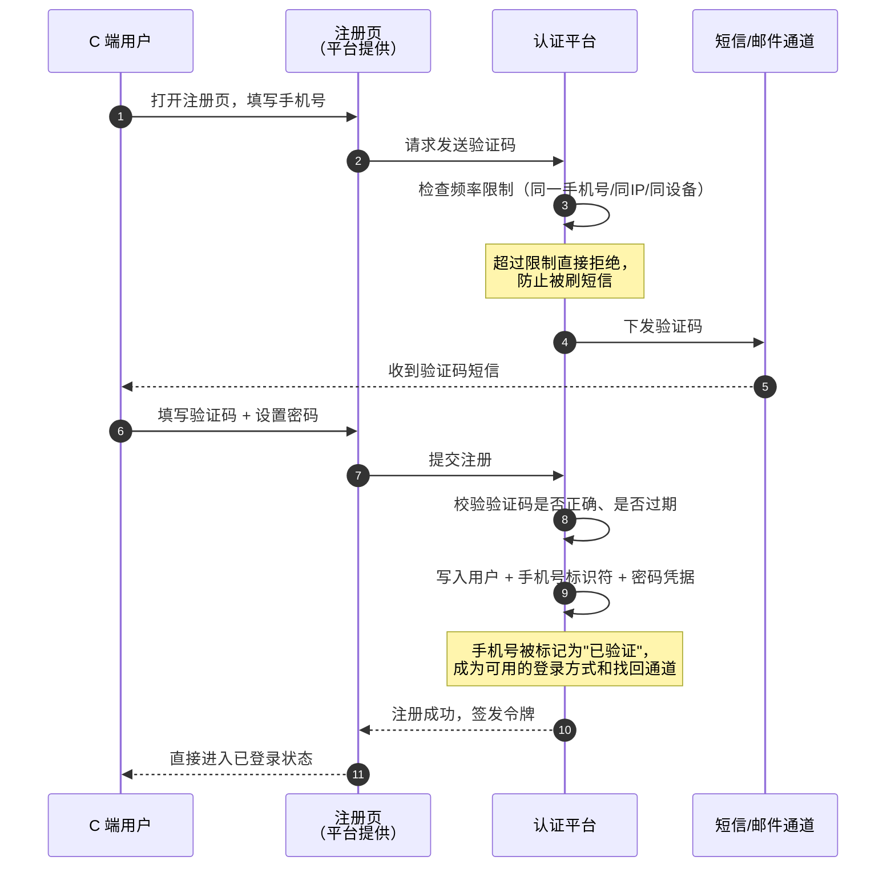
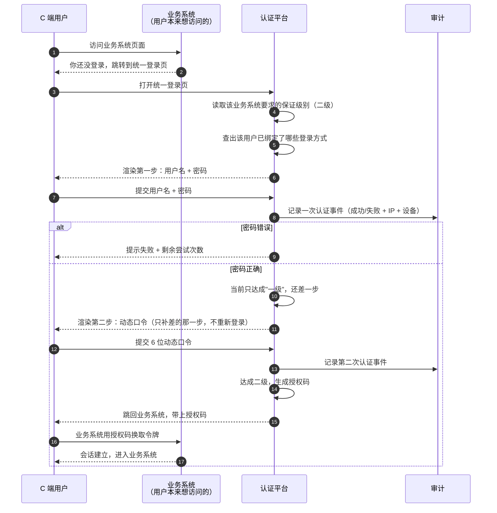
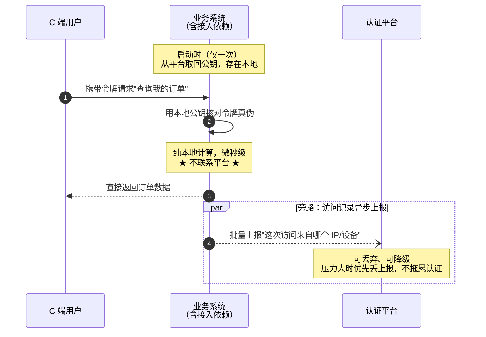
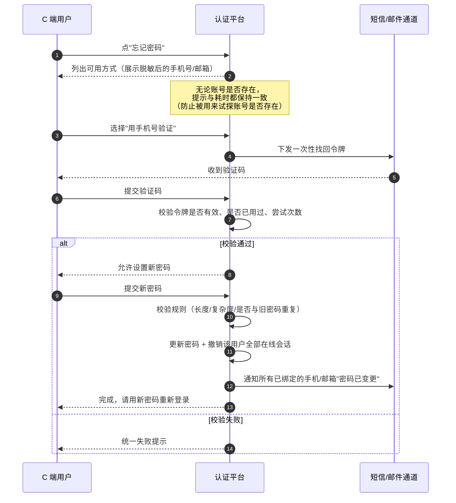
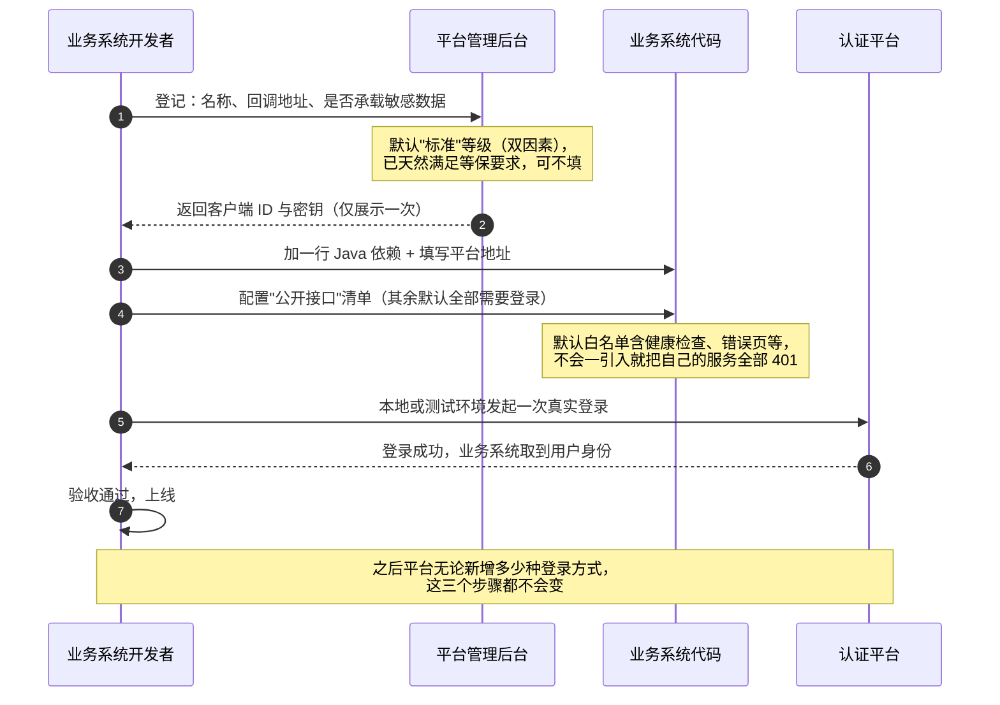
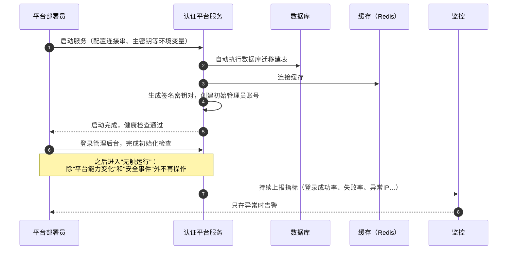
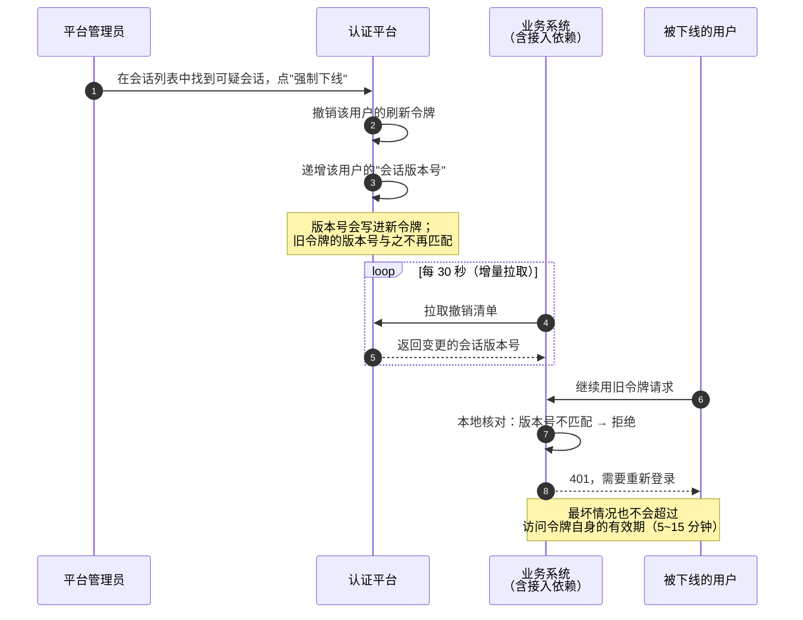
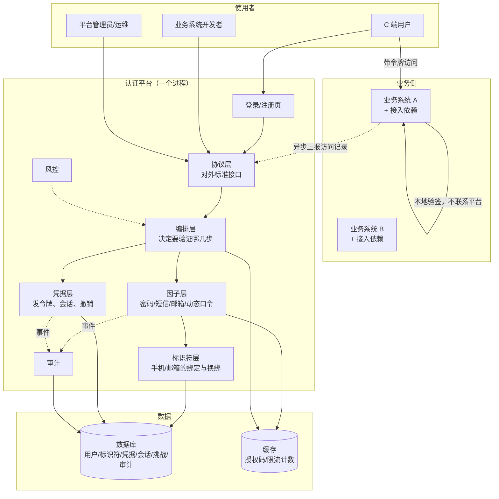

# 关津 · 系统架构说明（零基础版）

> **这篇文档写给完全不了解本系统的人。**  
> 不需要你知道什么是 OIDC、JWT、Token。读完你应该能回答三个问题：这东西是干什么的、有谁在用、每个人具体怎么走流程。
>
> 全篇尽量用大白话。专业名词在第一次出现时会解释，章末有术语表。

---

## 目录

- [第一章 这个系统解决什么问题](#第一章-这个系统解决什么问题)
- [第二章 先弄懂 7 个词](#第二章-先弄懂-7-个词)
- [第三章 系统有哪些功能](#第三章-系统有哪些功能)
- [第四章 有哪几种角色](#第四章-有哪几种角色)
- [第五章 各角色的主流程（时序图）](#第五章-各角色的主流程时序图)
- [第六章 系统内部长什么样](#第六章-系统内部长什么样)
- [第七章 数据存在哪里](#第七章-数据存在哪里)
- [第八章 术语表](#第八章-术语表)

---

## 第一章 这个系统解决什么问题

### 1.1 没有它的时候

一个集团有 100 个对外的业务系统：商城、会员、售后、活动、客服……

每个系统都需要"用户登录"这件事。于是每个系统都得自己做一遍：

- 做一套注册页、一套登录页、一套忘记密码流程
- 自己存用户密码、自己判断"这个请求是不是已登录"
- 自己处理短信验证码、自己做防刷

**结果是三个问题：**

| 问题          | 具体表现                               |
| ----------- | ---------------------------------- |
| **重复建设**    | 100 个系统写 100 套登录，改一次密码策略要改 100 个地方 |
| **安全下限被拉低** | 只要有一个系统密码存得马虎，整个集团的安全性就由它决定        |
| **体验割裂**    | 用户在商城注册过，去售后还要再注册一次                |

### 1.2 有它之后

把"登录相关的一切"从 100 个系统里**抽出来**，集中到一个独立系统——就是这个平台。

```
没有平台：  用户 ⇄ 商城（含登录）   用户 ⇄ 售后（含登录）   用户 ⇄ 活动（含登录）
                   ↑ 各写一套           ↑ 各写一套             ↑ 各写一套

有了平台：              ┌──────────────┐
       用户 ⇄ 商城 ───→│              │
       用户 ⇄ 售后 ───→│  统一认证平台  │← 只在这里做一次登录
       用户 ⇄ 活动 ───→│              │
                        └──────────────┘
       业务系统里不再有任何登录代码
```

### 1.3 一句话定义

> **它是一个统一的身份认证平台：帮 100 个业务系统做同一件事——确认"来访者是谁"。**

用户只在一个地方注册和登录；业务系统不再写登录代码；安全、风控、审计集中在一处，做一次就对全局生效。

### 1.4 它**不**做什么（同样重要）

| 不做       | 原因                                           |
| -------- | -------------------------------------------- |
| **不做授权** | 平台只回答"你是谁"，不回答"你能干什么"。**平台不定义**业务角色与权限、**不做**授权判定（只提供基础 RBAC 与授权入口，判定在业务侧）。角色、权限、能看哪些数据由各业务系统自己管 |
| 不做业务流程   | 下单、发货、积分——都不是它的事                             |
| 不做网关     | 不做请求路由、不做业务限流，这些交给网关                         |

这条边界是本系统能保持简单的根本原因，后面还会反复提到。

---

## 第二章 先弄懂 7 个词

用"公司大楼门禁"来打比方，一次讲明白。

| 词               | 大楼门禁里的对应物   | 在本系统里是什么                                            |
| --------------- | ----------- | --------------------------------------------------- |
| **认证**          | 保安确认"你是谁"   | 用户证明自己身份的过程                                         |
| **授权**          | 你能进哪几个房间    | ⚠️ 平台**不管**这个                                       |
| **令牌（Token）**   | 一张临时通行证     | 登录成功后拿到的一串字符，上面写着"这是张三，有效期到 15:30"                  |
| **签名**          | 通行证上的防伪钢印   | 平台用自己的**私钥**盖的章，别人伪造不了                              |
| **验签**          | 保安核对钢印真伪    | 业务系统用平台公布的**公钥**核对，确认通行证是真的                         |
| **会话（Session）** | 你在楼里的这段时间   | 平台记录的一次登录；可以查看，也可以强制终止                              |
| **保证级别**        | 进普通区 vs 进金库 | 这次登录有多可信。**一级**=一种方式；**二级**=两种方式（等保三级要求）；**三级**=强方式 |

### 2.1 为什么"验签"这件事很关键

这是本系统最重要的一个设计点，值得单独说清楚。

**问题**：业务系统每收到一个请求，怎么知道用户带的那张"通行证"是真的？

**笨办法**：每个请求都拿去问平台"这张证是真的吗？"—— 100 个业务系统每秒几十万请求全砸到平台上，平台直接瘫。

**聪明的办法**：平台把**核对用的公钥**放在一个公开地址上。业务系统第一次去拿一次，存在自己本地；之后每来一个请求，**自己用本地的公钥就地核对**，根本不联系平台。

```
笨办法（禁止）：业务系统 ──每个请求都去问──→ 平台     ← 平台 QPS = 所有业务系统之和
聪明的办法（采用）：业务系统 ──只拿一次公钥──→ 平台
                    之后：业务系统自己本地核对      ← 平台几乎不参与
```

**结论：平台的压力和业务系统的请求量无关，只和"登录次数"有关。** 所以哪怕业务系统每秒几十万请求，平台的负载依然很轻。

### 2.2 由此带来的一个副产品

既然业务系统是"自己在本地核对"，那**平台在物理上看不到每次请求的 IP 和设备**——它压根没经手这些请求。

那"记录每次访问来自哪里"这个需求怎么办？由业务系统**异步把记录上报给平台**（不影响请求本身，允许丢弃）。这部分见 §5.3。

---

## 第三章 系统有哪些功能

按"谁用"来分，一共四组。

### 3.1 给 C 端用户的功能

| 功能      | 说明                                         |
| ------- | ------------------------------------------ |
| 注册      | 用手机号或邮箱注册，需要收到验证码才能完成                      |
| 登录      | 支持四种方式：密码、短信验证码、邮箱验证码、动态口令（TOTP）；可组合成"双因素" |
| 免重复登录   | 在已接入的其它业务系统之间切换时，无需再次登录                    |
| 忘记密码    | 自助重置，通过已绑定的手机/邮箱验证身份                       |
| 换绑手机/邮箱 | 自助更换，需要先验证、有冷却期、且会通知旧的手机/邮箱                |
| 查看登录记录  | 看到自己在哪些设备上登录着，可以主动把某个设备踢下线                 |

### 3.2 给业务系统的功能

| 功能          | 说明                                  |
| ----------- | ----------------------------------- |
| 注册成为接入方     | 拿到"我是谁"的凭证（客户端 ID 和密钥）和回调地址配置       |
| 引入一个依赖即完成接入 | 加一行 Maven 依赖，所有接口自动变成"需要登录"         |
| 声明公开接口      | 明确写出哪几个接口不需要登录（比如首页、健康检查）           |
| 声明安全等级      | 回答一个问题："我这个系统承载敏感数据吗？"——不需要理解任何技术概念 |
| 拿到用户身份      | 请求里能直接取到用户唯一标识、用户名、以及"这次登录有多可信"     |

### 3.3 给平台运营/管理员的功能

| 功能   | 说明                                |
| ---- | --------------------------------- |
| 用户管理 | 查询、启用/停用用户，处理异常账号                 |
| 因子管理 | 启用或停用某种登录方式（比如短信通道故障时可临时关闭）       |
| 策略配置 | 规定哪些业务系统需要多高的安全等级、会话能活多久          |
| 会话管理 | 查看所有在线会话，强制让某个用户下线                |
| 审计查询 | 按时间、用户、业务系统、结果等条件查历史记录，并导出（供合规举证） |

### 3.4 安全与合规功能（自动生效，无需操作）

| 功能      | 说明                           |
| ------- | ---------------------------- |
| 密码高强度存储 | 密码不以可还原的形式保存，数据库泄露也无法直接反推出密码 |
| 登录失败锁定  | 连续输错就临时锁定账号                  |
| 防刷      | 注册、发验证码都有频率限制；短信有预算告警        |
| 全量审计    | 每一次认证动作、每一次管理操作都留痕，且带防篡改校验   |
| 国密算法    | 按要求使用国家密码标准算法                |

---

## 第四章 有哪几种角色

一共 7 种。前 3 种在"用系统"，第 4-5 种在"管系统"，最后 2 种在"看系统"。

| # | 角色               | 是谁                    | 他最关心什么        | 主要动作                |
| - | ---------------- | --------------------- | ------------- | ------------------- |
| 1 | **C 端用户**        | 业务系统背后的普通用户，千万级       | 登录快、少折腾、账号别被盗 | 注册、登录、找回、换绑、踢设备     |
| 2 | **业务系统开发者**      | 业务方写代码的人              | 接入要多久、要不要改代码  | 引入依赖、声明公开接口、取用户身份   |
| 3 | **业务系统管理员**      | 业务方管配置的人（小团队常与开发者同一人） | 配置别出错、密钥别泄露   | 登记接入信息、轮换密钥         |
| 4 | **平台管理员（ID 运营）** | 平台侧管账号与策略的人           | 一切可自助，不用改代码   | 管用户、管策略、管因子、踢下线、查审计 |
| 5 | **平台部署员（运维）**    | 平台侧管部署与监控的人           | 别半夜被叫醒        | 首次部署、升级、看监控、应急      |
| 6 | **安全合规负责人**      | 安全/合规岗                | 默认可举证，例外可追踪   | 定基线、做验收             |
| 7 | **审计员（可选）**      | 独立于运营的检查岗             | 记录不可篡改        | 只读查询审计              |

### 4.1 关键原则：每个角色只承担一件事

| 角色      | **只**由他承担              |
| ------- | ---------------------- |
| 业务系统开发者 | 声明"我的接口要不要保护、要多高的等级"   |
| 平台部署员   | 只处理"能力变化"和"安全事件"，日常不用动 |
| 平台管理员   | 配置策略与处理异常              |
| C 端用户   | 完成必要次数的验证              |
| 安全合规    | 定义基线，不逐条配置             |

---

## 第五章 各角色的主流程（时序图）

> 图里 `→` 表示"发起请求"，`-→`（虚线）表示"返回结果"。从上往下按时间顺序读。

### 5.1 C 端用户 · 注册

**一句话**：用户填手机号 → 收到验证码 → 设置密码 → 注册完成并自动登录。



**关键点**

- 手机号在这里一身三职：**登录方式 + 找回通道 + 通知渠道**。这是设计上必须一次想清楚的地方。
- 注册防刷是 C 端场景的生死线：不加限制，短信费用会被刷爆。
- 密码从这一刻起就以"不可还原"的形式存储。

### 5.2 C 端用户 · 登录（以"密码 + 动态口令"双因素为例）

**一句话**：用户在一个统一页面完成两步验证，然后被送回原来想去的业务系统。



**关键点**

- **阶梯认证**：从一级升到二级时，只补缺的那一步，不要求重新输密码。
- **一次验证，全域通行**：用户在商城登录后去售后，**不需要再验证**（因为已经达成二级）。用户真正输入验证码的次数，取决于"他今天跨越了几个等级"，而不是"他登录了几个系统"。
- 每次成功和失败都进审计流水，这是合规的硬要求。

### 5.3 C 端用户 · 访问业务接口（验签，不回源）★ 最容易误解的一环

**一句话**：业务系统**自己**就地核对令牌，平台完全不参与；访问记录事后异步上报。



**关键点**

- **平台不参与每个请求。** 所以平台的负载 ≈ 登录次数，与业务系统的请求总量**无关**。
- 唯一会让平台被压垮的做法是"每个请求都回平台问一次"——这是**明令禁止**的设计。
- 撤销（踢下线）的传播也走旁路：平台在本地维护"用户会话版本号"，业务系统定期增量拉取比对，见 §5.7。

### 5.4 C 端用户 · 忘记密码 / 换绑手机

**一句话**：找回和换绑本质是同一件事——**在不知道自己原密码的情况下，用其他已验证的方式重新证明身份，然后才能改东西。**



**关键点**

- **找回 = 换绑 = 重置**，走同一条链路，不是三套代码。区别只是"要改的目标"不同。
- 变更后通知**全部**已绑标识符——因为"悄悄换绑手机"正是账号被盗的典型表现。
- 有两条铁律（不变式）：**不能解绑最后一个已验证标识符**、**不能删除最后一个可用登录方式**，否则用户会把自己锁在门外。

### 5.5 业务系统开发者 · 接入平台

**一句话**：登记 → 加一行依赖 → 声明公开接口。三步，30 分钟内完成，之后方式再也不变。



**关键点**

- 业务方需要理解的概念**总共只有 5 个**：客户端身份、安全等级、公开接口、平台地址、（可选）登出回调。
- 业务方**不需要**理解密码算法、令牌格式、因子组合。
- 接入步骤数**恒定**：平台能力再增长，业务方要做的还是这三步。

### 5.6 平台部署员 · 首次部署

**一句话**：拉起服务 → 拉依赖 → 初始化 → 验证。日常运行期不需要再操作。



**关键点**

- **默认配置已经是安全、合规的形态**。配置的作用是"更贴合业务"，不是"让它能用"。
- 运维动作只应发生在两个时刻：**平台能力变化**（新增登录方式、升级版本）和**安全事件**（确认盗号、密钥到期）。其余时间应该什么都不用做。
- 前提是**可观测性**：一个状态面板 + 异常告警。没有它，"不用动"就等于"出了事也不知道"。

### 5.7 平台管理员 · 日常运营 与 强制下线

**一句话**：管理员踢人下线后，业务系统会在**最多 30 秒内**开始拒绝该用户，而不是等到令牌自然过期。



**关键点**

- 本地验签与即时撤销天生矛盾。本系统的解是**用可接受的延迟窗口换取"平台不参与每个请求"**：
  - 访问令牌有效期短（5~15 分钟）作为**兜底上限**；
  - 撤销清单拉取（目标 ≤ 30 秒）作为**实际生效时间**。
- 所以"踢下线"的准确语义是：**最长 30 秒内全网生效，最坏不超过令牌剩余有效期。**

---

## 第六章 系统内部长什么样

### 6.1 一张图看完




```

### 6.2 每一层在干什么（一句话版）

| 层 | 职责 | 一句话 |
|---|---|---|
| **协议层** | 对外提供标准接口 | 门口，负责接待所有来客 |
| **编排层** | 依据安全等级，决定"这次要验证哪几步" | 调度员，安排验证顺序 |
| **因子层** | 具体实现每一种登录方式 | 各种"证明方式"的抽屉，一种一个 |
| **标识符层** | 管理手机/邮箱这类"名字"的绑定与换绑 | 户口本管理员 |
| **凭据层** | 发令牌、管会话、撤销 | 发证窗口 |
| **风控** | 识别异常 | 保安 |
| **审计** | 全部留痕 | 监控录像 |

### 6.3 三个必须一次做对的抽象

如果这三个地方一开始做错，后面每加一种登录方式都要返工：

1. **登录方式必须是"插件"。** 密码、短信、邮箱、动态口令都是同一套接口的不同实现。加第 5 种（比如扫码），只需要写一个插件，**核心代码一行不改**。
2. **业务方只认"安全等级"，不认"登录方式"。** 业务方说"我要二级"，平台自己决定用哪几种组合达成。这样平台支持 5 种还是 50 种登录方式，业务方**毫无感知**。
3. **找回、换绑、重置是同一条链路。** 不然这三件事会在三个地方各写一遍，规则互相打架。

---

## 第七章 数据存在哪里

用大白话说，平台主要记六类东西：

| 记什么 | 内容 | 通俗解释 |
|---|---|---|
| **用户** | 用户唯一标识、状态 | 这个人的 ID 卡 |
| **标识符** | 手机号、邮箱、用户名（含"是否已验证"） | 这个人的各种"名字"，以及这些名字可不可信 |
| **登录方式凭据** | 密码摘要、动态口令密钥等 | 各种"钥匙"，加密存放 |
| **会话** | 每次登录的时间、IP、设备、安全等级、是否有效 | 谁在什么时候、用什么方式进来的 |
| **认证事件** | 每一次验证的成功/失败 | 监控录像，**只增不改不删** |
| **管理操作记录** | 管理员改了什么、改前改后是什么 | 后台操作台账，带防篡改校验 |

配两个存储：

- **数据库** —— 存放上面这些需要长期保存的数据
- **缓存** —— 存放短命的数据：一次性授权码、限流计数（它们几分钟后就该消失）

---

## 第八章 术语表

| 术语 | 通俗解释 |
|---|---|
| **认证（Authentication）** | 确认"你是谁" |
| **授权（Authorization）** | 决定"你能干什么"。**本平台不做** |
| **令牌 / Token** | 登录后拿到的一串字符，相当于临时通行证 |
| **签名 / 验签** | 用私钥盖章、用公钥核对钢印，确认凭证没被伪造 |
| **公钥 / 私钥** | 一对密钥。私钥只有平台有（用于盖章）；公钥公开（用于核对） |
| **JWKS** | 平台公布公钥的那个公开地址 |
| **会话 / Session** | 一次登录的持续状态，可以查看和强制终止 |
| **OIDC / OAuth 2.0** | 业界通用的认证协议标准，保证不同系统之间能对接 |
| **认证因子** | 证明身份的方式：密码、短信验证码、邮箱验证码、动态口令 |
| **标识符** | 指向某个人的"名字"：手机号、邮箱、用户名 |
| **保证级别** | 这次登录的可信程度。一级=一种方式；二级=两种；三级=强方式 |
| **阶梯认证** | 已有会话升到更高等级时，只补缺的那一步，不重新登录 |
| **单点登录 / SSO** | 登录一次，在多个业务系统之间通行 |
| **强制下线 / 撤销** | 让某个已登录用户立即失效，需要重新登录 |
| **接入依赖（Starter）** | 业务系统引入的一个代码包，引入后自动保护所有接口 |
| **国密** | 中国国家密码标准算法（SM2/SM3/SM4） |
| **等保三级** | 网络安全等级保护第三级，国家对重要系统的安全要求 |
| **密评** | 商用密码应用安全性评估 |

---

*本文档面向零基础读者，目标是"看得懂"。技术细节见同目录下的其余设计文档，入口是《GuanJin-设计基线索引.md》。*
```
