# 关津 · 页面规格

| 项目 | 内容 |
|---|---|
| 文档类型 | 实现前页面规格（前端 UI 契约） |
| 编写日期 | 2026-10-11 |
| 解决的问题 | 基线有流程、无页面（见 `GuanJin-设计基线索引.md` §6.2 缺口 4）：统一登录页（含 Flow Descriptor 动态渲染）、注册页、找回页、C 端个人中心（全量）、管理后台各页的要素与状态 |
| 上位依据 | `GuanJin-设计基线索引.md` §2 **为准**；接口路径一律对齐 `GuanJin-接口清单.md`；档位与门槛项对齐 `GuanJin-预设档位与配置点清单.html` §三 |
| 前端技术栈 | **Vue 3 + Vite + TypeScript**，构建产物经 `go:embed` 与后端**同端口**部署 |
| 多语言 | 预留 i18n 结构（`vue-i18n`），**v1 只做中文（zh-CN）** |
| 不在本文范围 | 后端实现、数据模型 DDL、SDK 侧契约、可视化设计稿（配色/字号） |

> **阅读约定**：`⚠️ 待定` = 基线未定义或存在冲突，需人工裁决（集中清单见索引 §4.2 / §5）。所有涉及的后端端点写出**完整路径**，并与 `GuanJin-接口清单.md` 对齐；清单中不存在的端点会显式标注 ⚠️。

---

## 0. 一页结论：前端的两个核心设计约束

前端不是"一串静态页面"，而是被两个约束收窄的**渲染引擎 + 有限原子集合**。

### 约束一：登录相关页面由服务端下发的 **Flow Descriptor** 驱动，前端不得硬编码流程

- 前端**不决定**"这次登录要几步、每步验什么因子、先密码还是先 OTP"。
- 这些全部来自 `GET /authorize/flow` 返回的 **Flow Descriptor**；用户每提交一步，`POST /authorize/submit` 回带**新的 Descriptor**（`status:"need_more"`）或直接完成（`{status:"completed", code, redirect_uri}`）。
- **阶梯认证**（只补缺失因素、不重新登录）因此是**数据驱动**的：前端只需按 Descriptor 重渲染，不需要写"从 AAL1 升 AAL2"的分支逻辑。
- **客户端档位不满足**（`ACR_INSUFFICIENT`）时，错误响应体 `details.flow` 直接带回新 Descriptor，前端把"升级引导"当作**换一个 Descriptor 渲染**，而不是一个报错页。
- **禁用因子不出现在选项中**：`disabled_factors[]` 里的因子在前端**既不渲染步骤、也不进入候选列表**（基线：被禁因子不计入 `current_acr`，见 `预设档位清单` §三 E）。

### 约束二：前端的 **UI 原子类型是有限的**，一套原子拼出所有流程

- v1 只实现四个原子：**`password` / `otp` / `qrcode` / `redirect`**。
- 因子 → 原子的映射是**声明式**的（`factor → UiAtom` 表），平台新增一种 OTP 类因子**不改前端代码**，只落进 `otp` 原子。
- 前端**禁止**写 `if (factor === 'sms')` 这类因子分支（与后端"因子 SPI、禁止按类型分支"的守护规则一致）。
- 出现未知因子（映射表缺失）时，**降级到 `otp` 原子并提示**，绝不白屏。

> **一句话**：前端只做两件事——**把 Descriptor 翻译成步骤**、**把步骤翻译成有限的原子**。任何"这次要走哪条流程"的知识都不属于前端。

---

## 1. 站点地图

```mermaid
flowchart TB
    classDef c fill:#eef2ff,stroke:#6366f1,color:#1e1b4b
    classDef a fill:#ecfdf5,stroke:#10b981,color:#064e3b
    classDef shared fill:#fff7ed,stroke:#f97316,color:#7c2d12

    subgraph C["C 端 · /login /register /recover /me/*"]
        direction TB
        L["/login<br/>统一登录页<br/>(Flow Descriptor 驱动)"]:::c
        R["/register<br/>注册页(分步)"]:::c
        F["/recover<br/>找回页(三步)"]:::c
        ME["/me<br/>个人中心概览"]:::c
        PW["/me/password<br/>修改口令"]:::c
        ID["/me/identifiers<br/>标识符管理"]:::c
        IDB["/me/identifiers/bind<br/>绑定标识符"]:::c
        IDR["/me/identifiers/:id/rebind<br/>换绑标识符"]:::c
        SE["/me/sessions<br/>在线会话与设备"]:::c
        PV["/me/privacy<br/>隐私与账号<br/>(注销/导出)"]:::c
    end

    subgraph A["管理后台 · /admin/*  (仅平台侧三员)"]
        direction TB
        DA["/admin<br/>概览"]:::a
        US["/admin/users<br/>用户管理"]:::a
        USD["/admin/users/:id<br/>用户详情"]:::a
        CL["/admin/clients<br/>业务系统管理"]:::a
        CLD["/admin/clients/:id<br/>业务系统详情"]:::a
        FA["/admin/factors<br/>因子管理"]:::a
        PO["/admin/policies<br/>策略配置(档位与门槛项)"]:::a
        BI["/admin/bindings<br/>角色授权"]:::a
        KE["/admin/keys<br/>密钥管理"]:::a
        SS["/admin/sessions<br/>会话管理"]:::a
        AU["/admin/audit<br/>审计日志(+详情/导出)"]:::a
        CF["/admin/config<br/>系统配置"]:::a
    end

    L -.登录/找回链接.-> F
    L -.注册链接.-> R
    L ==>|认证通过 302 回业务系统| EXT["业务系统(SP)"]:::shared
    ME --> PW
    ME --> ID
    ME --> SE
    ME --> PV
    ID --> IDB
    ID --> IDR
```



> 管理后台与 C 端**共用同一套 `/login`**（管理员也走统一登录，登录后令牌内含三员角色）；后台只对**平台侧三员**开放，业务方**不进后台**（业务方走 Agent 面上报）。菜单与操作按钮按角色**可见性矩阵**渲染（见 §5.5）。

---

## 2. 页面清单总表

| # | 页面 | 路由 | 受众角色 | 一句话作用 | 对应接口（`GuanJin-接口清单.md`） |
|---|---|---|---|---|---|
| C1 | 统一登录页 | `/login` | 匿名 / 已有会话用户 | 按 Flow Descriptor 动态渲染多步骤登录与阶梯认证 | `GET /authorize`、`GET /authorize/flow`、`POST /auth/challenge/{factor}`、`POST /auth/verify/{factor}`、`POST /authorize/submit` |
| C2 | 注册页 | `/register` | 匿名（必带 `client_id` 上下文） | 分步注册：先验证标识符，再设口令；注册即登录 | `POST /auth/register/start`、`POST /auth/register/complete`、`POST /auth/challenge/{factor}` |
| C3 | 找回页 | `/recover` | 匿名 | 三步找回：start → verify → complete（账号枚举防护） | `POST /auth/recover/start`、`POST /auth/recover/verify`、`POST /auth/recover/complete`、`POST /auth/challenge/{factor}` |
| C4 | 个人中心概览 | `/me` | 已登录用户 | 账号全景：资料、凭据状态、最近活动、风险提醒 | `GET /userinfo`、`GET /api/v1/me/sessions`、`GET /api/v1/me/identifiers` |
| C5 | 修改口令 | `/me/password` | 已登录用户 | 校验旧口令或凭 AAL2 会话改密；校验口令策略 | ⚠️ 待补（见 §7-①）；口令强度校验口径对齐 `预设档位清单` §三 A |
| C6 | 标识符管理 | `/me/identifiers` | 已登录用户 | 列出脱敏标识符与验证状态；解绑（冷却期 / 最后标识符保护） | `GET /api/v1/me/identifiers`、`DELETE /api/v1/me/identifiers/{id}` |
| C7 | 绑定标识符 | `/me/identifiers/bind` | 已登录用户 | 绑定手机/邮箱并发起验证（生效配置 ACR 前置） | `POST /api/v1/me/identifiers`、`POST /api/v1/me/identifiers/{id}/verify`、`POST /auth/challenge/{factor}` |
| C8 | 换绑标识符 | `/me/identifiers/:id/rebind` | 已登录用户 | 换绑 = 绑定新值 + 解绑旧值，替换成功后才失效旧值 | `POST /api/v1/me/identifiers`、`POST /api/v1/me/identifiers/{id}/verify`、`DELETE /api/v1/me/identifiers/{id}` |
| C9 | 在线会话与设备 | `/me/sessions` | 已登录用户 | 列出设备/IP/时间/保证级别；踢掉指定会话或全部 | `GET /api/v1/me/sessions`、`DELETE /api/v1/me/sessions/{id}`、`DELETE /api/v1/me/sessions?scope=all` |
| C10 | 隐私与账号 | `/me/privacy` | 已登录用户 | PIPL：数据导出、账号注销、同意与授权记录 | ⚠️ 待补（见 §7-②③）；只读部分见 `GET /userinfo` |
| A1 | 概览 | `/admin` | 系统管理员 / 安全管理员 / 审计员 | 平台健康度面板：用户/会话/客户端/审计聚合 | 聚合自 `GET /api/v1/users`、`/clients`、`/sessions`、`/audit-logs`（⚠️ 见 §7-④） |
| A2 | 用户管理 | `/admin/users` | 系统管理员（审计员只读） | 检索、建号、启停/锁定、重置口令、注销 | `GET /api/v1/users`、`POST /api/v1/users`、`PATCH /api/v1/users/{id}`、`POST /api/v1/users/{id}/reset-password`、`DELETE /api/v1/users/{id}` |
| A3 | 用户详情 | `/admin/users/:id` | 系统管理员 / 审计员 | 单用户全景：标识符（脱敏）、会话数、角色绑定 | `GET /api/v1/users/{id}`、`GET /api/v1/users/{id}/role-bindings` |
| A4 | 业务系统管理 | `/admin/clients` | 系统管理员（审计员只读） | 登记/检索接入方，展示档位与禁用因子 | `GET /api/v1/clients`、`POST /api/v1/clients`、`DELETE /api/v1/clients/{id}`、`POST /api/v1/clients/{id}/secret/rotate` |
| A5 | 业务系统详情 | `/admin/clients/:id` | 系统管理员（审计员只读） | 调档位/门槛项（方向校验）、查看回调与密钥状态 | `GET /api/v1/clients/{id}`、`PATCH /api/v1/clients/{id}` |
| A6 | 因子管理 | `/admin/factors` | 系统管理员 / 安全管理员（审计员只读） | 列出因子与能力声明；平台级启停（通道故障） | `GET /api/v1/factors`、`GET /api/v1/factors/{type}`、`PATCH /api/v1/factors/{type}` |
| A7 | 策略配置（档位与门槛项） | `/admin/policies` | 系统管理员（审计员只读） | 展示档位门槛项与**方向矩阵**，驱动 A5 的校验器 | `GET /api/v1/config/tiers` |
| A8 | 角色授权 | `/admin/bindings` | 安全管理员（审计员只读） | 查看策略快照与角色目录；角色→用户绑定/解绑 | `GET /api/v1/policies`、`GET /api/v1/policies/snapshots/{id}`、`GET /api/v1/policies/roles`、`GET /api/v1/policies/bindings`、`POST /api/v1/policies/bindings`、`DELETE /api/v1/policies/bindings/{id}` |
| A9 | 密钥管理 | `/admin/keys` | 系统管理员（审计员只读） | 签名密钥生命周期：轮换、退役、状态 | `GET /api/v1/keys`、`POST /api/v1/keys/rotate`、`POST /api/v1/keys/{kid}/retire` |
| A10 | 会话管理 | `/admin/sessions` | 系统管理员 / 安全管理员（审计员只读） | 全局会话检索；强制下线指定会话或某用户全部 | `GET /api/v1/sessions`、`DELETE /api/v1/sessions/{id}`、`DELETE /api/v1/sessions?user_id={id}` |
| A11 | 审计日志 | `/admin/audit` | 审计员 / 安全管理员 | 只读检索、详情（含完整性标签）、按 Client 导出 | `GET /api/v1/audit-logs`、`GET /api/v1/audit-logs/{id}`、`GET /api/v1/audit-logs/export` |
| A12 | 系统配置 | `/admin/config` | 系统管理员（审计员只读） | 平台可调参数（白名单项）；固定项不出现在界面 | `GET /api/v1/config`、`PATCH /api/v1/config` |

**页面总数：C 端 10 页 + 管理后台 12 页 = 22 页。**

---

## 3. 逐页规格

> 每页给出：**核心要素 / 关键状态 / 校验规则 / 危险操作二次确认 / 错误提示 / 对应接口**。错误提示一律遵循"统一响应体"`{code, message, trace_id, details?}`，界面展示 `message` 并提供"错误编号（`trace_id`）"复制入口。

### 3.1 C 端

#### C1 · 统一登录页 `/login`

**核心要素**
- **入口参数**：来自业务系统的 `302`，携带 `flow_id`（也接受 `login_hint`）。页面**不做任何流程判断**，先调 `GET /authorize/flow`。
- **流程区**：按 Flow Descriptor 渲染步骤（见 §4）。渲染的**原子集合固定为** `password` / `otp` / `qrcode` / `redirect`。
- **进度指示**：显示"当前 `current_acr` → 目标 `target_acr`"与步骤进度（已完成步骤打勾，可见但不可重输）。
- **候选因子区**：`available_factors − disabled_factors` 才出现在"换一种方式"列表；**禁用因子不出现**。
- **辅助入口**："忘记密码"→`/recover`；"注册"→`/register`（携带同一 `client_id`）。
- **品牌区**：v1 用平台统一标识（按业务系统定制登录页为后续项，见 `预设档位清单` §四）。

**关键状态**
| 状态 | 表现 |
|---|---|
| 加载 | 骨架屏；`GET /authorize/flow` 未返回前不渲染任何步骤 |
| 常规 | 渲染当前 `status="pending"` 且**非禁用**的**第一步**步骤 |
| 阶梯认证 | 已有会话、`current_acr < target_acr`：**只渲染缺失步骤**，已完成因素展示为"已通过 ✓（不重输）" |
| 升级引导 | `POST /authorize/submit` 返回 `ACR_INSUFFICIENT` 且 `details.flow` 存在：**换 Descriptor 重渲染**，顶部提示"当前业务系统需要更高保证级别，请补一次验证" |
| 满足 | `satisfied=true` 或 `submit` 返回 `completed`：展示 `redirect` 原子，`302` 回 `redirect_uri?code&state` |
| 禁用/锁定 | `ACCOUNT_LOCKED`：禁用整个表单，展示解锁时间（`details.retry_after`） |
| 限流 | `RATE_LIMITED`：展示倒计时（`Retry-After`） |
| 图形验证 | `CAPTCHA_REQUIRED`：内联渲染滑块/图形验证，完成后自动重试原提交 |
| 流程过期 | `FLOW_EXPIRED` / `FLOW_NOT_FOUND`：提示"登录会话已过期"并提供"重新开始"（回 `/authorize`） |

**校验规则**
- 口令：非空；不在前端做长度/复杂度拦截（门槛由服务端按目标档位判定，前端只做**非空**与**防重复提交**）。
- OTP：6 位数字（TOTP/短信/邮箱统一按 6 位渲染，位数由 `challenge_hint` 覆盖）；支持粘贴、自动聚焦、输入完成后不自动提交（用户点击确认）。
- 提交节流：提交中禁用按钮，防重复 `POST`。
- 幂等：提交携带 `Idempotency-Key`（写操作幂等约定，见 `接口清单` §5.6）。

**危险操作二次确认**：登录页无破坏性操作，不需要二次确认。

**错误提示（映射到 `接口清单` §5.4 错误码）**
| `code` | 提示文案方向 |
|---|---|
| `INVALID_CREDENTIAL` | "口令或验证码不正确，还剩 N 次"（`details.remaining_attempts`） |
| `CHALLENGE_EXPIRED` / `CHALLENGE_CONSUMED` / `CHALLENGE_INVALID` | "验证码已失效，请重新获取" |
| `ATTEMPTS_EXCEEDED` / `ACCOUNT_LOCKED` | "尝试次数过多，请稍后再试" |
| `ACR_INSUFFICIENT` | 非报错，转为**升级引导**（见上） |
| `RATE_LIMITED` | "操作过于频繁，请 N 秒后重试" |
| `FACTOR_DISABLED` / `FACTOR_NOT_SUPPORTED` | "该验证方式当前不可用，请换一种" |
| `INTERNAL_ERROR` / `DEPENDENCY_UNAVAILABLE` | "服务暂时不可用（fail-closed），请稍后重试"，附 `trace_id` |

**对应接口**
`GET /authorize`（入口跳转）、`GET /authorize/flow`、`POST /auth/challenge/{factor}`、`POST /auth/verify/{factor}`、`POST /authorize/submit`。

---

#### C2 · 注册页 `/register`（分步式）

**核心要素**
- **上下文必带**：`client_id`（目标业务系统）。缺失则回业务系统重定向，不出现"孤立注册页"。
- **分步结构**：
  - **步骤 1 · 选择注册方式**：`phone` / `email` / `username`（哪些可选由目标 client 的注册准入规则与可用因子决定，`registration_mode` 决定"自注册/邀请制"）。
  - **步骤 2 · 验证标识符**：手机/邮箱走 OTP（`next_action="type_code"`）；邀请制额外填 `invite_code`；仅"用户名+密码"型 client 可跳过（`next_action="none"`）。
  - **步骤 3 · 设置口令**：展示**目标档位对应的口令要求**（长度/复杂度/黑名单，见 `预设档位清单` §三 A）；实时强度提示。
  - **完成**：`注册即登录`——直接拿到令牌并跳回业务系统（不跳登录页）。
- **准入规则展示**：若为邀请制，明示"需邀请码"；若为实名前置（后续项），明示前置条件。

**关键状态**
| 状态 | 表现 |
|---|---|
| 加载 | 骨架屏；`client_id` 无效 → 提示并中止 |
| 空 | 未选择注册方式 |
| 步骤进行 | 顶部步骤条：验证标识符 → 设口令 → 完成 |
| 已发送 | 展示"验证码已发送至 `target_masked`"，60s 倒计时可重发 |
| 禁用 | 目标 client 不允许自注册 → 只展示"请联系业务方"（`REGISTRATION_NOT_ALLOWED`） |
| 成功 | 自动登录并跳回 `redirect_uri`；展示"注册成功"过渡 |

**校验规则**
- 手机号：中国大陆 `1[3-9]\d{9}`（v1 仅中文区号）。
- 邮箱：基础 RFC 形状校验（含 `@` 与域名）。
- 用户名：字符集与长度由服务端返回的规则覆盖（前端不硬编码）。
- 邀请码：非空（若为邀请制）。
- 口令：前端**只做即时提示**（长度/类别/是否命中黑名单的**预估**），**最终判定以服务端为准**；禁止用前端校验替代服务端。
- 验证码：6 位数字；一次性。

**危险操作二次确认**：无破坏性操作（注册非危险动作），不需要二次确认。

**错误提示**
| `code` | 提示方向 |
|---|---|
| `REGISTRATION_NOT_ALLOWED` | "该业务系统当前不开放自助注册" |
| `IDENTIFIER_ALREADY_BOUND` | "该手机号/邮箱已被注册，请直接登录或找回" |
| `INVITE_CODE_INVALID` | "邀请码无效或已使用" |
| `WEAK_PASSWORD` / `PASSWORD_POLICY_VIOLATION` | 就地高亮口令规则项，指明未满足的条件（如"至少 12 位、含 3 类字符"） |
| `IDENTIFIER_INVALID_FORMAT` | "格式不正确，请检查" |
| `CHALLENGE_EXPIRED` / `INVALID_CREDENTIAL` | "验证码错误或已过期" |
| `RATE_LIMITED` / `BUDGET_EXCEEDED` | "发送过于频繁 / 已达上限，请稍后" |
| `CAPTCHA_REQUIRED` | 内联验证后重试 |

**对应接口**
`POST /auth/register/start`、`POST /auth/register/complete`、`POST /auth/challenge/{factor}`（注册挑战 `purpose=register`，channel 型在此触发发送）。

---

#### C3 · 找回页 `/recover`（三步）

**核心要素**
- **统一恢复模型**：找回 = 换绑 = 重置走同一条链路；本页负责"忘记凭据"场景（`recover`）。分三步对应三个端点。
  - **Step 1 · start**：输入 `identifier`（手机/邮箱/用户名，可带 `client_id`）；返回 `methods[]`（**脱敏**）与 `recover_id`。
  - **Step 2 · verify**：选择一种方式，输入验证码 → 拿到短期 `recovery_token`。
  - **Step 3 · complete**：设置新口令（或换绑新标识符，按 `target`）；完成后**撤销全部会话 + 通知全部已绑标识符**。
- **账号枚举防护**：无论账号是否存在，**界面提示与响应耗时保持一致**——不存在时也进入"已发送（脱敏占位）"状态，不出现"账号不存在"。
- **前置条件**：若该 client 配置为"仅管理员重置"，本页展示 `RECOVER_DISABLED` 引导。

**关键状态**
| 状态 | 表现 |
|---|---|
| 加载 | 骨架屏 |
| Step1 完成 | 展示脱敏方式列表（如 `138****8888` / `a***@x.com`）；**账号不存在时展示同样结构**（占位脱敏值） |
| 已发送 | 倒计时 60s 可重发 |
| Step2 通过 | 进入设置新口令；`recovery_token` 短期一次性，**仅本会话可用** |
| Step3 成功 | "凭据已更新，请用新凭据重新登录"，跳 `/login`（带原 `client_id`） |
| 过期 | `RECOVER_EXPIRED` / `RECOVERY_TOKEN_EXPIRED` → 回 Step1 |
| 限流 | `RATE_LIMITED`（按 IP × 标识符 × 设备） |

**校验规则**
- `identifier`：非空；格式按类型校验（同 C2）。
- 验证码：6 位数字，一次性，尝试次数受限。
- 新口令：按目标档位（或生效配置）口令策略；**不得与最近 N 次重复**（前端提示，服务端判定）。
- 耗时一致性：前端**不得**依据响应时间/文案差异暴露账号存在性（禁止"用户不存在"提示）。

**危险操作二次确认**：Step3 提交前给出**一次确认**——"提交后你所有设备的登录状态将被清除，且会通知所有已绑手机/邮箱。是否继续？"

**错误提示**
| `code` | 提示方向 |
|---|---|
| `RECOVER_DISABLED` | "该业务系统关闭了自助找回，请联系业务方重置" |
| `RECOVER_EXPIRED` / `RECOVERY_TOKEN_EXPIRED` | "本次找回已过期，请重新开始" |
| `INVALID_CREDENTIAL` / `ATTEMPTS_EXCEEDED` | "验证码错误 / 尝试过多" |
| `PASSWORD_POLICY_VIOLATION` / `PASSWORD_REUSED` | 同 C2，就地高亮 |
| `LAST_AUTHENTICATOR_CANNOT_REMOVE` | "不能删除最后一个可用登录方式" |
| `RATE_LIMITED` | 倒计时提示 |

**对应接口**
`POST /auth/recover/start`、`POST /auth/recover/verify`、`POST /auth/recover/complete`、`POST /auth/challenge/{factor}`（如需在 verify 前补发挑战）。

---

#### C4 · 个人中心概览 `/me`

**核心要素**
- **账号卡片**：`sub`、`preferred_username`、账号状态（正常/锁定/停用）。
- **凭据与安全概览**：已绑标识符数量与验证状态、口令年龄（是否临近强制更换周期）、当前生效配置档位（`L1/L2/L3`）与 `current_acr`。
- **最近活动**：最近会话（设备/IP/时间/保证级别），最多展示 3~5 条，含"查看全部"→`/me/sessions`。
- **风险提醒**：异常登录提醒、口令即将过期、未验证标识符提醒。
- **导航**：修改口令 / 标识符管理 / 在线会话 / 隐私与账号。

**关键状态**：加载（骨架屏）、空（无会话 → "暂无登录记录"）、错（部分接口失败时**局部降级**，失败卡片显示重试，不影响其它卡片）、成功（正常展示）。
**校验规则**：只读页，无输入校验。
**危险操作二次确认**：无。
**错误提示**：`TOKEN_INVALID`/`TOKEN_EXPIRED` → 跳 `/login`；单卡片失败展示"加载失败，点击重试"（附 `trace_id`）。
**对应接口**：`GET /userinfo`、`GET /api/v1/me/sessions`、`GET /api/v1/me/identifiers`。

---

#### C5 · 修改口令 `/me/password`

**核心要素**
- **两种前置路径**（对齐任务前提"校验旧口令，或凭 AAL2 会话"）：
  1. **校验旧口令**：默认路径，输入当前口令。
  2. **凭 AAL2 会话免旧口令**：当当前会话 `acr=AAL2` 时，允许**免输旧口令**直接设置新口令（页面显式说明"你已完成二次验证，可免旧口令"）。
- **口令策略提示**：展示目标档位/生效配置对应的长度、复杂度、历史不可复用、黑名单规则。
- **完成后副作用提示**：改密成功后**撤销全部其它会话**（保留当前会话或按策略要求全部重登），并**通知全部已绑标识符**。

**关键状态**：加载（读生效配置）、常规、提交中（禁用）、成功（提示并可选"退出重新登录"）、失败（旧口令错误 / 策略不符）、需要升级（`ACR_INSUFFICIENT` → 引导补因素后再回来）。
**校验规则**：新口令非空、不与旧口令相同、符合策略（服务端判定）；两次输入一致；旧口令非空（走路径 1 时）。
**危险操作二次确认**：提交前确认——"修改口令将退出其它设备的登录，并通知你所有已绑手机/邮箱。"（一次确认）
**错误提示**：`INVALID_CREDENTIAL`（旧口令错）、`PASSWORD_POLICY_VIOLATION`、`PASSWORD_REUSED`、`ACR_INSUFFICIENT`（转升级引导）、`RATE_LIMITED`。
**对应接口**：⚠️ **基线接口清单中无"已登录改密"端点**（见 §7-①）。当前最近的可用原语是 `POST /auth/challenge/password` + `POST /auth/verify/password`（用于**校验旧口令**），**设置新口令**需新增端点（建议 `POST /api/v1/me/password`）。

---

#### C6 · 标识符管理 `/me/identifiers`

**核心要素**
- **列表**：每行展示 `type`（手机/邮箱/用户名）、**脱敏值**（`138****8888` / `a***@x.com`）、验证状态（已验证 / 待验证）、`primary`、`created_at`、`unbind_cooldown_until?`（冷却期）。
- **操作**：绑定（→ C7）、换绑（→ C8）、解绑（本页内联确认）。
- **不变式提示**：最后一个**已验证**标识符**禁止解绑**（`LAST_IDENTIFIER_CANNOT_UNBIND`）。
- **冷却期**：处于冷却期的标识符解绑按钮置灰，悬停说明"冷却期至 <时间>"。
- **变更通知说明**：解绑/换绑后**通知全部已绑标识符（含旧值）**——页面常驻说明。

**关键状态**：加载、空（异常，理论上至少一个；展示"数据异常，请联系管理员"）、正常、操作中、成功（列表刷新 + Toast）、受限（解绑被拒）。
**校验规则**：无输入（列表页）。
**危险操作二次确认**：**解绑必须二次确认**（危险操作）——确认框列出"该标识符当前用途（登录方式 / 找回通道）"，提示"解绑后将失去该登录与找回通道，并通知其它标识符"。
**错误提示**：`LAST_IDENTIFIER_CANNOT_UNBIND`、"不能解绑最后一个已验证标识符"；`COOLDOWN_ACTIVE`、"冷却期内不可解绑，解绑可于 <时间> 后进行"；`IDENTIFIER_REQUIRED_BY_POLICY`、"该标识符被策略要求保留"；`ACR_INSUFFICIENT` → 升级引导。
**对应接口**：`GET /api/v1/me/identifiers`、`DELETE /api/v1/me/identifiers/{id}`。

---

#### C7 · 绑定标识符 `/me/identifiers/bind`

**核心要素**
- **表单**：选择 `type`（手机/邮箱）、输入 `value`。
- **前置 ACR**：绑定是**写操作**，前置 = 用户**生效配置**（`user_visited_clients` 中档位最高者对应的门槛）。不满足时先走 `step_up`。
- **两步**：① 提交值 → 服务端返回 `id + challenge_id + target_masked`（状态 `pending_verification`）；② 输入验证码 → `POST .../{id}/verify` 置为已验证。
- **占用外部资源的标识符必须验证**（手机/邮箱），未验证前**不可作为登录方式与找回通道**。

**关键状态**：加载（读生效配置）、常规、`ACR_INSUFFICIENT` → 内联补因素（走 `/auth/challenge/{factor}` + `/auth/verify/{factor}` 的 `step_up`），补足后自动回到本表单、**不丢失已填值**、待验证（等待验证码）、成功（返回列表，Toast"已绑定并验证"）、取消（待验证状态可由用户在 C6 列表删除）。
**校验规则**：`type ∈ {phone,email}`；值格式校验（同 C2）；`value` 与现有标识符重复 → `IDENTIFIER_ALREADY_BOUND`；验证码 6 位。
**危险操作二次确认**：无（新增非破坏性）。
**错误提示**：`IDENTIFIER_ALREADY_BOUND`、"该手机号/邮箱已被占用"；`IDENTIFIER_INVALID_FORMAT`；`IDENTIFIER_NOT_OWNED`、"该标识符不属于当前账号"；`ACR_INSUFFICIENT` → 升级引导；`RATE_LIMITED`；`CHALLENGE_EXPIRED`/`INVALID_CREDENTIAL`/`ATTEMPTS_EXCEEDED`。
**对应接口**：`POST /api/v1/me/identifiers`、`POST /api/v1/me/identifiers/{id}/verify`、`POST /auth/challenge/{factor}`（`purpose=enroll` / `step_up`）。

---

#### C8 · 换绑标识符 `/me/identifiers/:id/rebind`

**核心要素**
- **语义**：换绑 = **绑定新值 + 解绑旧值**，但**替换成功后才失效旧值**（避免用户被锁在门外）。
- **流程**：① 展示旧值（脱敏）与该标识符用途；② 输入新值并验证；③ 新值验证通过后，系统解绑旧值（走 `DELETE`）并**通知全部已绑标识符（含旧值）**。
- **冷却期**：换绑后旧值进入冷却期（`unbind_cooldown_until`），期间不可再被绑定为同一账号。
- **前置 ACR**：同 C7，需**生效配置**门槛。
- **风险提示**："悄悄换绑"是盗号典型，页面对用户显式告警"将通知旧手机/邮箱"。

**关键状态**：加载、常规、待验证、成功（回 C6，Toast"换绑成功，已通知旧标识符"）、失败（旧值解绑失败时**回滚**新值绑定，避免双绑）、`ACR_INSUFFICIENT` → 升级引导。
**校验规则**：新值格式；新值不得与任一现有标识符重复；新值 ≠ 旧值；验证码 6 位。
**危险操作二次确认**：换绑确认框——"换绑后将向**旧手机/邮箱**发送变更通知；旧值进入冷却期且不可立即重新绑定。确认换绑？"
**错误提示**：`IDENTIFIER_ALREADY_BOUND`、`IDENTIFIER_INVALID_FORMAT`、`IDENTIFIER_NOT_FOUND`（旧值已不存在）、`COOLDOWN_ACTIVE`、`ACR_INSUFFICIENT`、`RATE_LIMITED`。
**对应接口**：`POST /api/v1/me/identifiers`（绑新）、`POST /api/v1/me/identifiers/{id}/verify`（验新）、`DELETE /api/v1/me/identifiers/{id}`（解旧）。

---

#### C9 · 在线会话与设备 `/me/sessions`

**核心要素**
- **列表字段**：`client`（业务系统名）、`device`、`ip`、`created_at`、`last_seen_at`、`acr`、`amr[]`、`current`（当前会话标记）。
- **操作**：踢掉指定会话（`DELETE /api/v1/me/sessions/{id}`）；"退出全部设备"（`DELETE /api/v1/me/sessions?scope=all`）。
- **当前设备保护**：当前会话行标记"本机"，踢自己需特别确认（或直接提供"退出登录"）。
- **脱敏**：IP/设备按合规展示（IP 可脱敏为 `1.2.*.*`，设备展示 UA 解析后的友好名）。

**关键状态**：加载、空（"暂无登录记录"）、正常、操作中、成功（行移除 + Toast）、失败。
**校验规则**：无输入。
**危险操作二次确认**：
- 踢**单个**会话：轻确认（"确定让该设备下线？"）。
- **退出全部设备**：强确认（列出数量，"将退出你在 N 个业务系统的所有会话，需要重新登录"）。
**错误提示**：`SESSION_NOT_FOUND`、"该会话已失效"；`SESSION_NOT_OWNED`（越权，理论不可达）、`TOKEN_INVALID`/`TOKEN_EXPIRED` → 跳 `/login`。
**对应接口**：`GET /api/v1/me/sessions`、`DELETE /api/v1/me/sessions/{id}`、`DELETE /api/v1/me/sessions?scope=all`。

---

#### C10 · 隐私与账号 `/me/privacy`（PIPL）

**核心要素**
- **数据导出**：一键申请导出"我的个人信息副本"；异步生成后提供下载（含账号、标识符脱敏清单、会话/认证事件）。
- **账号注销**：自助注销入口；注销前强提醒影响（登录失效、不可恢复、已接入业务系统将无法登录）。
- **同意与授权记录**：展示已同意的处理事项（如敏感信息处理单独同意）与时间。
- **注销前置**：需通过一次**高保证级别验证**（生效配置门槛，通常要求 AAL2），并二次确认（含输入确认语）。

**关键状态**：加载、常规、导出申请中（异步任务，展示"生成中/可下载"）、注销进行中、注销成功（清空本地令牌 → 跳 `/login`；页面显示"已注销"）、失败。
**校验规则**：注销需通过 ACR 校验；确认语输入匹配（如"注销账号"）。
**危险操作二次确认**：**注销为最高级危险操作**：① 展示影响清单；② 要求输入确认语；③ 通过 ACR 验证；④ 再次确认按钮（"确认注销，不可撤销"）。
**错误提示**：`ACR_INSUFFICIENT` → 升级引导后才可注销；`RATE_LIMITED`；`INTERNAL_ERROR`。
**对应接口**：⚠️ **基线接口清单中无 C 端"账号注销"与"数据导出"端点**（见 §7-②③）。当前仅管理面有 `DELETE /api/v1/users/{id}`（停用/注销，管理员操作）与 `GET /api/v1/audit-logs/export`（审计导出，管理员）；PIPL 自助能力需新增 `POST /api/v1/me/export`、`POST /api/v1/me/deactivate`（建议命名）。

---

### 3.2 管理后台（仅平台侧三员）

> **共性**：所有列表页支持 `?page=&page_size=`（默认 50，上限 200，超限 `PAGE_SIZE_EXCEEDED`）；所有写操作写审计；**审计员（Auditor）只读**，其界面不出现任何写按钮/表单。全局布局：左侧菜单（按角色可见性矩阵渲染，见 §5.5）+ 顶部角色标识 + 主体内容区 + 全局 Toast。

#### A1 · 概览 `/admin`

**核心要素**：用户总数/新增、活跃会话数、在线业务系统数、近 24h 认证成功率与失败 Top、异常告警（锁定激增、短信预算告警）、密钥轮换倒计时、待处理项（如 `publishing` 状态的密钥）。
**关键状态**：加载、部分降级（某个聚合接口失败 → 该卡片显示重试）、正常。
**校验规则**：只读。
**危险操作二次确认**：无。
**错误提示**：`INSUFFICIENT_ROLE`（越权进入 → 403 页）、聚合失败展示重试。
**对应接口**：聚合自 `GET /api/v1/users`、`GET /api/v1/clients`、`GET /api/v1/sessions`、`GET /api/v1/audit-logs`、`GET /api/v1/keys`（⚠️ 无专用 dashboard 聚合端点，见 §7-④，v1 由前端并发聚合）。

#### A2 · 用户管理 `/admin/users`

**核心要素**：检索（`q`、`status`、`created_from/to`）、列表（状态、是否锁定、最后登录）、"新建用户"（**无默认口令**，初始凭据外部注入，`status=pending_password`，首登强制改密）、行操作（启用/停用/锁定/解锁、重置口令、注销）。
**关键状态**：加载、空（"无匹配用户"）、正常、操作中、成功、越权（`INSUFFICIENT_ROLE`）。
**校验规则**：`q` 任意；建号时 `identifiers[]` 至少一项且格式合法；`reset-password` 的 `new_password` 符合策略，或走 `force_external_injection`。
**危险操作二次确认**：停用/锁定/注销/重置口令均需确认（列出影响："将撤销该用户全部会话"），注销额外强提醒（软删、保留审计）。
**错误提示**：`IDENTIFIER_ALREADY_BOUND`、`IDENTIFIER_INVALID_FORMAT`、`PASSWORD_POLICY_VIOLATION`、`USER_NOT_FOUND`、`INVALID_PARAMETER`、`INSUFFICIENT_ROLE`。
**对应接口**：`GET /api/v1/users`、`POST /api/v1/users`、`PATCH /api/v1/users/{id}`、`POST /api/v1/users/{id}/reset-password`、`DELETE /api/v1/users/{id}`。

#### A3 · 用户详情 `/admin/users/:id`

**核心要素**：账号基本信息、已绑标识符（**脱敏**）、会话数、状态、**角色绑定列表**（`binding_id/client_id/role/granted_by/granted_at`）。系统管理员可执行启停/重置；审计员只读。
**关键状态**：加载、正常、`USER_NOT_FOUND`。
**校验规则**：只读 + 复用 A2 的写校验。
**危险操作二次确认**：同 A2（本页可发起启停/重置/注销）。
**错误提示**：`USER_NOT_FOUND`、`INSUFFICIENT_ROLE`。
**对应接口**：`GET /api/v1/users/{id}`、`GET /api/v1/users/{id}/role-bindings`（+ A2 的写端点）。

#### A4 · 业务系统管理 `/admin/clients`

**核心要素**：列表（名称、`tier`、`disabled_factors`、回调地址数）、"登记接入方"（表单：名称、`redirect_uris[]`、`tier`（默认 L2）、`disabled_factors[]`、`grant_types`、`registration_policy`、`is_confidential`）；登记成功**仅一次展示** `client_id + client_secret + agent_hmac_secret`；行操作：轮换 secret、注销。
**关键状态**：加载、空、正常、登记成功（**密钥仅此一次**，提供复制按钮与"我已保存"确认）、操作中。
**校验规则**：`redirect_uris` 至少 1 条且为合法 URL；`tier ∈ {L1,L2,L3}`；调整 `disabled_factors` 属"只能增加禁用"方向（详见 A5/方向矩阵）。
**危险操作二次确认**：轮换 secret（"旧 secret 在并行窗口后失效"）、注销接入方（强确认，列出受影响回调与在途会话）。
**错误提示**：`INVALID_PARAMETER`、`CLIENT_LIMIT_REACHED`、`CLIENT_NOT_FOUND`、`INSUFFICIENT_ROLE`。
**对应接口**：`GET /api/v1/clients`、`POST /api/v1/clients`、`DELETE /api/v1/clients/{id}`、`POST /api/v1/clients/{id}/secret/rotate`。

#### A5 · 业务系统详情 `/admin/clients/:id`

**核心要素**：基本信息、回调地址、当前 `tier` 与**门槛项展开值**、禁用因子、"调整档位/门槛项"表单。
**方向校验（核心）**：服务端**方向校验器**约束"只允许更严方向"（四类：下限类只能更大、上限类只能更小、只能更严类不可放松、只能提高类只能提高）。**前端必须依据 `GET /api/v1/config/tiers` 返回的方向矩阵**做**前置提示与禁用非法控件**，最终以服务端 `TIER_DIRECTION_VIOLATION` 为准。
**关键状态**：加载、正常、调整中、**被拒**（方向越界：控件回滚并高亮）、成功（展示 `applied_changes[]`，写审计含变更前后值）。
**校验规则**：数值范围合法；方向合法；不得改平台固定项（否则 `CONFIG_READONLY`）；"不限"此类特例（并发会话数）单独处理。
**危险操作二次确认**：改动门槛项（可能影响存量用户）→ 确认框列出"变更前 → 变更后"，并提示"收紧后存量不合规用户将在准入时被要求整改"。
**错误提示**：`TIER_DIRECTION_VIOLATION`、`TIER_UNKNOWN`、`CONFIG_READONLY`、`CLIENT_NOT_FOUND`。
**对应接口**：`GET /api/v1/clients/{id}`、`PATCH /api/v1/clients/{id}`、`GET /api/v1/config/tiers`（读方向矩阵）。

#### A6 · 因子管理 `/admin/factors`

**核心要素**：因子清单（`type`、`kind`、`enabled`、`capabilities[]`、能力声明 Descriptor）、单个因子详情；**平台级启停**开关（如通道故障临时关停）。
**区分**：平台级启停（本页 `PATCH /factors/{type}`）与**客户端级"禁用因子"**（A5）是两回事，界面必须明确标注。
**关键状态**：加载、正常、停用（`enabled=false` 醒目提示"全局停用，所有业务系统不再可选"）、启停中。
**校验规则**：启停仅切换 `enabled`；无参数校验。
**危险操作二次确认**：停用因子需确认（"将影响所有正在使用该因子的业务系统"）。
**错误提示**：`FACTOR_NOT_SUPPORTED`、`INSUFFICIENT_ROLE`。
**对应接口**：`GET /api/v1/factors`、`GET /api/v1/factors/{type}`、`PATCH /api/v1/factors/{type}`（系统管理员 / 安全管理员可写）。

#### A7 · 策略配置（档位与门槛项）/admin/policies`

**核心要素**：**只读**渲染 `L1/L2/L3` 各门槛项取值与**方向矩阵**（①②③④类）；作为 A5 编辑表单的"规则来源"。按 `预设档位清单` §三展示 A（凭据）/B（会话令牌）/C（失败处理）/D（准入生命周期）/E（因子限制）五组。
**关键状态**：加载、正常。
**校验规则**：只读（本页不含编辑；编辑在 A5）。
**危险操作二次确认**：无。
**错误提示**：`INTERNAL_ERROR`。
**对应接口**：`GET /api/v1/config/tiers`。

#### A8 · 角色授权 `/admin/bindings`

**核心要素**：
- **策略快照**：`GET /api/v1/policies` 列表 + 快照详情（权限点目录、角色目录、接口映射、默认角色、数据敏感标记定义）。
- **角色目录**：`GET /api/v1/policies/roles`（按 client 聚合）。
- **绑定**：`GET/POST/DELETE /api/v1/policies/bindings`；绑定需填 `reason`（等保 e) 要求授权主体为**真人**）。
- **副作用提示**：绑定/解绑后**撤销该用户会话**（用户需重新登录拿到新角色）——必须显著提示。
**关键状态**：加载、空（无快照/无绑定）、正常、绑定中、成功（列表刷新 + 提示"已撤销该用户会话"）。
**校验规则**：`user_id`、`client_id`、`role` 必填且合法；`reason` 必填。
**危险操作二次确认**：绑定与解绑均确认（"将撤销 user 的会话，使其重新登录生效"）。
**错误提示**：`BINDING_ALREADY_EXISTS`、`BINDING_NOT_FOUND`、`ROLE_UNKNOWN`、`USER_NOT_FOUND`、`SNAPSHOT_NOT_FOUND`、`INSUFFICIENT_ROLE`（仅安全管理员可写）。
**对应接口**：`GET /api/v1/policies`、`GET /api/v1/policies/snapshots/{id}`、`GET /api/v1/policies/roles`、`GET /api/v1/policies/bindings`、`POST /api/v1/policies/bindings`、`DELETE /api/v1/policies/bindings/{id}`。

#### A9 · 密钥管理 `/admin/keys`

**核心要素**：密钥列表（`kid`、`alg`、`scope`（`user_token` / `gateway_assertion`）、`status`（`active/publishing/retiring/retired`）、`not_before/not_after`）；操作：轮换（先并行发布新公钥）、退役（仅当旧密钥已无有效令牌）。
**关键状态**：加载、轮换中（`publishing` 状态醒目展示"并行期"）、正常、错误（提前退役被拒）。
**校验规则**：轮换需选 `scope` 与 `reason`；退役仅在允许窗口。
**危险操作二次确认**：轮换与退役均需确认（退役提示"需确认旧密钥已无有效令牌，否则用户将掉线"）。
**错误提示**：`KEY_ROTATION_IN_PROGRESS`、`KEY_RETIRE_PREMATURE`、`KEY_NOT_FOUND`。
**对应接口**：`GET /api/v1/keys`、`POST /api/v1/keys/rotate`、`POST /api/v1/keys/{kid}/retire`。

#### A10 · 会话管理 `/admin/sessions`

**核心要素**：全局会话检索（`user_id`、`client_id`、`active`）；列表（用户、client、设备、IP、时间、`acr`）；操作：强制下线指定会话、撤销某用户全部会话。**实时生效**（承载数据面）。
**关键状态**：加载、空、正常、操作中、成功（行移除）。
**校验规则**：无输入校验。
**危险操作二次确认**：踢单个轻确认；撤销某用户全部会话强确认（"将立即让该用户在所有业务系统下线"）。
**错误提示**：`SESSION_NOT_FOUND`、`USER_NOT_FOUND`、`INSUFFICIENT_ROLE`。
**对应接口**：`GET /api/v1/sessions`、`DELETE /api/v1/sessions/{id}`、`DELETE /api/v1/sessions?user_id={id}`。

#### A11 · 审计日志 `/admin/audit`

**核心要素**：检索（`from/to`、`user_id`、`client_id`、`event_type`、`result`）；列表（**只读、只增**，含完整性校验状态标记）；详情（变更前后值 + 完整性标签）；**按 Client 切分导出**（`format=csv`，导出中标识符脱敏）。
**关键状态**：加载、空、正常、导出中（异步下载）、完整性异常（醒目标记"校验失败"）。
**校验规则**：时间区间合法；导出用**游标**分页。
**危险操作二次确认**：无（只读；导出为读取动作，但可提示"导出文件含敏感信息，请妥善保管"）。
**错误提示**：`AUDIT_LOG_NOT_FOUND`、`INSUFFICIENT_ROLE`（仅审计员可看详情/导出）。
**对应接口**：`GET /api/v1/audit-logs`、`GET /api/v1/audit-logs/{id}`、`GET /api/v1/audit-logs/export`。

#### A12 · 系统配置 `/admin/config`

**核心要素**：展示并编辑平台**可调**参数（注册/验证码限流、短信预算阈值、审计留存天数等）。**固定项（无默认口令、口令慢哈希、审计完整性算法、主密钥来源、国密 TLS、三权分立等）不出现在界面**（"能固定的不做开关"）。
**关键状态**：加载、正常、编辑中、保存成功、被拒（尝试改固定项 → `CONFIG_READONLY`）。
**校验规则**：仅白名单键可写；数值范围校验；保存成功写审计（含变更前后值）。
**危险操作二次确认**：调低限流/留存等影响面大的参数需确认（列出前后值）。
**错误提示**：`CONFIG_READONLY`、`INVALID_PARAMETER`、`INSUFFICIENT_ROLE`。
**对应接口**：`GET /api/v1/config`、`PATCH /api/v1/config`。

---

## 4. Flow Descriptor 渲染规格

### 4.1 Descriptor 契约（对齐 `接口清单` §3.1.4）

```ts
// 服务端 GET /authorize/flow 与 POST /authorize/submit 的 details.flow 共用此结构
export type Acr = 'AAL0' | 'AAL1' | 'AAL2'
export type Tier = 'L1' | 'L2' | 'L3'
export type UiAtom = 'password' | 'otp' | 'qrcode' | 'redirect'
export type FactorType = string // password | sms_otp | email_otp | totp | recovery_code | 未来因子

export interface FlowStep {
  factor: FactorType
  role: 'first' | 'second'
  status: 'pending' | 'done'
  challenge_hint?: { target_masked?: string; next_action?: 'type_code' | 'input_totp' | 'input_password' }
}

export interface FlowDescriptor {
  flow_id: string
  client: { id: string; name: string; tier: Tier }
  target_acr: Acr
  current_acr: Acr
  satisfied: boolean
  steps: FlowStep[]
  available_factors: FactorType[]
  disabled_factors: FactorType[]   // 来自 clients 的“禁用因子”；被禁因子不计入 current_acr
  registration_mode: 'self' | 'invite' | 'none'
  expires_at: string
}
```

### 4.2 因子 → UI 原子映射（声明式，禁止 `if factor===...`）

```ts
// atoms/mapping.ts —— 唯一一处“因子 → 原子”的映射；新增 OTP 类因子无需改前端
export const ATOM_BY_FACTOR: Record<FactorType, UiAtom> = {
  password: 'password',
  sms_otp: 'otp',
  email_otp: 'otp',
  totp: 'otp',
  recovery_code: 'otp',
  qrcode: 'qrcode',       // 预留：扫码因子（本期无）
  // 未来新增因子未登记时 → 降级到 'otp'（见 resolveAtom）
}

const FALLBACK_ATOM: UiAtom = 'otp'

export function resolveAtom(factor: FactorType): UiAtom {
  return ATOM_BY_FACTOR[factor] ?? FALLBACK_ATOM
}
```

### 4.3 渲染规则（前端必须遵守的 5 条）

1. **不硬编码流程**：步骤顺序、是否需要第二因素、是否阶梯，全部读 `steps` / `target_acr` / `current_acr`。
2. **禁用因子不可见**：渲染前先过滤 `disabled_factors`；`available_factors` 也要减去禁用集后才进入"换一种方式"。
3. **只渲染第一个 pending 步骤**：`done` 步骤展示为"已通过 ✓"且不可重输（阶梯认证：只补缺，不重登）。
4. **`submit` 返回 `need_more` → 换 Descriptor 重渲染**；返回 `completed` → 渲染 `redirect` 原子并跳转。
5. **`ACR_INSUFFICIENT` 不是错误页**：读取 `details.flow` 覆盖当前 Descriptor，并在顶部渲染"升级引导"横幅。

### 4.4 示意代码（Vue 3 + TypeScript）

```vue
<!-- views/LoginFlow.vue -->
<script setup lang="ts">
import { computed, ref, onMounted } from 'vue'
import { resolveAtom } from './atoms/mapping'
import PasswordAtom from './atoms/PasswordAtom.vue'
import OtpAtom from './atoms/OtpAtom.vue'
import QrCodeAtom from './atoms/QrCodeAtom.vue'
import RedirectAtom from './atoms/RedirectAtom.vue'
import type { FlowDescriptor, FlowStep } from './types'

const props = defineProps<{ flowId: string }>()

const flow = ref<FlowDescriptor | null>(null)
const loading = ref(true)
const banner = ref<string | null>(null)      // 升级引导横幅
const submitting = ref(false)

// ── 加载 / 刷新 Descriptor ──────────────────────────────
async function loadFlow(id: string) {
  loading.value = true
  try {
    const res = await fetch(`/authorize/flow?flow_id=${encodeURIComponent(id)}`)
    flow.value = await res.json()
  } finally {
    loading.value = false
  }
}
onMounted(() => loadFlow(props.flowId))

// ── 过滤：禁用因子绝不出现 ─────────────────────────────
const disabled = computed(() => new Set(flow.value?.disabled_factors ?? []))
const candidateFactors = computed(() =>
  (flow.value?.available_factors ?? []).filter(f => !disabled.value.has(f)),
)

// ── 只取第一个“未完成且非禁用”的步骤 ────────────────────
const activeStep = computed<FlowStep | undefined>(() =>
  flow.value?.steps.find(s => s.status === 'pending' && !disabled.value.has(s.factor)),
)

// ── 因子 → 原子 → 组件 ─────────────────────────────────
const ATOM_COMPONENT = { password: PasswordAtom, otp: OtpAtom, qrcode: QrCodeAtom, redirect: RedirectAtom } as const
const activeAtom = computed(() => (activeStep.value ? resolveAtom(activeStep.value.factor) : 'redirect'))
const activeComponent = computed(() => ATOM_COMPONENT[activeAtom.value])

// 无活跃步骤且已达标 → 跳转原子
const showRedirect = computed(() => !activeStep.value)

// ── 提交当前步骤（先 challenge 再 verify，或直接 submit，视原子而定）──
async function onSubmit(payload: { response: string; challengeId: string }) {
  if (!flow.value || submitting.value) return
  submitting.value = true
  try {
    const res = await fetch('/authorize/submit', {
      method: 'POST',
      headers: { 'Content-Type': 'application/json', 'Idempotency-Key': crypto.randomUUID() },
      body: JSON.stringify({
        flow_id: flow.value.flow_id,
        answers: [{ factor: activeStep.value!.factor, challenge_id: payload.challengeId, response: payload.response }],
      }),
    })
    const data = await res.json()

    if (res.ok && data.status === 'need_more') {
      flow.value = data.flow as FlowDescriptor      // 阶梯：换 Descriptor，只补缺的一步
      banner.value = null
      return
    }
    if (res.ok && data.status === 'completed') {
      flow.value = { ...flow.value, satisfied: true, steps: [] } // 触发 redirect 原子
      return
    }
    // 错误分支
    if (data.code === 'ACR_INSUFFICIENT' && data.details?.flow) {
      flow.value = data.details.flow as FlowDescriptor  // 升级引导 = 换 Descriptor 重渲染
      banner.value = `该业务系统（${data.details.flow.client.name}）需要更高的保证级别，请补一次验证`
      return
    }
    banner.value = data.message ?? '操作失败，请重试'
  } finally {
    submitting.value = false
  }
}
</script>

<template>
  <section class="auth-card" v-if="!loading && flow">
    <header>
      <h1>{{ flow.client.name }}</h1>
      <p class="progress">
        当前保证级别 {{ flow.current_acr }} → 需要 {{ flow.target_acr }}
      </p>
    </header>

    <div v-if="banner" class="banner-upgrade" role="alert">{{ banner }}</div>

    <!-- 已完成步骤：只展示，不可重输（阶梯认证） -->
    <ul class="steps">
      <li v-for="s in flow.steps" :key="s.factor" :class="{ done: s.status === 'done' }">
        {{ s.factor }} <span v-if="s.status === 'done'">已通过 ✓</span>
      </li>
    </ul>

    <!-- 当前步骤：由原子组件渲染 -->
    <component
      v-if="!showRedirect"
      :is="activeComponent"
      :factor="activeStep!.factor"
      :hint="activeStep!.challenge_hint"
      :flow-id="flow.flow_id"
      :disabled="submitting"
      @submit="onSubmit"
    />
    <!-- 达标：跳转回业务系统 -->
    <RedirectAtom v-else :flow-id="flow.flow_id" />

    <!-- 换一种方式：仅候选（已去除禁用因子） -->
    <nav class="alt-factors" v-if="candidateFactors.length > 1">
      <button v-for="f in candidateFactors" :key="f" type="button">{{ f }}</button>
    </nav>
  </section>

  <div v-else-if="loading" class="skeleton" aria-busy="true">加载中…</div>
</template>
```

> **`PasswordAtom` / `OtpAtom` / `QrCodeAtom` / `RedirectAtom`** 只负责"收集一个答案并 emit"，**不感知因子语义、不感知流程**。`OtpAtom` 通过 `hint.next_action` 决定渲染"6 位数字框"还是"输入口令"，位数由 `challenge_hint` 覆盖。

---

## 5. 通用交互规范

### 5.1 反馈三态（每个数据区块强制）

| 态 | 规范 |
|---|---|
| **加载** | 骨架屏优先（比 spinner 好）；按钮提交中禁用并显示进度；列表加载保留上一次内容 + 顶部细进度条（避免闪烁） |
| **空** | 区分"真空"与"筛选无结果"：真空给引导（如"暂无登录记录"），筛选无结果给"清除筛选" |
| **错** | 就地展示错误，**保留用户已填内容**；提供重试；展示 `trace_id` 可复制；错误分级：字段级（红字）／表单级（顶部 alert）／页面级（空态 + 重试） |
| **成功** | 轻操作用 Toast（自动消失）；重操作（绑定/换绑/注销）用结果页或明确 Toast + 列表刷新；**不使用仅靠 Toast 承载不可逆结果** |
| **禁用** | 用"置灰 + 悬停原因"，而非直接隐藏（可发现性）；`ACR_INSUFFICIENT` 的禁用必须给出"为什么/如何解除" |

### 5.2 危险操作二次确认（分级）

| 级别 | 场景 | 确认方式 |
|---|---|---|
| L1 轻确认 | 踢单个会话、停用单个因子 | 行内确认/小弹窗，一句影响说明 |
| L2 强确认 | 解绑标识符、换绑、撤销某用户全部会话、调整门槛项、轮换/退役密钥 | 弹窗列出**具体影响清单**（前端读取接口返回的关联信息）+ 前后值 |
| L3 最高确认 | 账号注销、删除业务系统 | 影响清单 + **输入确认语**（如"注销账号"）+（注销）ACR 验证 + 二次按钮 |

- 所有确认弹窗**默认聚焦"取消"**，`Esc` = 取消；确认按钮为**危险色**且不与主色混淆。
- 提交后若失败，**必须回滚 UI 乐观更新**（如换绑失败恢复旧值展示）。

### 5.3 脱敏展示规则（对齐 `预设档位清单` §二「敏感数据脱敏展示」）

| 类型 | 规则 | 示例 |
|---|---|---|
| 手机号 | 保留前 3 + 后 4 | `138****8888` |
| 邮箱 | 保留首字符 + 域名 | `a***@x.com` |
| 用户名 | 按策略保留首尾（中间 `*`） | `zh***ng` |
| 口令 / 令牌 / secret | **任何界面与日志均不出现完整值** | 登记 client 时 secret **仅一次**展示并提供复制 |
| IP | 按合规：管理后台可完整、C 端可 `1.2.*.*` | — |

- 脱敏**由服务端返回 `value_masked`**为主，前端**不自行拼接**（避免前后端不一致）。
- 全局配置"显示完整值"的开关**不提供**（能固定的不做开关）。

### 5.4 可访问性（a11y）

- 语义标签：`<form>`/`<label for>`/`role="alert"`；错误与状态用 `aria-live` 播报。
- 键盘可达：所有操作（含列表行操作、确认弹窗）可用键盘完成；焦点环可见；弹窗焦点陷阱 + `Esc` 关闭 + 关闭后焦点归位。
- 验证码/OTP：`inputmode="numeric"`、`autocomplete="one-time-code"`、支持粘贴与分隔（`123 456`）。
- 对比度满足 WCAG AA；不**仅**用颜色传达状态（同时给图标/文字）。
- 文案：错误提示不带技术术语；不泄露账号存在性（找回页统一话术）。

### 5.5 响应式与布局

- **断点**：≥1024 管理后台三栏（菜单+主区）；C 端登录/注册/找回为**居中卡片**；<768 管理后台菜单收为抽屉，表格转卡片列表。
- **C 端认证页**：单列、移动优先、主按钮固定可见（长表单时 sticky）。
- **管理后台表格**：横向滚动 + 关键列固定；筛选区可折叠；批量操作（如有）固定在底部操作条。
- **角色可见性矩阵**（三权分立落地）：

| 菜单/操作 | 系统管理员 | 安全管理员 | 审计员 |
|---|---|---|---|
| 概览 A1 | ✅ | ✅ | ✅（只读） |
| 用户管理 A2/A3 | ✅（写） | ❌ | ✅（只读） |
| 业务系统 A4/A5 | ✅（写） | ❌ | ✅（只读） |
| 因子管理 A6 | ✅（写） | ✅（写） | ✅（只读） |
| 策略配置 A7 | ✅（只读） | ✅（只读） | ✅（只读） |
| 角色授权 A8 | ❌ | ✅（写） | ✅（只读） |
| 密钥管理 A9 | ✅（写） | ❌ | ✅（只读） |
| 会话管理 A10 | ✅（写） | ✅（写） | ✅（只读） |
| 审计日志 A11 | ❌ | ✅（只读） | ✅（只读 + 详情/导出） |
| 系统配置 A12 | ✅（写） | ❌ | ✅（只读） |

> **审计员不得执行任何写操作**——界面上不出现写按钮，而非"点击后报错"。

### 5.6 i18n 预留

- 采用 `vue-i18n`；所有文案走 `t('login.title')` 形式，**不在模板里写中文字面量**。
- 目录：`src/locales/zh-CN.ts`（v1 唯一）、预留 `en-US.ts`；错误码 → 文案的映射集中在 `src/locales/errors.ts`（按 `code` 查表，未命中回退到服务端 `message`）。
- 日期/数字用 `Intl` 格式化，`lang` 从 locale 推导；v1 固定 `zh-CN`。

---

## 6. 路由与工程约定（落地提示）

- 两套布局：`layouts/AuthLayout.vue`（C 端认证，居中卡片）与 `layouts/AdminLayout.vue`（后台，菜单+权限守卫）。
- 路由守卫：`/me/*` 需用户令牌；`/admin/*` 需管理员令牌且按角色做**菜单级 + 路由级 + 按钮级**三重可见性控制（矩阵见 §5.5）。
- 统一请求层：`api/client.ts` 注入 `Authorization`，统一处理 `TOKEN_EXPIRED/TOKEN_REVOKED`（跳登录）、`ACR_INSUFFICIENT`（回吐 `details.flow`）、`RATE_LIMITED`（倒计时）、`trace_id`（错误提示）。
- 构建：Vite 产物输出到 `web/dist`，由 Go `go:embed` 内嵌并与后端**同端口**提供；前端路由使用 history 模式，**回退到 `index.html`** 由后端兜底。
- 管理后台仅在**平台侧**启用；业务方无后台入口（对应"业务方走 Agent 面上报"）。

---

---

*本文为 `GuanJin-页面规格`，是 `GuanJin-设计基线索引.md` §6.2 缺口 4 的产出。任何与索引 §2 冲突处以索引为准；端点一律对齐 `GuanJin-接口清单.md`，清单中不存在的端点已用 ⚠️ 标注并汇总于 §7。*
